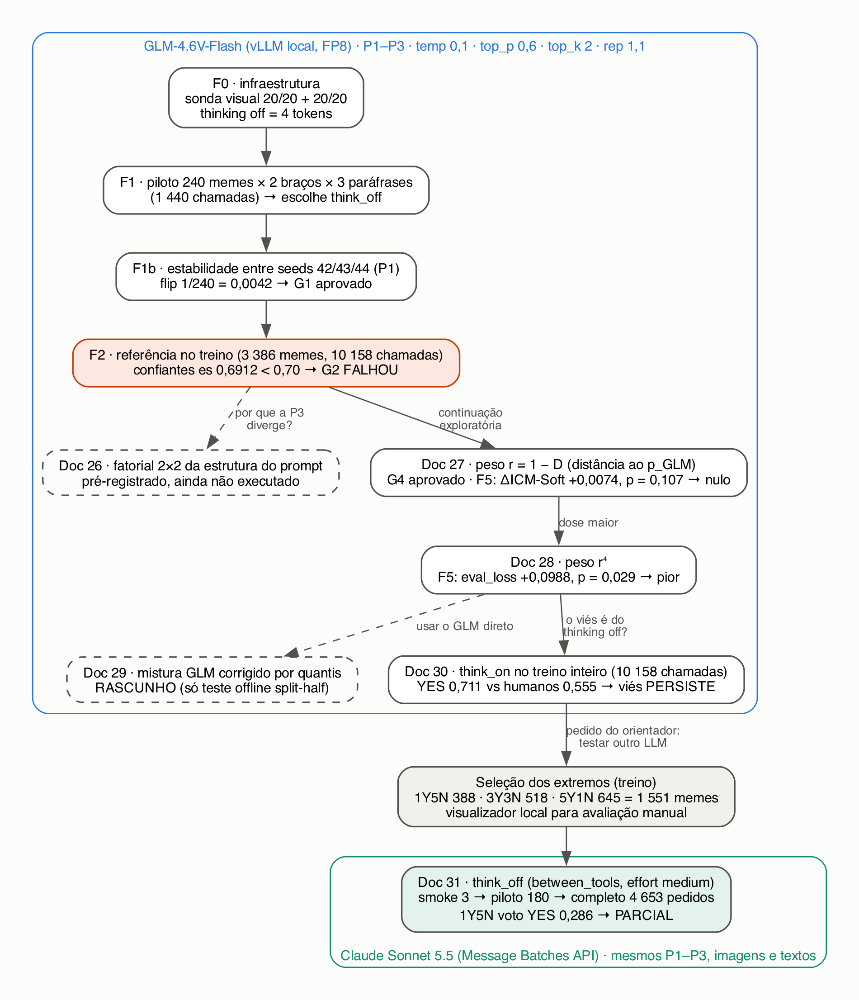
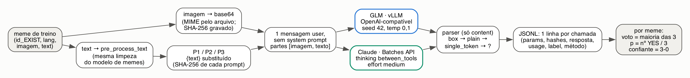

# Metodologia: LLMs multimodais como anotadores de referência para sexismo em memes (GLM-4.6V-Flash e Claude Sonnet 5.5)

*Documento de método dos docs 25 a 31 (`EXIST_MEMES/glm_annotator/`), escrito em 2026-10-22 para servir de base aos capítulos de implementação e de resultados da tese. Os resultados numéricos estão no documento irmão, `RELATORIO_GLM_CLAUDE.md`. Aqui o foco é **como** cada passo foi feito.*

---

## 0. Como ler este documento

**Convenção de marcação**, a mesma de `NOTAS_PARA_TESE.md`:

- `[MEDIDO]`: número observado, com o artefato que o produziu.
- `[HIPÓTESE]`: interpretação plausível, ainda não testada. Não escrever como fato.
- `[LIMITAÇÃO]`: restrição a declarar explicitamente no texto da tese.

**Estatuto de cada documento.** Os experimentos têm estatutos diferentes, que precisam ser mantidos na tese:

| doc | pergunta | estatuto | executado? |
|---|---|---|---|
| 25 | um LLM multimodal serve de "anotador de referência" para ponderar anotadores humanos? | **pré-registro confirmatório** | sim, até a F2 (portão G2 falhou; encerrado) |
| 26 | a divergência da paráfrase P3 vem da estrutura do prompt? (fatorial 2×2) | exploratório, pré-registrado | **ainda não** (pré-registrado em 2026-10-08; aguarda o servidor) |
| 27 | ponderar anotadores pela distância ao soft label do GLM melhora o modelo de memes? | exploratório (continuação declarada do 25) | sim, com retreino (F5) |
| 28 | uma dose maior da mesma ponderação (peso r⁴) muda o resultado? | exploratório | sim, com retreino |
| 29 | misturar o GLM, corrigido por quantis, diretamente no soft label ajuda? | **rascunho**, aguardando o orientador | não (só teste offline *split-half*) |
| 30 | o viés de YES do GLM some com o raciocínio (thinking) ligado? | descritivo, com regra de decisão | sim |
| 31 | o viés de YES é do GLM ou aparece também em outro LLM (Claude)? | descritivo, com regra de decisão | sim, braço `think_off` nos memes extremos (o braço `think_on` está definido, mas não rodou) |

**Disciplina comum a todos.** Cada documento foi escrito **antes** da execução e congelado. Uma mudança posterior entra só como seção nova datada, com o motivo, sem editar o original. Os números nunca são apagados: um resultado intermediário que depois é substituído continua registrado, com a data.



*Figura M1 — Encadeamento dos documentos. Caixas tracejadas: desenhado, mas não executado. Fonte: `glm_reference/reports/fluxo_experimentos.png` (gerado de `fluxo_experimentos.dot`).*

---

## 1. Dados

- **Corpus:** EXIST 2026, Task 2 (memes), arquivo `EXIST_MEMES/Dataset/memes/training/EXIST2026_training.json`. São 3 984 memes, cada um com 6 votos humanos na Task 2.1 (`labels_task2_1`: YES/NO), ids dos anotadores, gênero e faixa etária. Os memes estão em inglês (`en`) ou espanhol (`es`).
- **Soft label humano:** `p_h` = fração de YES entre os 6 votos (0, ⅙, …, 1).
- **Split:** o mesmo do modelo de memes, congelado em `reliability/outputs/split_taskA_frozen.json` (`random_state=42`, `test_size=0,15`, estratificado pelo voto majoritário). **Treino: 3 386 memes · validação: 598.** O `run_probe.py` recalcula o split com `build_frozen_split` e exige igualdade antes de exportar `glm_reference/train_ids.json` e `val_ids.json`. Todos os experimentos com LLM usam **só o treino**. A validação nunca é anotada por LLM e nunca muda de label.
- **Painéis de anotadores:** 887 anotadores. A coleta tem 151 painéis fixos de 6 pessoas (~26 memes por painel), e 868 dos 887 anotadores estão em um único painel (`SPEC_25.md` §0).

**Distribuição dos votos humanos no treino** `[MEDIDO — calculado de EXIST2026_training.json + train_ids.json em 2026-10-22]`:

| nº de YES (de 6) | 0 | 1 | 2 | 3 | 4 | 5 | 6 | total |
|---|---|---|---|---|---|---|---|---|
| memes | 316 | **388** | 458 | **518** | 585 | **645** | 476 | 3 386 |
| en | 170 | 210 | 242 | 260 | 291 | 310 | 232 | 1 715 |
| es | 146 | 178 | 216 | 258 | 294 | 335 | 244 | 1 671 |

Em negrito, os três grupos "extremos" usados nos docs 31 em diante (§6).

---

## 2. Princípios de desenho

1. **Pré-registro com portões de falha dura.** Parâmetros e limiares vão para `glm_reference/config.json` e são conferidos por `assert` no início de cada fase (`common.assert_config()`). Um portão reprovado impede, em código, que a fase seguinte rode.
2. **Separação entre construir a referência e auditar os humanos.** Nas fases que constroem a referência do GLM (F0–F2), nenhum voto humano é lido. A função que sorteia o piloto recebe só ids e idiomas, e um `assert` sobre `inspect.signature` garante isso. Assim a referência não é ajustada aos anotadores que vai auditar.
3. **Retentativa só para falha de transporte** (timeout, conexão, HTTP 5xx e 429), até 3 vezes com *backoff*. **Nunca** por falha de parse ou resposta truncada: repetir até "dar certo" seria seleção. Um erro HTTP 4xx é determinístico e fica gravado com `label="?"`.
4. **Execução retomável e sem refazer chamadas.** Cada chamada concluída vira uma linha num JSONL (append + flush). Antes de chamar, o cliente pula toda chave `(meme_id, braço, paráfrase, seed)` já gravada. Chamada gravada nunca é refeita.
5. **Implementação validada antes de rodar:** casos calculados à mão (Apêndice A dos SPECs 25 e 27, `tests/test_weights.py`), teste do parser com strings fixas e um teste ponta a ponta contra um servidor falso. No Claude, testes com cliente falso no scratchpad (`test_claude_ref.py`, `test_reencode.py`).

---

## 3. Uma chamada, do meme ao voto (comum ao GLM e ao Claude)



*Figura M2 — O mesmo caminho vale para os dois modelos; muda só o cliente. Fonte: `glm_reference/reports/fluxo_chamada.png`.*

### 3.1 Entrada

- **Imagem:** o arquivo original do meme (`DATA / path_memes`), enviado em base64 com o MIME deduzido pela extensão (`mimetypes`). O SHA-256 do arquivo vai para o registro de cada chamada.
- **Texto:** o campo `text` do meme, limpo por `memes_core.pre_process_text`, a mesma limpeza usada pelo modelo de memes da tese. O texto fica no idioma original, sem tradução.
- **Mensagem:** uma única mensagem `user`, **sem system prompt**, com as partes na ordem `[imagem, texto]`. A instrução é sempre em inglês.

### 3.2 Os três prompts (paráfrases P1–P3)

Para medir a sensibilidade do julgamento à redação, cada meme é perguntado com três paráfrases da mesma definição. `{text}` é substituído pelo texto limpo (`str.replace`, não `format`, para que chaves no texto do meme não quebrem o prompt). Cada prompt termina com quebra de linha: no GLM com thinking desligado, o template de chat acrescenta `/nothink` ao fim da mensagem.

**Proveniência** (`SPEC_25.md` §4): a P1 adapta a pergunta mostrada aos anotadores de tweets do EXIST 2023 (visão geral estendida, Seção 3.3) e a regra de escopo dos memes do EXIST 2026 (visão geral, Seção 2.1: *"it is sexist itself, describes a sexist situation or criticizes a sexist behavior"*). As frases *"A meme that condemns or reports sexism is still YES"* e *"Judge the image and the text together"* não vêm do EXIST: tornam a regra explícita. A P2 e a P3 dizem o mesmo com outra redação e outra ordem.

`[LIMITAÇÃO]` As diretrizes de anotação de memes do EXIST não são públicas. A P1 é a melhor aproximação pública, não a instrução original dos anotadores.

**P1** — SHA-256 `eda963068a2270d49f149c082a8989ca310a68ca655a9c635efb4464a112cd54`
```text
Is the meme sexist, in any form, or does it describe situations in which such discrimination occurs (i.e., it is sexist itself, describes a sexist situation or criticizes a sexist behavior)?

YES: the meme is sexist itself, describes a sexist situation or criticizes a sexist behavior.
NO: the meme does not prejudice, underestimate or discriminate women.
A meme that condemns or reports sexism is still YES.

Remember that sexism may be expressed in different forms! It may sound friendly, funny, offensive, hateful or even violent. Sexism comprises any form of oppression or prejudice against women because of their sex. This discrimination can be based on different beliefs such as stereotypes, the belief that men are superior to women or irrational hatred of women (misogyny). Note that misogyny is a radical/hate-driven sexism.

Judge the image and the text together. Text extracted from the meme (English or Spanish, do not translate it):
{text}

Answer with one word: YES or NO.
```

**P2** — SHA-256 `7265b449b1dda235dc97a3396d75b869928c5141d6c8711834f17e968c552800`
```text
Sexism is any form of oppression or prejudice against women because of their sex. It can sound friendly, funny, offensive, hateful or violent, and it can rest on stereotypes, on the belief that men are superior to women, or on hatred of women (misogyny, the radical, hate-driven form of sexism).

Look at the meme, image and text together. Label it YES if it is sexist itself, if it describes a sexist situation, or if it criticizes a sexist behavior. A meme that condemns or reports sexism also counts as YES. Label it NO if it does not prejudice, underestimate or discriminate women.

Text extracted from the meme (English or Spanish, keep it in its original language):
{text}

Answer with one word: YES or NO.
```

**P3** — SHA-256 `e9663f15f8be12d651c299af89d57628088dca46d9e56e3eb591c2d284a69136`
```text
Text extracted from the meme (English or Spanish, original language):
{text}

Task: decide whether this meme, considering the image and the text together, contains sexist expressions or behaviors. This includes memes that are sexist themselves, memes that describe a sexist situation, and memes that criticize or condemn a sexist behavior. Sexism means any oppression or prejudice against women because of their sex, whether it sounds friendly, funny, offensive, hateful or violent, including stereotypes, the belief that men are superior to women, and misogyny.

Is this meme sexist under this definition? Answer with one word: YES or NO.
```

A P3 difere da P1 em cinco pontos ao mesmo tempo: (1) o texto do meme vem **antes** da instrução; (2) o enquadramento é "*Task: decide whether…*"; (3) a pergunta é se o meme *"contains sexist expressions or behaviors"*; (4) não há definição do NO; (5) termina com *"Is this meme sexist under this definition?"* (`SPEC_26.md` §0).

### 3.3 Parser

O parser (`client.parse`) olha **só** a resposta final (`content`), nunca o raciocínio. São quatro passos, nesta ordem:

1. `box`: o primeiro trecho `<|begin_of_box|>…<|end_of_box|>` (formato do GLM), normalizado (strip, maiúsculas, sem pontuação nem `*`), se for YES ou NO;
2. `plain`: o `content` inteiro normalizado é YES ou NO (formato típico do Claude);
3. `single_token`: exatamente um dos dois rótulos aparece como palavra isolada;
4. senão `label="?"`, com o motivo: `empty`, `length` (resposta truncada), `both` (YES e NO presentes), `other` (recusa ou texto sem rótulo). Os erros de API ficam como `error`, e as recusas do Claude como `refusal`.

O Claude usa o mesmo `client.parse`, recebendo `"length"` quando a parada é por `max_tokens` e o `stop_reason` nos demais casos.

### 3.4 Registro

Cada chamada gera uma linha JSONL com: `meme_id`, `lang`, `arm`, `paraphrase`, `seed`, `params` (todos os parâmetros enviados), `prompt_sha256`, `image_sha256`, `content`, `reasoning_content`, `finish_reason`, `usage`, `latency_s` (GLM), `label`, `parse_method`, `error`, `timestamp` e `server_model`. O Claude acrescenta `batch_id`, `refusal_category` e `image_reencoded`. Arquivos: `glm_reference/raw/think_off.jsonl`, `glm_reference/raw/think_on.jsonl` e `claude_reference/raw/claude-sonnet-5-5_think_off.jsonl`.

### 3.5 Agregação por meme

- **Voto do modelo:** a maioria dos rótulos parseados, quando pelo menos 2 concordam (com 3 paráfrases não há empate); senão, sem voto.
- **Soft label do modelo:** `p_LLM` = nº de YES / 3 ∈ {0, ⅓, ⅔, 1}, definido só quando as três paráfrases foram parseadas.
- **Confiante:** as três paráfrases parseadas e iguais (padrão 3-0).
- **Taxa de YES por paráfrase (`yes_rate`):** fração de YES entre as chamadas parseadas.

---

## 4. GLM-4.6V-Flash: configuração

| item | valor | motivo / fonte |
|---|---|---|
| modelo | `glm-4.6v-flash` (checkpoint `cont1037/GLM-4.6V-Flash-FP8-DYNAMIC`, contexto 32 768) | servidor do grupo |
| servidor | vLLM `0.29.1rc1.dev452+g3df4ae153`, API compatível com OpenAI, em `http://193.136.195.31:8000/v1` | `config.json → runtime.server_version` |
| cliente | Mac local, Python 3.13.5, SDK `openai` 2.14.0, `AsyncOpenAI` com semáforo | `SPEC_25.md` §1 |
| `temperature` · `top_p` · `top_k` · `repetition_penalty` | **0,1 · 0,6 · 2 · 1,1**, enviados explicitamente (`top_k` e `repetition_penalty` via `extra_body`) | decisão do autor (temp) e model card (demais); mandar explícito torna a configuração auditável |
| `seed` | 42 na referência; 43 e 44 no teste de estabilidade | `config.json` |
| thinking desligado | `extra_body={"chat_template_kwargs": {"enable_thinking": False}}` | o template acrescenta `/nothink` |
| `max_tokens` | 16 384 (thinking ligado) · 256 (desligado) | 2 048 truncava o raciocínio no teste inicial |
| timeout | 600 s (ligado) · 60 s (desligado) | |
| concorrência | **4** (o pré-registro dizia 8; adendo §19 de 2026-10-07, antes de qualquer chamada: servidor partilhado) | a mesma em todos os braços, porque a ordem de lote pode alterar resultados numéricos no vLLM |

`[LIMITAÇÃO]` O checkpoint é quantizado (FP8). A sonda visual da F0 mostra que a visão **funciona**, não que é tão boa quanto a do modelo BF16, que não foi testado.

`[LIMITAÇÃO]` Infraestrutura: imagens que geram mais de ~6 084 tokens de encoder são recusadas pelo servidor com HTTP 400 (cache de encoder do vLLM). Isso afetou 5 dos 3 386 memes de treino (15 chamadas), em todos os braços. Esses memes ficam sem referência do GLM.

### 4.1 F0 — Infraestrutura e testes de fumaça (portão G0)

| teste | procedimento | critério |
|---|---|---|
| G0.1 servidor | `GET /v1/models` e `GET /version` | modelo listado; versão gravada |
| G0.2 thinking desligado | 3 memes do piloto com P1 e `enable_thinking=False` | raciocínio vazio e `completion_tokens ≤ 32` nas 3 |
| G0.3 **sonda visual** | 20 primeiros memes do piloto com o prompt *"Describe the image in one sentence. Do not transcribe its text."*, uma vez com a imagem real e outra com um PNG branco de 512×512 gerado em memória | revisão manual: as descrições da imagem branca descrevem algo vazio **e** ≥ 16/20 descrições reais correspondem ao meme |
| G0.4 vazão | latência e chamadas/min com concorrência 4 | só registro |

**Por que a sonda visual.** Checkpoints quantizados podem degradar a torre de visão sem erro visível: o modelo continua respondendo em formato válido, decidindo só pelo texto. Como o texto do meme também vai no prompt, essa falha passaria por todas as métricas de classificação. A imagem branca é o controle negativo. As chamadas da F0 não entram nos JSONL do experimento.

### 4.2 F1 — Piloto e escolha do modo de raciocínio (portão G1)

- **Amostra:** 240 memes de treino, 120 `en` + 120 `es`. Por idioma, os ids ordenados como string; um único `numpy.random.default_rng(2026)`; `rng.choice` sem reposição. O sorteio usa só id e idioma, nunca votos (`glm_reference/pilot_ids.json`).
- **Braços:** `think_on` e `think_off` × P1–P3 × seed 42 = **1 440 chamadas**.
- **Métricas sem rótulo humano** (total, en, es): `parse_rate`, `length_rate`, `yes_rate`, `paraphrase_agreement` (fração de memes confiantes), recusas, fração de raciocínios com caracteres CJK, mediana de `completion_tokens` e de latência.
- **Regra de escolha (fixada antes):** um braço é elegível se `parse_rate ≥ 0,98` e `paraphrase_agreement ≥ 0,70` **em cada idioma**, e `0,05 ≤ yes_rate ≤ 0,95`. Se os dois forem elegíveis, fica o `think_off`, salvo um ganho de concordância > 0,05 do `think_on`. A escolha se baseia na **consistência do modelo consigo mesmo** sob reformulação do prompt, e não na concordância com os humanos, o que tornaria a referência circular.
- **Por que 70 % de memes confiantes:** cada anotador vota em ~26 memes; tirando os unânimes, sobram ~20. Com 70 % confiantes, ficam ~14 por anotador para estimar o desvio; o erro-padrão de uma proporção com 14 memes já chega a 0,13. O valor é escolha do autor, não vem da literatura.

### 4.3 F1b — Estabilidade entre seeds

- **Procedimento:** braço escolhido (`think_off`), P1, seeds **42, 43 e 44** nos 240 memes do piloto (480 chamadas novas; a seed 42 vem do piloto).
- **Métrica:** `flip_rate` = fração de memes cujos três rótulos (um por seed) não são todos iguais. Um `?` conta como flip. Calculada no total e por idioma.
- **Portão G1:** `flip_rate ≤ 0,10` no total.
- `[LIMITAÇÃO]` Com `temperature=0,1` e `top_k=2`, a geração é quase determinística por construção. Um flip baixo era esperado: o teste mede o ruído de amostragem residual, não a robustez do julgamento. A robustez é o que a concordância entre paráfrases mede.

### 4.4 F2 — Referência no treino completo (portão G2)

- **Chamadas:** `think_off` × P1–P3 × seed 42 nos 3 386 memes de treino = 10 158. As 720 do piloto (`think_off`, seed 42) foram reaproveitadas pela chave de retomada, então foram **9 438 chamadas novas** (`SPEC_25.md` §18).
- **Saída:** `glm_reference/glm_votes.csv` (`meme_id, lang, label_p1..p3, glm_vote, glm_confident`).
- **Portão G2:** `parse_rate ≥ 0,98` **e** fração de memes confiantes ≥ 0,70, os dois em cada idioma. Se falhar, o experimento para (§11 do SPEC_25).
- Pela regra, as fases F3 (pesos), F4 (checagens) e F5 (retreino) do doc 25 só rodariam com o G2 aprovado.

### 4.5 Doc 26 — Fatorial 2×2 da estrutura do prompt (pré-registrado, **ainda não executado**)

Desenhado para separar dois dos cinco fatores em que a P3 difere da P1: a ordem (texto do meme antes ou depois da instrução) e o enquadramento ("pergunta direta" ou "*Task: decide whether…*"). Seriam 4 células × 240 memes do piloto = 960 chamadas `think_off`, seed 42, com um controle de ruído (`D(direct_after, P1 original) ≤ 0,02`) e a medida `R = D(célula, P1) / D(P3, P1)` (R ≥ 0,5: o fator explica a maior parte da divergência da P3). Os textos exatos das quatro células e os SHA-256 estão em `SPEC_26.md` §3. **Ainda não executado** (pré-registrado em 2026-10-08; aguarda o servidor GLM): não existem `raw/factorial26.jsonl` nem `reports/factorial26_summary.md`, e não há resultado para citar.

### 4.6 Doc 27 — Ponderação de anotadores pela distância ao soft label do GLM

Continuação **exploratória**, aprovada pelo orientador em 2026-10-09 e declarada como motivada pela falha do G2. Não reabre o doc 25. Nenhuma chamada nova: reaproveita `glm_votes.csv`.

**Referência:** `p_GLM,i` = fração de YES entre P1, P2 e P3 do meme `i`. Os memes 2-1 deixam de ser descartados.

**Memes que entram no cálculo do desvio:** os não unânimes entre os humanos **e** com as três paráfrases parseadas. Ficam fora os unânimes (6-0) e os 5 memes sem referência.

**Fórmulas** (`weights.py`, funções puras; `SPEC_27.md` §3 e §8):

- desvio do anotador `a` no meme `i`: `d_ai = |1[voto_a = YES] − p_GLM,i|` ∈ {0, ⅓, ⅔, 1};
- peso de consenso, *leave-one-out*: `w_ai = 1 − H(fração de YES entre os outros 5 votos)`, com `H` a entropia binária em bits. Com 5 outros votos: 5-0 → 1,000; 4-1 → 0,278; 3-2 → 0,029. Discordar do GLM quando os outros cinco concordam entre si pesa muito; discordar num meme em que eles se dividem quase não pesa;
- desvio do anotador: `D_a = Σ_i w_ai·d_ai / Σ_i w_ai`;
- peso do voto: `r_a = 1 − D_a` (sem meme incluído ou com `Σw = 0`: `r_a = 1`);
- novo soft label de **todo** meme de treino: `p_new = Σ_a r_a·1[voto_a = YES] / Σ_a r_a`. Os memes unânimes mantêm 0 ou 1 por construção, e um painel com todos os `r` iguais não muda nada (as duas propriedades viram `assert`).

`[LIMITAÇÃO]` Num meme 2-1, todo anotador leva pelo menos ⅓ de desvio, o que cria um piso em `D_a`. Os `D` do doc 27 não estão na mesma escala que os do doc 25.

**Checagens descritivas (F4, `checks.py` → `reports/checks_summary.md`):**

- (a) linha de base dos pares: a mesma fórmula com `p_outros` (fração de YES dos outros 5) no lugar do GLM, e ρ de Spearman(r_glm, r_peer);
- (b) o peso só mede o limiar do anotador? ρ(D_glm, taxa de YES do anotador) e ρ(D_glm, |taxa de YES do anotador − média de p_GLM nos mesmos memes|);
- (c) `r` por gênero × idade, com IC 95 % por *bootstrap* de anotadores (2 000 reamostragens, `default_rng(2026)`);
- (d) quanto os labels se movem: `share_moved` = fração de memes com |Δp| ≥ 1/12 (meio voto) e mudanças de rótulo duro;
- (e) o GLM confiante contraria um meme unânime? Com 30 casos sorteados para revisão manual;
- (f) acordo do voto do GLM com o rótulo duro humano, empates fora;
- (g) precisão por anotador: `n_included`, massa `Σw` e largura do IC 95 % de `D_glm` por *bootstrap* dos memes;
- (h) fração da massa `Σw` vinda de memes 2-1;
- (i) hesitação do GLM × divisão humana, com IC 95 % para a diferença de proporções (aproximação normal). Só se diz "mais" quando o IC exclui zero (`SPEC_27.md` §16B: com votos aleatórios sintéticos, a comparação crua dava "mais" por puro ruído).

**Portão G4:** retreino só se `share_moved ≥ 0,05` **e** ρ(r_glm, r_peer) < 0,8.

**F5 — retreino** (disparado pelo autor na VM):

- modelo de memes da tese (`memes_model.ipynb`: XLM-RoBERTa-large + CLIP ViT-L/14, fusão por concatenação em 1024-d), sem nenhuma edição de código; muda só `ARM` e `SEED` na célula 6;
- braços `glmbase` (cópia byte a byte do `soft_labels_taskA_raw.json`, com tag própria para não colidir com runs antigas) e `glmw` (Task 2.1 de treino trocada por `p_new`). Validação sempre com os labels originais, conferida por SHA-256. Tasks 2.2 e 2.3 intocadas;
- seeds pareadas **42, 7 e 2025**, 15 épocas;
- **estado primário:** E = argmin(`eval_loss`), a época escolhida pela loss e nunca pela métrica (`SPEC_27.md` §16A, P3). O estado final é secundário (regra de simetria);
- **teste:** Δ = glmw − glmbase por seed; média; t pareado **bilateral**, df = 2. Para p < 0,05 é preciso |t| > 4,30. Métrica primária: Task A ICM-Soft-Norm. Secundárias: ICM-Norm *hard* e `eval_loss`; Tasks B e C para dano colateral;
- **critério de sucesso:** Δ médio de ICM-Soft-Norm > 0, p < 0,05 **e** `eval_loss` sem piora. Um nulo se registra como "efeito não detectado com 3 seeds", nunca como "efeito zero";
- **controle `glmshift`** (definido depois da F4, antes da F5): nos memes não unânimes, `p_ctrl = clip(p_old + Δ̄, 0, 1)`, com Δ̄ = deslocamento médio que o glmw produziu (+0,0705), sem ponderar anotador nenhum. Pela regra fixada, só seria treinado se o glmw satisfizesse o critério.
- **Determinismo do treino:** o notebook fixa as seeds de python/numpy/torch/cuda, usa `cudnn.benchmark=False`, `use_deterministic_algorithms(True)` e `CUBLAS_WORKSPACE_CONFIG=:4096:8`, faz re-seed imediatamente antes de instanciar o modelo e imprime um *fingerprint* SHA-256 dos pesos. `[MEDIDO]` Três execuções de `glmbase` seed 7 deram `eval_loss` idêntica época a época.

### 4.7 Doc 28 — Dose maior: peso r⁴

Exploratório, motivado pelo nulo do doc 27. Muda só o peso do voto: `p_new = Σ r⁴·1[YES] / Σ r⁴`, com o mesmo `r_glm` do doc 27 (`annotator_weights.csv`, SHA-256 conferido). Elevar à 4ª potência preserva a ordem dos anotadores e amplia a distância entre eles (o dobro do `r` vira 16× o peso). O BASE foi reaproveitado do doc 27, porque o treino é determinístico.

**Triagem com 1 seed (42)**, limites fixados antes: continuar para as seeds 7 e 2025 se |Δ hard| ≥ 0,03, |Δ soft| ≥ 0,02 ou |Δ `eval_loss`| ≥ 0,03, em qualquer direção (o dobro dos Δ da seed 42 no doc 27). A confirmação usa a mesma análise do doc 27, e um efeito negativo significativo também é registrado.

### 4.8 Doc 29 — Mistura do GLM corrigido por quantis (**rascunho, não aprovado**)

Proposta, aguardando o orientador. **Nenhum label foi gerado e nenhuma run foi feita.** `doc29.py build` não deve ser rodado antes da aprovação.

- **Ideia:** usar o GLM diretamente no label, depois de corrigir o viés de YES: `p_novo = 0,5·p_h + 0,5·q(p_GLM)`, braço `glmq50`.
- **Correção por quantis `q`:** ordenam-se os `p_h` dos 3 381 memes com referência; os níveis do GLM (254, 241, 739 e 2 147 memes em 0, ⅓, ⅔ e 1) ocupam blocos consecutivos dessa fila, e `q(nível)` = média dos `p_h` do bloco. O mapa medido é `q(0)=0`, `q(⅓)=0,124`, `q(⅔)=0,303`, `q(1)=0,756`; a média de `q(p_GLM)` iguala a humana (0,5549). O GLM decide a **ordem**, e os humanos decidem a **escala**.
- **Controle `smooth50`:** `p_novo = 0,5·p_h + 0,5·0,555`, a mesma mistura sem informação do GLM, para separar "o GLM informa" de "suavizar ajuda".
- **Teste offline *split-half*** (`splithalf_29.py` → `reports/splithalf_29.md`): em cada meme de treino, as 20 divisões 3 contra 3 dos anotadores, nos dois sentidos; uma metade (pura ou misturada) prevê a fração de YES da outra; métricas MSE e entropia cruzada (com p cortado em [0,001; 0,999]); IC 95 % da diferença `glmq50 − smooth50`.

### 4.9 Doc 30 — GLM com thinking ligado no treino inteiro

- **Pergunta:** o viés de YES do GLM (`think_off`: 80,4 % de YES no treino, contra 55,5 % dos humanos) é efeito do raciocínio desligado?
- **Execução:** `run_reference_think_on.py`, braço `think_on`, P1–P3, seed 42, os 3 386 memes de treino. Parâmetros idênticos aos do doc 25. As 720 chamadas `think_on` do piloto foram reaproveitadas, então foram 9 438 novas. Grava `glm_votes_think_on.csv`, sem tocar em nenhum artefato dos docs 25–29.
- **Regra (fixada antes):** o viés **persiste** se a taxa de YES do `think_on` for ≥ média humana + 0,10 (≥ 0,655). Nesse caso, o passo seguinte é testar outros modelos, como pediu o orientador.
- **Descritivos fora da regra:** acerto contra a maioria humana (empates fora), Spearman(p_GLM, p_h), YES quando os humanos dizem NO, NO quando dizem YES, e a distribuição de p_GLM.

---

## 5. Custos de execução do GLM (medidos)

`[MEDIDO — timestamps e usage de raw/think_off.jsonl e raw/think_on.jsonl, chamadas com seed 42]`

| braço | latência mediana por chamada | tokens gerados (mediana · máx) | tokens de entrada (mediana) | 9 438 chamadas da referência completa (concorrência 4) |
|---|---|---|---|---|
| `think_off` | 0,66 s | 4 · 207 | 724 | **0,78 h** (2026-10-08) |
| `think_on` | 16,0 s | 169 · 2 084 | 720 | **12,7 h** (2026-10-12 a 13) |

O servidor é do grupo, então o custo monetário marginal é zero. A vazão medida na F0 foi de 73,6 chamadas/min (latência mediana de 2,5 s nas descrições da sonda).

---

## 6. Seleção dos memes extremos e visualizador

**Motivação.** Os docs 27–30 mostraram que o GLM diz YES muito mais que os humanos. Para comparar modelos onde a resposta humana é mais clara, o foco passou aos casos extremos de concordância humana no treino.

**Seleção** (`select_extremes.py`, só lê arquivos já gravados, sem chamada a modelo):

- grupos definidos pelo número de YES humanos na Task 2.1: **1Y5N** (1 YES, 5 NO; n = 388), **3Y3N** (empate; n = 518) e **5Y1N** (5 YES, 1 NO; n = 645), total **1 551 memes**;
- grupos escolhidos pelo autor em 2026-10-19; os unânimes (0-6 e 6-0) não entram (para o GLM contra memes unânimes, ver também a checagem (e) do doc 27);
- a ordem dentro de cada grupo é embaralhada com `default_rng(2026)`, de modo que os N primeiros de cada grupo formam uma amostra aleatória (o piloto do Claude usa isso);
- saídas: `glm_reference/extremes/extremes.csv` (votos humanos e rótulos P1–P3 do GLM off e on), `extremes.json` (o mesmo, mais imagem, texto, demografia e o raciocínio do GLM `think_on`) e `reports/extremes.md`.

**Nível de referência humano em cada grupo:** por construção, a fração de YES esperada de um anotador típico é ⅙ ≈ 0,167 no 1Y5N, 0,5 no 3Y3N e ⅚ ≈ 0,833 no 5Y1N.

**Visualizador local** (`viewer.py` + `viewer.html`): servidor HTTP da biblioteca padrão, só em `127.0.0.1:8765`, com uma única *thread* (evita corrida ao gravar). Mostra imagem, texto, votos humanos com gênero e idade, e as respostas do GLM off/on com o raciocínio. Tem abas por grupo, filtros (idioma, "GLM discorda da maioria", "off e on diferem", "não avaliados") e um **modo cego**, que esconde os votos humanos e dos modelos até o avaliador dar o próprio rótulo (teclas Y/N/A). A avaliação é gravada na hora em `extremes/avaliacao.json` e `.csv`, com troca atômica de arquivo. Serve para revisão qualitativa dos casos; nenhuma métrica deste relatório depende dela.

---

## 7. Claude Sonnet 5.5 (doc 31)

### 7.1 Pergunta e regra pré-registrada

**Pergunta:** o viés de YES é do GLM ou aparece também em outro LLM multimodal, com os mesmos prompts, imagens e textos?

**Pré-registro aprovado pelo autor em 2026-10-19, antes do piloto** (`SPEC_31.md`). Antes da aprovação rodou apenas o `--smoke`: 3 chamadas síncronas no meme 110096, só para checar a chave e os parâmetros, sem nada gravado.

**Métrica principal:** voto YES do Claude no grupo 1Y5N (5 de 6 humanos dizem NO).

- **≥ 0,40:** o Claude também tem o viés, que portanto não é exclusivo do GLM. O valor 0,40 fica abaixo do GLM com thinking ligado (0,51) com folga de 0,1.
- **≤ 0,25:** o viés é, em boa parte, do GLM. O valor 0,25 está perto do esperado de um anotador humano típico (0,167).
- **Entre os dois:** parcial; reportar sem conclusão forte.

Secundária: o voto YES no 3Y3N comparado com 0,5. Mesma leitura por idioma.

### 7.2 Modelo e parâmetros

| item | valor | motivo |
|---|---|---|
| modelo | `claude-sonnet-5-5` | o Claude 5.5 de porte médio que permite desligar o thinking; o Opus 5.5 não permite (400 em qualquer `effort`) |
| thinking (braço `think_off`) | `thinking: {"type": "between_tools"}` | no Sonnet 5.5, `disabled` é rejeitado (400). Pelo nome, `between_tools` limita o raciocínio às trocas com ferramentas, e aqui não há ferramentas. Confirmado empiricamente: 0 dos 4 716 registros com raciocínio; saída média de 4,0 tokens |
| `effort` | `medium`, explícito | o padrão muda por modelo |
| `max_tokens` | 256 | igual ao GLM `think_off` |
| amostragem | **padrão da API**: os modelos 5.5 rejeitam temperature/top_p/top_k fora do padrão e não têm `seed` | ver §8 |
| mensagem | idêntica ao GLM: 1 mensagem `user`, sem system prompt, partes `[imagem base64, texto]`; mesmos P1–P3 e mesmo texto limpo | |
| braço `think_on` | definido (`thinking: adaptive`, resumo do raciocínio gravado, `max_tokens` 16 000), **não executado** | |
| SDK | `anthropic` 1.15.0, Python 3.13.5, no Mac | |

### 7.3 Execução pela Message Batches API

- **Por que *batch*:** metade do preço e sem limite prático de concorrência; o resultado sai em até 24 h (na prática, de 3 min a ~4 h por lote, §7.6).
- **Pedidos:** um por (meme, paráfrase), com `custom_id = "<meme_id>_p<1|2|3>"`. Os lotes são fatiados em até 150 MB (o limite da API é 256 MB e 100 000 pedidos).
- **Estado e retomada:** cada lote enviado vai para `claude_reference/batches.json` (id, modelo, braço, data, `custom_ids`, idioma e SHA-256 da imagem de cada meme), com gravação atômica. Rodar o mesmo comando de novo recolhe os lotes terminados e envia só o que falta; um Ctrl+C ou uma queda de rede não perdem nada. Cada execução envia no máximo uma vez.
- **Coleta** (`collect`): `succeeded` → resposta parseada (§3.3). `errored` com `invalid_request` (4xx, determinístico) → registro `?` com `parse_method="error"`. Outros erros (servidor, expirado, cancelado) não são gravados e voltam a ser enviados, a mesma regra de "retentativa só para transporte" do GLM.
- **Recusas:** `stop_reason == "refusal"` vira `?` com `parse_method="refusal"` e a `refusal_category`. Por decisão de desenho, **sem `fallbacks`** para outro modelo (que, de resto, a Batch API não aceita): trocar de modelo nos casos difíceis mudaria o anotador no meio da medição.
- **Ordem pré-registrada:** `--smoke` (3 chamadas síncronas, nada gravado) → piloto `--per-group 20` (60 memes, 180 pedidos, lote `msgbatch_01FkUCMPxzxwLmcQuaPTbDST`) → todos os 1 551 memes.
- **Comandos** (da raiz do repositório, com `ANTHROPIC_API_KEY` exportada no terminal e nunca gravada no repositório):

```bash
python3 EXIST_MEMES/glm_annotator/claude_reference.py --model claude-sonnet-5-5 --arm think_off --smoke
python3 EXIST_MEMES/glm_annotator/claude_reference.py --model claude-sonnet-5-5 --arm think_off --per-group 20
python3 EXIST_MEMES/glm_annotator/claude_reference.py --model claude-sonnet-5-5 --arm think_off
```

A chave da conta não estava associada a um *workspace*, e a API exigiu o cabeçalho `anthropic-workspace-id`, passado pela variável `ANTHROPIC_CUSTOM_HEADERS`. Isso é só infraestrutura, sem efeito no método.

### 7.4 Tratamento de imagens (diferenças em relação ao GLM)

1. **Limite de 5 MB por imagem.** Só o meme 210851 (5,1 MB) passa do limite. Ele é reduzido para 1 568 px no maior lado e enviado como JPEG de qualidade 90, que é o tamanho a que o Claude reduz as imagens de qualquer forma. O SHA-256 registrado continua sendo o do arquivo original. Declarado no pré-registro.
2. **Desvio datado de 2026-10-19 (escrito antes de ver qualquer resposta reenviada).** Na rodada completa, 21 memes (63 pedidos) voltaram com `invalid_request_error: Could not process image`. São JPEGs válidos, que o PIL e o GLM leem sem erro. Esses memes foram **reenviados uma única vez** com a imagem decodificada e reconvertida para PNG (os mesmos pixels, sem nova compressão). Os registros reenviados têm `image_reencoded: true`, e os registros de erro originais continuam no JSONL (4 716 linhas = 4 653 pedidos + 63 reenvios). A regra era: se falhasse de novo, ficaria `?` definitivo. Os 63 foram processados. Na análise vale o último registro de cada chave.

### 7.5 Métricas e relatório

`claude_reference.py` calcula, por grupo × (total, en, es): fração de YES humana; voto YES do GLM off, do GLM on e do Claude; fração de YES do Claude nas paráfrases; parse rate; recusas. Grava em `glm_reference/reports/claude_claude-sonnet-5-5_think_off_extremes.md`. As métricas adicionais deste relatório (concordância entre paráfrases, paráfrase dissidente, acordo com a maioria humana, κ, McNemar, cruzamentos) foram calculadas em 2026-10-22 a partir dos mesmos arquivos e são **descritivas, pós-hoc**: não fazem parte da regra do §7.1. As figuras vêm de `plot_doc31.py`.

### 7.6 Custo e tempo (medidos)

- **Preço:** Sonnet 5.5 custa US$ 2 por milhão de tokens de entrada e US$ 10 por milhão de saída; a Batch API cobra 50 %.
- **Tokens** `[MEDIDO — usage dos 4 653 registros finais]`: entrada média de 1 121,7 tokens por pedido (mediana 874, mín. 279, máx. 5 311, quase tudo imagem); saída média de 4,0 tokens (máx. 70).
- **Custo real:** ≈ **US$ 5,31** pelos 4 653 pedidos, ≈ US$ 0,00114 por pedido (≈ US$ 0,0034 por meme com 3 paráfrases). A estimativa do `--smoke` (US$ 2,43) era baixa porque usava um único meme de imagem pequena.
- **Tempo por lote** (do envio ao fim do processamento): 180 pedidos → 3 min; 666 → 125 min; 875 → 85 min; 816 → 127 min; 787 → 229 min; 972 → 246 min; 357 → 134 min; 63 (reenvio PNG) → 4 min. Com os lotes processados em paralelo, a rodada completa levou ~4 h de relógio. O tempo depende da fila da API, não do tamanho do lote.

---

## 8. O que é comparável entre GLM e Claude

| aspecto | GLM-4.6V-Flash | Claude Sonnet 5.5 | igual? |
|---|---|---|---|
| memes | treino inteiro (3 386) e os 1 551 extremos | **só os 1 551 extremos** | as comparações diretas usam só os extremos |
| imagem | arquivo original | arquivo original; 1 meme reduzido (5 MB) e 21 reconvertidos para PNG | quase |
| texto e prompts | P1–P3, texto limpo por `pre_process_text` | idênticos (mesmos SHA-256) | sim |
| formato da mensagem | 1 `user`, sem system prompt, `[imagem, texto]` | idem | sim |
| raciocínio | `think_off` (`enable_thinking=False`) e `think_on` | só `think_off` (`between_tools`) | só o braço off é comparável |
| amostragem | temp 0,1 · top_p 0,6 · top_k 2 · rep 1,1 · seed 42 | padrão da API, sem seed | **não** |
| repetição entre seeds | sim (F1b: seeds 42, 43, 44) | **impossível** (a API não tem seed) | não |
| parser e agregação | `client.parse`; maioria das 3; confiante = 3-0 | idênticos | sim |
| falhas de imagem | 5 memes sem resposta (cache de encoder) | 0 no fim (após o reenvio PNG) | não afeta os extremos, salvo 1 meme do 5Y1N sem voto do GLM |
| execução | servidor local, síncrono, concorrência 4 | Batch API, assíncrono | sem efeito nas respostas |

`[LIMITAÇÃO]` **Não há teste de estabilidade entre seeds para o Claude**, e não é possível fazer um equivalente ao F1b: a API não expõe `seed` nem permite fixar a temperatura. O que se pode medir é a variação entre **duas execuções idênticas** (reenviar os mesmos pedidos e contar quantos rótulos mudam). Isso não foi feito; ver as pendências no relatório.

---

## 9. Definições das métricas e dos testes

- **Voto YES (taxa):** fração dos memes do grupo cujo voto (maioria das 3 paráfrases) é YES. O denominador é o número de memes do grupo, incluindo os sem voto.
- **IC 95 % de Wilson** para uma proporção k/n: `(p̂ + z²/2n ± z·√(p̂(1−p̂)/n + z²/4n²)) / (1 + z²/n)`, com z = 1,96.
- **Fração de YES nas paráfrases:** YES / respostas parseadas, juntando P1, P2 e P3.
- **Concordância entre paráfrases (fração 3-0):** memes com as três paráfrases parseadas e iguais / memes do grupo.
- **Paráfrase dissidente:** nos memes 2-1, a paráfrase que ficou sozinha.
- **Acordo com a maioria humana nos extremos** (pós-hoc): NO no 1Y5N (maioria humana NO), YES no 5Y1N (maioria humana YES) e a média das duas, que equivale a uma acurácia balanceada nesses dois grupos. Um meme sem voto conta como erro. O 3Y3N não tem maioria e fica fora.
- **Acordo e κ de Cohen** entre dois modelos: `κ = (p_o − p_e) / (1 − p_e)`, sobre os memes com voto dos dois.
- **Teste de McNemar exato** (bilateral) para a diferença de taxas de YES pareadas entre dois modelos: binomial nos pares discordantes (b = só o primeiro diz YES, c = só o segundo diz YES).
- **`flip_rate`:** fração de memes cujos rótulos nas seeds 42, 43 e 44 não são todos iguais (`?` conta como flip).
- **Spearman:** correlação de Pearson dos ranks (pandas), sem SciPy, conforme o pré-registro.
- **F5:** Δ por seed, média, desvio-padrão, t pareado bilateral com df = 2 (`analyze_f5.py`, que reaproveita `stats` e `p_two_sided` de `reliability/analyze_arm_experiment.py`).

---

## 10. Artefatos e reprodução

| arquivo | conteúdo |
|---|---|
| `glm_annotator/SPEC_25.md` … `SPEC_31.md` | pré-registros, adendos e resultados datados |
| `glm_annotator/NOTAS_PARA_TESE.md` · `EXPLICACAO_METODOS.md` · `RUNBOOK.md` | notas para a tese (docs 25–28), explicação dos métodos de ponderação com exemplo numérico, passo a passo |
| `glm_annotator/client.py` · `prompts.py` · `common.py` | cliente GLM, parser, retomada; prompts e hashes; caminhos e parâmetros |
| `glm_annotator/run_probe.py` · `run_pilot.py` · `run_reference.py` · `run_reference_think_on.py` | F0, F1/F1b, F2, doc 30 |
| `glm_annotator/weights.py` · `checks.py` · `analyze_f5.py` · `doc28.py` · `control_glmshift.py` · `splithalf_29.py` | docs 27, 28 e 29 |
| `glm_annotator/select_extremes.py` · `viewer.py` · `viewer.html` | extremos e visualizador |
| `glm_annotator/claude_reference.py` · `plot_doc31.py` | doc 31 e suas figuras |
| `glm_reference/config.json` | parâmetros fixados, portões, versões, SHA-256 dos arquivos de labels |
| `glm_reference/raw/*.jsonl` · `claude_reference/raw/*.jsonl` | uma linha por chamada |
| `glm_reference/glm_votes.csv` · `glm_votes_think_on.csv` · `extremes/extremes.csv` | votos agregados |
| `glm_reference/reports/` | relatórios e figuras de cada fase |
| `claude_reference/batches.json` | estado dos lotes do Claude |

*Todos os números deste documento vêm dos artefatos acima. O que não tem fonte não está aqui.*
