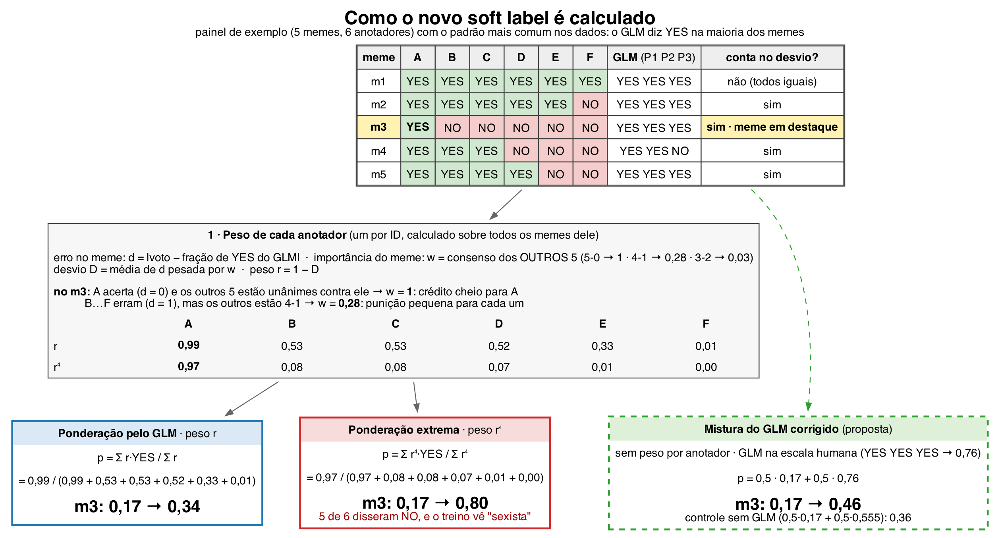
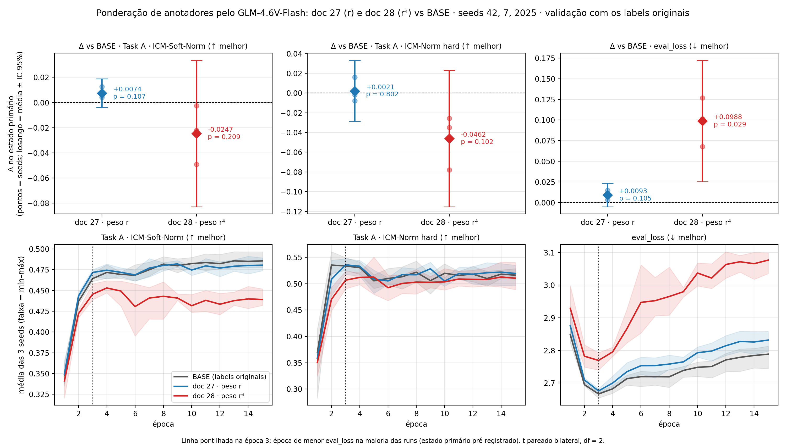
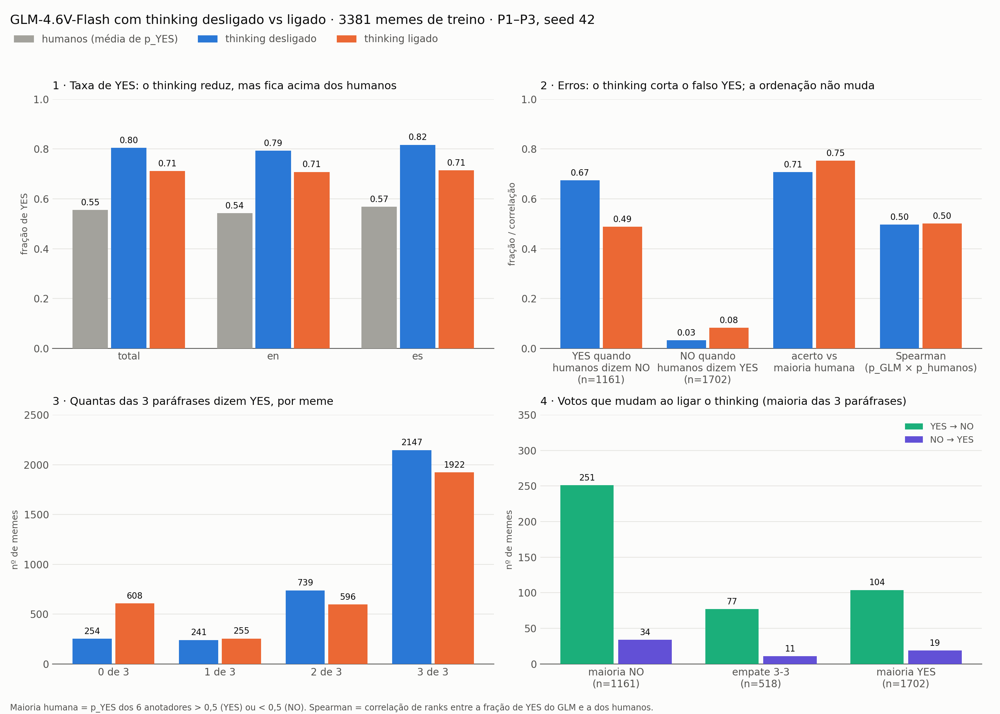
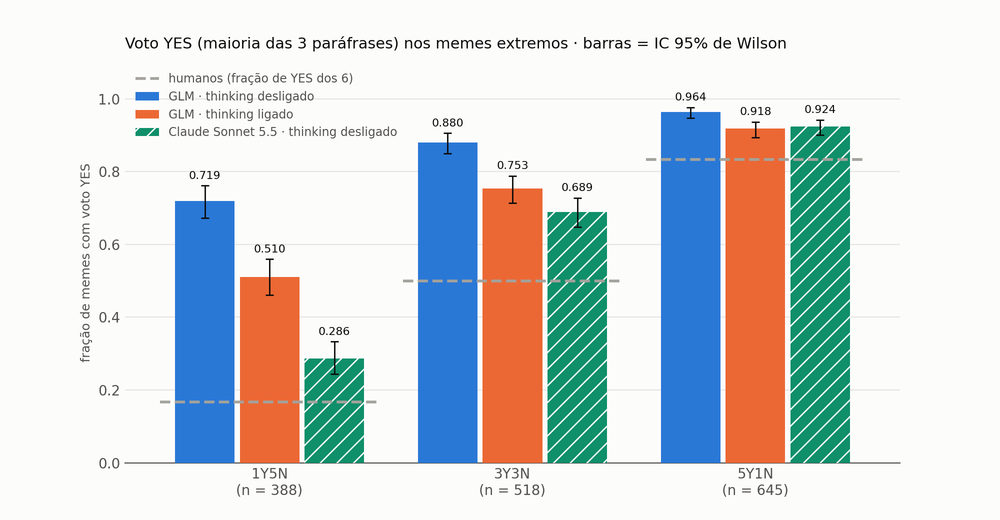
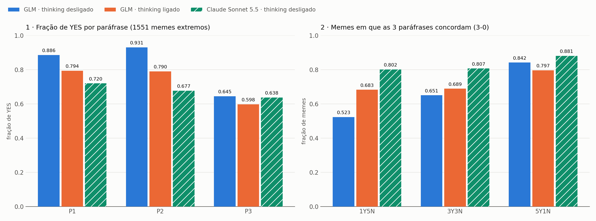
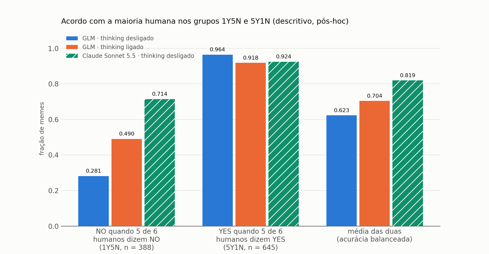
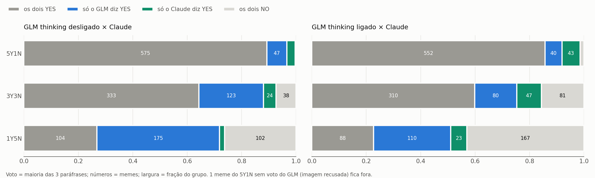

# Relatório: GLM-4.6V-Flash e Claude Sonnet 5.5 como anotadores de sexismo em memes — resultados

*Resultados dos docs 25 a 31 (`EXIST_MEMES/glm_annotator/`), consolidados em 2026-10-22. O **como** de cada passo (prompts, parâmetros, fórmulas, testes) está em `METODOLOGIA_GLM_CLAUDE.md`, e as seções citadas como "Metodologia §x" referem-se a ele. Convenção: `[MEDIDO]` (com artefato), `[HIPÓTESE]`, `[LIMITAÇÃO]`. Os decimais seguem a vírgula portuguesa no texto; as figuras usam ponto.*

---

## 0. Resumo

1. **O GLM como referência para ponderar anotadores (doc 25) falhou no portão pré-registrado.** No treino completo, as três paráfrases concordaram em 72,7 % dos memes em inglês e em **69,1 % em espanhol**, abaixo do mínimo de 70 % (faltaram 15 memes). O julgamento é estável entre seeds (1 flip em 240 memes), mas depende da redação: uma única paráfrase (P3) responde por 75 % das discordâncias.
2. **As continuações exploratórias não melhoraram o modelo de memes.** Ponderar anotadores pela distância ao GLM (doc 27) deu Δ ICM-Soft-Norm = +0,0074 (p = 0,107; `eval_loss` pior nas 3 seeds). Com a dose maior r⁴ (doc 28), a `eval_loss` piorou significativamente (+0,0988, p = 0,029). O diagnóstico: o peso mediu o **limiar de YES** de cada anotador (ρ = −0,676), porque o GLM diz YES demais.
3. **O viés de YES do GLM persiste com o raciocínio ligado** (doc 30): 0,711 de YES no treino, contra 0,804 com ele desligado e 0,555 dos humanos.
4. **Nos 1 551 memes extremos, o Claude Sonnet 5.5 tem muito menos viés que o GLM.** No grupo em que 5 de 6 humanos dizem NO (1Y5N), o voto YES foi de **0,286** no Claude, contra 0,719 no GLM com thinking desligado e 0,510 com ele ligado. Pela regra pré-registrada, o resultado é **PARCIAL** (entre 0,25 e 0,40): o viés é em grande parte do GLM, mas o Claude também fica acima dos humanos (0,286 contra 0,167 no 1Y5N; 0,689 contra 0,5 no empate).
5. **O Claude é mais consistente entre paráfrases** (as três concordam em 83,6 % dos extremos, contra 69,8 % no GLM off), e a P3 deixa de ser a fonte dominante de discordância. O custo foi de ≈ US$ 5,31 pelos 4 653 pedidos.

---

## Parte I — GLM-4.6V-Flash

### 1. F0 — Infraestrutura e visão (doc 25)

`[MEDIDO — glm_reference/probe_vision.csv; config.json → runtime.gates]`

- **Sonda visual (G0.3):** com a imagem branca, 20/20 descrições do tipo *"a blank white square with no visible content"*, sem nenhuma cena alucinada. Com a imagem real, 20/20 descrições correspondentes ao meme (revisão manual do autor em 2026-10-07). **Aprovado.**
- **Thinking desligado (G0.2):** 3/3 respostas sem raciocínio, com 4 tokens (`<|begin_of_box|>YES<|end_of_box|>`).
- **Vazão (G0.4):** 73,6 chamadas/min com concorrência 4; latência mediana de 2,5 s nas descrições.

### 2. F1 — Piloto e escolha do modo de raciocínio

`[MEDIDO — reports/pilot_summary.md; 1 440 chamadas, 240 memes, seed 42]`

| braço | escopo | parse | `yes_rate` | concordância entre paráfrases | tokens gerados (mediana) | latência mediana |
|---|---|---|---|---|---|---|
| `think_on` | total | 1,000 | 0,700 | 0,758 | 171 | 15,7 s |
| `think_on` | en | 1,000 | 0,694 | 0,767 | 154,5 | 15,3 s |
| `think_on` | es | 1,000 | 0,706 | 0,750 | 176 | 17,2 s |
| `think_off` | total | 1,000 | 0,793 | 0,750 | 4 | 0,71 s |
| `think_off` | en | 1,000 | 0,797 | 0,775 | 4 | 0,65 s |
| `think_off` | es | 1,000 | 0,789 | **0,725** | 4 | 0,82 s |

Zero respostas truncadas, recusas ou erros de API; zero raciocínios com caracteres CJK. Os dois braços foram elegíveis. O ganho de concordância do `think_on` (0,758 − 0,750 = 0,008) ficou abaixo do limiar de 0,05, e por isso foi **escolhido o `think_off`**, ~22× mais rápido.

**Achado — raciocinar não aumentou a consistência.** Com o thinking ligado, o modelo produziu cadeias de raciocínio reais (mediana de 753 caracteres, nenhuma vazia) e concordou entre paráfrases praticamente na mesma taxa.

**Sensibilidade à redação, já no piloto** `[MEDIDO — raw/<braço>.jsonl, análise de 2026-10-07]`:

| braço | YES em P1 | YES em P2 | YES em P3 | paráfrase dissidente nos memes não confiantes |
|---|---|---|---|---|
| `think_off` | 0,838 | 0,887 | **0,654** | P1 2 · P2 14 · **P3 44** (de 60) |
| `think_on` | 0,771 | 0,754 | **0,575** | P1 13 · P2 9 · **P3 36** (de 58) |

### 3. F1b — Estabilidade entre seeds

`[MEDIDO — reports/pilot_summary.md; raw/think_off.jsonl; 480 chamadas novas, P1, seeds 42/43/44]`

| escopo | `flip_rate` |
|---|---|
| total | **0,0042** (1/240) |
| en | 0,0000 (0/120) |
| es | 0,0083 (1/120) |

Um único meme mudou de rótulo: o `110614` (NO · YES · NO nas seeds 42 · 43 · 44). Em 237/240 memes, o texto da resposta foi idêntico caractere a caractere nas três seeds. **G1 aprovado** (limite 0,10).

**Achado — a redação pesa ~60× mais que a amostragem.** Nos mesmos 240 memes, trocar a seed muda o rótulo em 0,4 % deles (1/240), enquanto trocar a paráfrase (mesma seed) produz respostas divergentes em 25 % (60/240). Uma referência de prompt único teria parecido estável, escondendo uma dependência de redação de 25 %. `[LIMITAÇÃO]` Com temp 0,1 e top_k 2, o flip baixo era esperado por construção.

### 4. F2 — Referência completa: **portão G2 falhou**

`[MEDIDO — reports/reference_summary.md; glm_votes.csv; 10 158 chamadas]`

| escopo | memes | parse | confiantes (3-0) | exigido |
|---|---|---|---|---|
| total | 3 386 | 0,9985 | 0,7091 | — |
| en | 1 715 | 0,9983 | **0,7265** (1 246) | ≥ 0,70 ✓ |
| es | 1 671 | 0,9988 | **0,6912** (1 155) | ≥ 0,70 ✗ (mínimo 1 170: faltaram 15 memes) |

- **Não é falha de infraestrutura:** as 15 chamadas não parseadas são HTTP 400 em 5 memes (3 en, 2 es), por imagens de 6 090 a 6 144 tokens, acima do cache de encoder (6 084). Mesmo contando os 2 memes em espanhol como confiantes, seriam 1 157 < 1 170.
- **O piloto superestimou a confiança:** 0,750 → 0,709 no total; 0,725 → 0,691 em espanhol.
- **A dependência de redação se confirmou:** YES por paráfrase de P1 0,861 · P2 0,913 · **P3 0,636**. Nos 980 memes não confiantes, a dissidente foi P1 em 39, P2 em 207 e **P3 em 734 (75 %)**.
- **Distribuição da referência** (`SPEC_27.md` §1): 3-0 YES 0,634 · 3-0 NO 0,075 · 2-1 YES 0,218 · 2-1 NO 0,071 · sem resposta 0,001.

**Leitura pré-registrada:** a referência não sustenta a ponderação dos anotadores, e o doc 25 terminou aqui, sem calcular pesos e sem GPU.

`[HIPÓTESE]` A P3 (texto antes da instrução; *"contains sexist expressions or behaviors"*) induz uma leitura mais restritiva. O fatorial que separaria ordem e enquadramento (doc 26) foi pré-registrado e aguarda o servidor; ainda não há resultado para citar.

### 5. Doc 27 — Ponderação pela distância ao soft label do GLM

*Figura R1 — Os três métodos de label aplicados a um painel de exemplo: ponderação por r (doc 27), por r⁴ (doc 28) e a mistura corrigida proposta (doc 29, não executada). Fonte: `reports/soft_label_metodos.png`.*

**Pesos (F3′)** `[MEDIDO — config.json; annotator_weights.csv]`: 887 anotadores, `r_glm` de 0,021 a 1,0 (mediana 0,562); 3 381 memes com referência; validação idêntica ao `raw` (hash).

**Checagens (F4)** `[MEDIDO — reports/checks_summary.md]`:

| checagem | resultado |
|---|---|
| (a) ρ(r_glm, r_peer) | **0,5008** (n = 887): o GLM não reproduz o consenso dos pares |
| (b) ρ(D_glm, taxa de YES do anotador) | **−0,6760** |
| (b) ρ(D_glm, \|limiar do anotador − limiar do GLM\|) | **0,7104** |
| (d) `share_moved` (\|Δp\| ≥ 1/12) | **0,3461** (en 0,3469 · es 0,3453) |
| (d) mudanças de rótulo duro | 554: empate→YES 409 · empate→NO 109 · NO→YES 36 · **YES→NO 0** |
| (e) GLM 3-0 contrariando meme unânime | 56/608 = 0,0921 |
| (f) acordo do voto do GLM com o rótulo duro humano (empates fora) | 0,7073 (6-0 0,8278 · 5-1 0,7083 · 4-2 0,6148) |
| (g) memes incluídos por anotador | mediana 17 (mín. 7 · máx. 45); largura mediana do IC 95 % de D_glm: **0,456** |
| (h) massa Σw vinda de memes 2-1 | 0,2879 |
| (i) divisões humanas 4-2/3-3 nos memes GLM 2-1 vs 3-0 | 0,522 vs 0,436; diferença **+0,086** (IC 95 % [+0,049; +0,123]) |

**r por gênero × idade (c)**: mulheres e faixas etárias mais altas recebem peso maior (F 46+: 0,596 [0,559; 0,630]; M 18–22: 0,461 [0,425; 0,496]). Pelo contraste com `r_peer`, que é quase plano, o padrão vem do GLM. `[HIPÓTESE]` Esses grupos dizem mais YES, e o peso favorece quem diz YES, como mostra (b).

**Portão G4 aprovado** (0,3461 ≥ 0,05 e 0,5008 < 0,8). **Retreino (F5)** `[MEDIDO — reports/f5_report.md; estado primário E = argmin eval_loss = época 3 nas 6 runs]`:

| métrica | Δ 42 | Δ 7 | Δ 2025 | média | t | p |
|---|---|---|---|---|---|---|
| A ICM-Soft-Norm (primária) | +0,0040 | +0,0057 | +0,0126 | **+0,0074** | 2,81 | 0,107 |
| A ICM-Norm *hard* | +0,0160 | −0,0079 | −0,0019 | +0,0021 | 0,29 | 0,802 |
| `eval_loss` (↓ melhor) | +0,0148 | +0,0096 | +0,0035 | **+0,0093** (pior) | 2,83 | 0,105 |

Tasks B e C sem sinal (|Δ| ≤ 0,005, p > 0,4). No estado final (secundário): ICM-Soft-Norm A −0,0052 (p = 0,237) e `eval_loss` +0,0432 (p = 0,038). **Critério não satisfeito: efeito não detectado com 3 seeds.** O controle `glmshift` não rodou, pela regra fixada.

### 6. Doc 28 — Peso r⁴

**Efeito nos labels de treino:** deslocamento médio para o YES de +0,120 (doc 27: +0,054); 62,5 % dos memes mudam meio voto ou mais; 849 rótulos duros mudam (19 de YES para NO).

**Triagem (seed 42)** `[MEDIDO — reports/doc28_screen.md]`: hard −0,0778, soft −0,0492, `eval_loss` +0,1269, todos além dos limites, e por isso seguiu para as outras seeds.

**Confirmação** `[MEDIDO — reports/f5_report_glmw4.md]`:

| métrica | Δ 42 | Δ 7 | Δ 2025 | média | t | p |
|---|---|---|---|---|---|---|
| A ICM-Soft-Norm (primária) | −0,0492 | −0,0222 | −0,0026 | **−0,0247** | −1,83 | 0,209 |
| A ICM-Norm *hard* | −0,0778 | −0,0350 | −0,0257 | −0,0462 | −2,88 | 0,102 |
| `eval_loss` (↓ melhor) | +0,1269 | +0,1014 | +0,0680 | **+0,0988** (pior) | 5,79 | **0,029** |

No estado final (secundário): ICM-Soft-Norm A −0,0465 (3/3 seeds, p = 0,002) e `eval_loss` +0,2884 (p < 0,001). **Efeito negativo registrado.** `[LIMITAÇÃO]` Na seed 42, a época escolhida (2) quase empatou com a 4 (diferença de 0,0007 na loss): não citar o Δ da seed 42 isolado.

*Figura R2 — Δ contra o BASE no estado primário (em cima) e curvas por época (embaixo), docs 27 e 28. Fonte: `reports/doc27_28_resultados.png`.*

**Leitura dos docs 27–28.** A ponderação pelo GLM desloca a calibração para o YES, em vez de selecionar anotadores mais fiáveis. Quanto mais forte o deslocamento, mais os labels de treino se afastam dos labels humanos da validação, e pior o modelo fica. `[HIPÓTESE]` Que o efeito seja **só** o deslocamento é uma inferência: o controle que a testaria (`glmshift`) não rodou.

### 7. Doc 29 — Mistura corrigida por quantis (rascunho; só o teste offline)

`[MEDIDO — reports/splithalf_29.md; 3 381 memes, 20 divisões por meme; nenhum modelo treinado]`

| previsor da outra metade (3 anotadores) | MSE ↓ | entropia cruzada ↓ |
|---|---|---|
| só a metade (humano puro) | 0,1193 | 1,1079 |
| 0,5·metade + 0,5·0,555 (`smooth50`) | 0,0916 | **0,6112** |
| 0,5·metade + 0,5·GLM sem correção | 0,1062 | 0,8563 |
| 0,5·metade + 0,5·q(GLM) (`glmq50`) | **0,0885** | 0,6242 |
| só q(GLM) | 0,1154 | 0,7240 |

`glmq50 − smooth50`: MSE −0,0031 (IC 95 % [−0,0043; −0,0019]); entropia cruzada +0,0130 (IC 95 % [+0,0077; +0,0182]). O GLM corrigido tem alguma informação sobre a opinião humana, mas o ganho além da suavização cega é pequeno, e o sinal se inverte conforme a métrica. **Proposta não aprovada; nenhum label foi gerado.**

### 8. Doc 30 — Thinking ligado no treino inteiro

`[MEDIDO — reports/think_on_vs_off.md; config.json → runtime.doc30; 10 158 chamadas think_on, parse 0,9985]`

| escopo | humanos (média p_h) | YES `think_off` | YES `think_on` | Δ (on − off) | confiantes `think_on` | voto igual on/off |
|---|---|---|---|---|---|---|
| total | 0,555 | 0,804 | 0,711 | −0,093 | 0,747 | 0,853 |
| en | 0,542 | 0,793 | 0,708 | −0,085 | 0,764 | 0,875 |
| es | 0,568 | 0,817 | 0,715 | −0,102 | 0,730 | 0,831 |

p_GLM (0 / ⅓ / ⅔ / 1): `think_on` 608 / 255 / 596 / 1 922 · `think_off` 254 / 241 / 739 / 2 147.

**Decisão pela regra pré-registrada: o viés de YES PERSISTE** (0,711 ≥ 0,655).

Descritivo extra (3 381 memes com referência; acerto sem os empates 3-3):

| braço | acerto vs maioria humana | Spearman(p_GLM, p_h) | YES quando os humanos dizem NO (n = 1 161) | NO quando os humanos dizem YES (n = 1 702) |
|---|---|---|---|---|
| `think_off` | 0,707 | 0,496 | 0,674 | 0,032 |
| `think_on` | 0,753 | 0,501 | 0,488 | 0,082 |

O thinking desloca o limiar do GLM (o falso YES cai de 67 % para 49 %), mas quase não muda a **ordenação** dos memes (Spearman 0,496 → 0,501). Custo: 12,7 h de servidor para 9 438 chamadas, contra 0,78 h com o thinking desligado.

*Figura R3 — Doc 30. Fonte: `reports/doc30_think_on_vs_off.png`.*

---

## Parte II — Memes extremos: GLM × Claude

**Escopo de comparação.** O Claude rodou **só** nos 1 551 memes extremos do treino (1Y5N n = 388, 3Y3N n = 518, 5Y1N n = 645; Metodologia §6). Todas as tabelas desta parte comparam os três anotadores nos **mesmos** memes. Os números do GLM no treino completo (Parte I, §8) não são diretamente comparáveis a estes e aparecem só como contexto, na §15.

### 9. Regra pré-registrada (SPEC_31 §3) — **PARCIAL**

`[MEDIDO — claude_reference/raw/claude-sonnet-5-5_think_off.jsonl; reports/claude_claude-sonnet-5-5_think_off_extremes.md]`

Voto YES do Claude no 1Y5N = **111/388 = 0,286** (IC 95 % de Wilson: 0,243–0,333). O valor fica entre 0,25 e 0,40, então a decisão é **PARCIAL**. O intervalo inteiro está abaixo do limite de 0,40 e cruza o de 0,25.

Histórico da métrica, registrado com as datas em `SPEC_31.md` §5:

- piloto (20 memes por grupo): 0,200, que não aplica a regra porque o IC 95 % ia de ~0,06 a ~0,44;
- rodada completa antes do reenvio PNG: 108/388 = 0,278, com 8 memes do 1Y5N sem voto;
- final: 111/388 = 0,286.

### 10. Voto YES por grupo e idioma

`[MEDIDO — extremes.csv + JSONL do Claude; voto = maioria das 3 paráfrases; k/n e IC 95 % de Wilson]`

| grupo | idioma | n | humanos | GLM off | GLM on | **Claude** |
|---|---|---|---|---|---|---|
| 1Y5N | total | 388 | 0,167 | 0,719 (279) [0,672; 0,761] | 0,510 (198) [0,461; 0,560] | **0,286 (111) [0,243; 0,333]** |
| 1Y5N | en | 210 | 0,167 | 0,643 (135) [0,576; 0,705] | 0,471 (99) [0,405; 0,539] | 0,271 (57) [0,216; 0,335] |
| 1Y5N | es | 178 | 0,167 | 0,809 (144) [0,745; 0,860] | 0,556 (99) [0,483; 0,627] | 0,303 (54) [0,241; 0,374] |
| 3Y3N | total | 518 | 0,500 | 0,880 (456) [0,850; 0,906] | 0,753 (390) [0,714; 0,788] | **0,689 (357) [0,648; 0,728]** |
| 3Y3N | en | 260 | 0,500 | 0,865 (225) | 0,765 (199) | 0,704 (183) |
| 3Y3N | es | 258 | 0,500 | 0,895 (231) | 0,740 (191) | 0,674 (174) |
| 5Y1N | total | 645 | 0,833 | 0,964 (622) [0,947; 0,976] | 0,918 (592) [0,894; 0,937] | **0,924 (596) [0,901; 0,942]** |
| 5Y1N | en | 310 | 0,833 | 0,961 (298) | 0,916 (284) | 0,919 (285) |
| 5Y1N | es | 335 | 0,833 | 0,967 (324) | 0,919 (308) | 0,928 (311) |
| todos | total | 1 551 | 0,555 | 0,875 (1 357) | 0,761 (1 180) | 0,686 (1 064) |

No 5Y1N, 1 meme não tem voto do GLM (imagem recusada pelo servidor) e conta no denominador. O Claude tem voto em todos os 1 551.

*Figura R4 — Voto YES por grupo, com IC 95 % de Wilson; tracejado = fração de YES humana do grupo. Fonte: `reports/doc31_voto_yes.png` (`plot_doc31.py`).*

**Leitura.** No 1Y5N, o Claude reduz o voto YES do GLM off em 0,433 (0,719 → 0,286) e o do GLM on em 0,224. Os intervalos não se sobrepõem. No 5Y1N, os três ficam acima de 0,833 e o Claude fica no nível do GLM on. No 3Y3N, os três ficam acima de 0,5, o que é um viés para o YES nos memes ambíguos, menor no Claude. A diferença entre idiomas é pequena no Claude (1Y5N: en 0,271 · es 0,303) e grande no GLM off (en 0,643 · es 0,809).

### 11. Paráfrases: taxa de YES por prompt e concordância (descritivo, pós-hoc)

`[MEDIDO — mesmos arquivos; taxas sobre respostas parseadas]`

**Fração de YES por paráfrase:**

| escopo | anotador | P1 | P2 | P3 | todas |
|---|---|---|---|---|---|
| 1 551 extremos | GLM off | 0,886 | 0,932 | **0,645** | 0,821 |
| 1 551 extremos | GLM on | 0,794 | 0,791 | **0,598** | 0,728 |
| 1 551 extremos | Claude | 0,720 | 0,677 | 0,638 | 0,678 |
| 1Y5N | GLM off | 0,742 | 0,825 | 0,376 | 0,648 |
| 1Y5N | GLM on | 0,572 | 0,557 | 0,348 | 0,492 |
| 1Y5N | Claude | 0,340 | 0,278 | 0,258 | 0,292 |
| 3Y3N | GLM off | 0,892 | 0,944 | 0,614 | 0,817 |
| 3Y3N | GLM on | 0,786 | 0,793 | 0,566 | 0,715 |
| 3Y3N | Claude | 0,726 | 0,693 | 0,614 | 0,678 |
| 5Y1N | GLM off | 0,969 | 0,986 | 0,832 | 0,929 |
| 5Y1N | GLM on | 0,935 | 0,930 | 0,775 | 0,880 |
| 5Y1N | Claude | 0,944 | 0,904 | 0,885 | 0,911 |

**Concordância entre paráfrases (fração de memes 3-0) e paráfrase dissidente:**

| anotador | 1Y5N | 3Y3N | 5Y1N | todos | memes 2-1: dissidente P1 · P2 · P3 |
|---|---|---|---|---|---|
| GLM off | 0,523 | 0,651 | 0,842 | **0,698** | 21 · 89 · **357** (76 % P3) |
| GLM on | 0,683 | 0,689 | 0,797 | 0,732 | 79 · 64 · **271** (65 % P3) |
| Claude | **0,802** | **0,807** | **0,881** | **0,836** | 75 · 80 · 99 (39 % P3) |

*Figura R5 — Fração de YES por paráfrase (esquerda) e concordância 3-0 por grupo (direita). Fonte: `reports/doc31_parafrases.png`.*

**Leitura.**

- **O Claude é mais consistente sob reformulação do prompt**, em todos os grupos, e isso apesar de rodar sem temperatura fixa nem seed.
- No GLM, a P3 é um caso à parte: responde YES ~25 pontos abaixo de P1/P2 e é a dissidente em três quartos dos casos. No Claude, as três paráfrases ficam a menos de 0,09 umas das outras, e as discordâncias se repartem entre elas.
- Curiosamente, a taxa de YES da P3 é quase a mesma nos três anotadores (0,598–0,645). O que separa os modelos é sobretudo P1 e P2.
- `[HIPÓTESE]` A redação da P3 (texto antes da instrução, pergunta sobre *"contains sexist expressions or behaviors"*) puxa o GLM para um limiar mais próximo do humano, enquanto a P1/P2, com a regra explícita "*A meme that condemns or reports sexism is still YES*", empurra o GLM para o YES. O Claude parece aplicar o mesmo critério nas três redações. Não testado: é o que o doc 26 mediria.

### 12. Acordo com a maioria humana (descritivo, pós-hoc)

`[MEDIDO — 1Y5N: maioria humana NO; 5Y1N: maioria humana YES; o 3Y3N não tem maioria e fica fora; meme sem voto = erro]`

| anotador | idioma | NO no 1Y5N (n = 388) | YES no 5Y1N (n = 645) | acurácia nos dois grupos (n = 1 033) | média das duas (acurácia balanceada) |
|---|---|---|---|---|---|
| GLM off | total | 0,281 | 0,964 | 0,708 | 0,623 |
| GLM off | en | 0,357 | 0,961 | 0,717 | 0,659 |
| GLM off | es | 0,191 | 0,967 | 0,698 | 0,579 |
| GLM on | total | 0,490 | 0,918 | 0,757 | 0,704 |
| GLM on | en | 0,529 | 0,916 | 0,760 | 0,722 |
| GLM on | es | 0,444 | 0,919 | 0,754 | 0,682 |
| **Claude** | total | **0,714** | 0,924 | **0,845** | **0,819** |
| Claude | en | 0,729 | 0,919 | 0,842 | 0,824 |
| Claude | es | 0,697 | 0,928 | 0,848 | 0,812 |

*Figura R6 — Fonte: `reports/doc31_acerto.png`.*

**Leitura.** Os três anotadores reconhecem bem um meme que 5 de 6 humanos chamam de sexista (≥ 0,918). A diferença está toda no lado do NO: o GLM off só concorda com a maioria NO em 28 % dos memes 1Y5N (19 % em espanhol), e o Claude em 71 %. `[LIMITAÇÃO]` Estes números valem só para os extremos. Não são comparáveis ao "acerto vs maioria humana" do doc 30 (0,707/0,753), que inclui as divisões 6-0, 4-2 e 2-4.

### 13. Concordância entre os modelos (descritivo, pós-hoc)

`[MEDIDO — memes com voto dos dois anotadores; κ de Cohen; McNemar exato bilateral; b = só o 1º diz YES, c = só o 2º diz YES]`

| grupo | par | n | acordo | κ | os dois YES | b | c | os dois NO | McNemar p |
|---|---|---|---|---|---|---|---|---|---|
| 1Y5N | GLM off × Claude | 388 | 0,531 | 0,210 | 104 | **175** | 7 | 102 | 4,0·10⁻⁴³ |
| 1Y5N | GLM on × Claude | 388 | 0,657 | 0,320 | 88 | 110 | 23 | 167 | 8,4·10⁻¹⁵ |
| 1Y5N | GLM off × GLM on | 388 | 0,724 | 0,443 | 185 | 94 | 13 | 96 | 2,6·10⁻¹⁶ |
| 3Y3N | GLM off × Claude | 518 | 0,716 | 0,203 | 333 | 123 | 24 | 38 | 3,2·10⁻¹⁷ |
| 3Y3N | GLM on × Claude | 518 | 0,755 | 0,394 | 310 | 80 | 47 | 81 | 4,3·10⁻³ |
| 3Y3N | GLM off × GLM on | 518 | 0,830 | 0,448 | 379 | 77 | 11 | 51 | 2,4·10⁻¹³ |
| 5Y1N | GLM off × Claude | 644 | 0,896 | 0,010 | 575 | 47 | 20 | 2 | 1,3·10⁻³ |
| 5Y1N | GLM on × Claude | 644 | 0,871 | 0,108 | 552 | 40 | 43 | 9 | 0,83 |
| 5Y1N | GLM off × GLM on | 644 | 0,922 | 0,290 | 582 | 40 | 10 | 12 | 2,4·10⁻⁵ |
| todos | GLM off × Claude | 1 550 | 0,745 | 0,291 | 1 012 | 345 | 51 | 142 | 9,8·10⁻⁵⁵ |
| todos | GLM on × Claude | 1 550 | 0,779 | 0,451 | 950 | 230 | 113 | 257 | 2,6·10⁻¹⁰ |
| todos | GLM off × GLM on | 1 550 | 0,842 | 0,480 | 1 146 | 211 | 34 | 159 | 2,2·10⁻³² |

*Figura R7 — Votos cruzados, GLM × Claude, por grupo. Fonte: `reports/doc31_cruzamento.png`.*

**Leitura.**

- No 1Y5N, quando os dois discordam, é quase sempre o GLM dizendo YES sozinho: 175 contra 7 casos frente ao GLM off.
- O Claude raramente diz YES onde o GLM off diz NO (51 de 1 550). Ele se comporta como um subconjunto mais conservador do GLM, e não como um anotador com outro critério.
- O κ baixo no 5Y1N (0,010) é efeito da prevalência (quase tudo é YES), e não de discordância real: o acordo bruto é 0,896.
- `[LIMITAÇÃO]` São doze testes de McNemar sem correção para comparações múltiplas. São descritivos, e nenhum deles era regra de decisão. Mesmo com Bonferroni (×12), só o 5Y1N GLM on × Claude (p = 0,83) e o 3Y3N GLM on × Claude (p = 0,0043 → 0,052) deixariam de ser significativos.

### 14. Qualidade operacional e custo

| item | GLM off | GLM on | Claude (`think_off`) |
|---|---|---|---|
| parse nos extremos | 0,999 (3 chamadas sem resposta: 1 meme do 5Y1N) | 0,999 | **1,000** (4 652 `plain` + 1 `single_token`) |
| recusas | 0 | 0 | **0** |
| erros de imagem | 5 memes no treino (cache de encoder) | idem | 21 memes "Could not process image" → resolvidos por 1 reenvio em PNG (desvio datado) |
| tokens gerados por resposta | mediana 4 | mediana 169 (máx. 2 084) | média 4,0 (máx. 70) |
| tempo | 0,66 s por chamada; 0,78 h por 9 438 chamadas | 16,0 s por chamada; 12,7 h por 9 438 | lotes de 3 min a 4,1 h; ~4 h no total (1 551 memes) |
| custo | servidor do grupo | servidor do grupo | **≈ US$ 5,31** (4 653 pedidos, preço *batch*) |

O único `single_token` é o meme 111129 na P2: o Claude respondeu "YES" e acrescentou uma explicação de duas frases (o meme critica chamar mulheres adultas de "niñas"). O parser extraiu YES corretamente.

**Estimativa para o treino completo com o Claude** (não executado): faltariam 1 835 memes = 5 505 pedidos ≈ US$ 6,3 a mais (≈ US$ 11,6 no total), em 2–4 h, reaproveitando os 4 653 pedidos já feitos.

### 15. Contexto: o GLM no treino completo (não comparável diretamente)

| anotador | memes | YES (paráfrases) | humanos | fonte |
|---|---|---|---|---|
| GLM off | 3 381 | 0,804 | 0,555 | doc 30 |
| GLM on | 3 381 | 0,711 | 0,555 | doc 30 |
| Claude | — | não rodou no treino completo | — | — |

Nos extremos, o GLM off dá 0,821 de YES nas paráfrases, o GLM on 0,728 e o Claude 0,678, contra 0,555 dos humanos (média dos três grupos, ponderada pelo tamanho). Quanto o Claude daria no treino completo só a rodada completa (opção A, §18) diria.

---

## Parte III — Interpretação, limitações e pendências

### 16. Interpretação

1. **O viés de YES é, em grande parte, do GLM-4.6V-Flash** `[MEDIDO]`. Com os mesmos prompts, imagens e textos, o Claude reduz o falso YES no 1Y5N de 72 % para 29 %, e as discordâncias entre os dois são quase todas "o GLM diz YES sozinho". O raciocínio ligado no GLM corrige só metade dessa distância (0,510).
2. **Mas não é só do GLM** `[MEDIDO]`. O Claude também fica acima dos humanos no 1Y5N (0,286 contra 0,167) e no 3Y3N (0,689 contra 0,5). `[HIPÓTESE]` Uma causa comum aos dois modelos é a própria definição do EXIST embutida nos prompts: "descrever uma situação sexista" ou "criticar um comportamento sexista" conta como YES, e os prompts reforçam isso ("*A meme that condemns or reports sexism is still YES*"). Um modelo que aplica essa regra ao pé da letra diz YES em memes que muitos anotadores humanos, que viram outra instrução, chamaram de NO. A revisão manual no visualizador (os 104 memes do 1Y5N em que os dois modelos dizem YES) é o caminho para checar isso qualitativamente.
3. **A dependência de redação é sobretudo um traço do GLM** `[MEDIDO]`. A concordância entre paráfrases nos extremos sobe de 0,698 (GLM off) para 0,836 (Claude), e a P3 deixa de concentrar as discordâncias. A conclusão do doc 25 ("a verdade do modelo é, em parte, um artefato do prompt") vale para o GLM, e é mais fraca para o Claude.
4. **Para a tese:** os resultados negativos dos docs 25, 27 e 28 se referem a **esta** referência (GLM-4.6V-Flash FP8, thinking desligado). Eles não autorizam concluir que "LLMs em geral" falham como referência. O doc 31 mostra que outro modelo tem um perfil de viés bem diferente. Se a ponderação ou a mistura com o Claude produziria outro resultado no modelo de memes é uma pergunta nova, que exigiria a referência no treino completo e um pré-registro próprio.

### 17. Limitações

- `[LIMITAÇÃO]` **Sem seeds no Claude.** A API não aceita `seed` nem temperatura fixa nos modelos 5.5. A estabilidade entre execuções não foi medida. As respostas de 4 tokens sugerem baixa variabilidade, mas isso é `[HIPÓTESE]`.
- `[LIMITAÇÃO]` **Escopo do Claude:** só os 1 551 extremos e só o braço `think_off`. Não há números do Claude no treino completo, nos grupos 0, 2, 4 e 6 YES, nem com o raciocínio ligado.
- `[LIMITAÇÃO]` **Um modelo de cada família:** GLM-4.6V-Flash FP8 e Claude Sonnet 5.5. Nenhum modelo GPT, Gemini ou DeepSeek foi testado.
- `[LIMITAÇÃO]` **Imagens:** 1 meme reduzido (limite de 5 MB) e 21 reconvertidos para PNG no Claude; 5 memes de treino sem resposta do GLM (1 deles no 5Y1N).
- `[LIMITAÇÃO]` **Prompts:** as diretrizes reais dos anotadores de memes do EXIST não são públicas. Os prompts são uma aproximação, e o viés medido é relativo a eles.
- `[LIMITAÇÃO]` **Métricas pós-hoc:** só o voto YES no 1Y5N (e o 3Y3N como secundária) foi pré-registrado no doc 31. O resto é descritivo.
- `[LIMITAÇÃO]` **Retreinos (docs 27–28):** 3 seeds (df = 2). "Efeito não detectado" não é "efeito zero".

### 18. Pendências e próximos passos possíveis (nenhum autorizado ainda)

| opção | o que mede | custo estimado | pré-requisito |
|---|---|---|---|
| A. Claude `think_off` no treino completo | taxa de YES, Spearman e acerto comparáveis ao doc 30 | ≈ US$ 6,3 · 2–4 h | seção datada no SPEC_31 + `--scope train` no script |
| B. Repetir o piloto do Claude (180 pedidos) | estabilidade entre execuções (substitui o teste de seeds) | ≈ US$ 0,2 · minutos | seção datada |
| C. Claude `think_on` nos extremos | o raciocínio muda o viés no Claude? | maior (raciocínio cobrado como saída) | medir o custo no piloto antes |
| D. Revisão manual no visualizador dos 104 memes 1Y5N com os dois YES | a hipótese da definição EXIST (§16, item 2) | tempo do autor | — |
| E. Doc 29 | a mistura corrigida ajuda o modelo de memes? | 6 runs de GPU | aprovação do orientador |

*Todos os números deste relatório vêm dos artefatos citados. O doc 26 não tem resultado, e o doc 29 é rascunho: nenhum dos dois deve ser apresentado como experimento concluído.*
