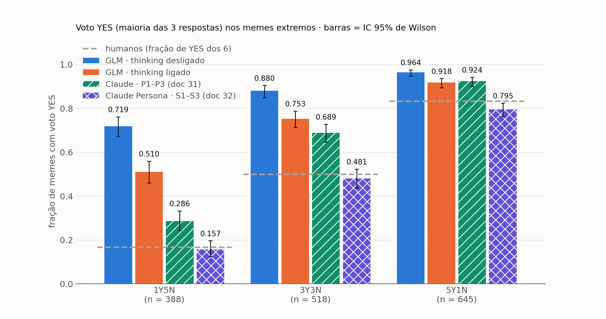
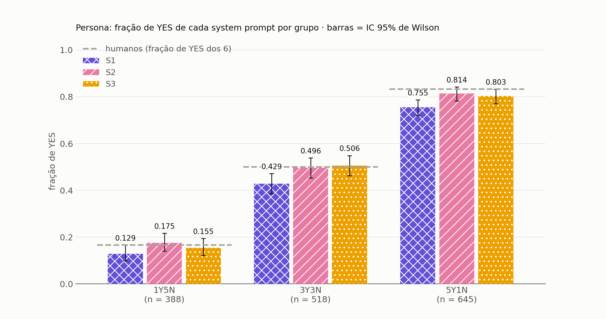
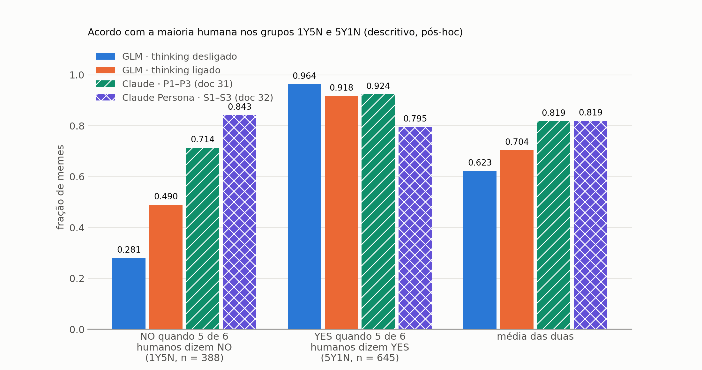
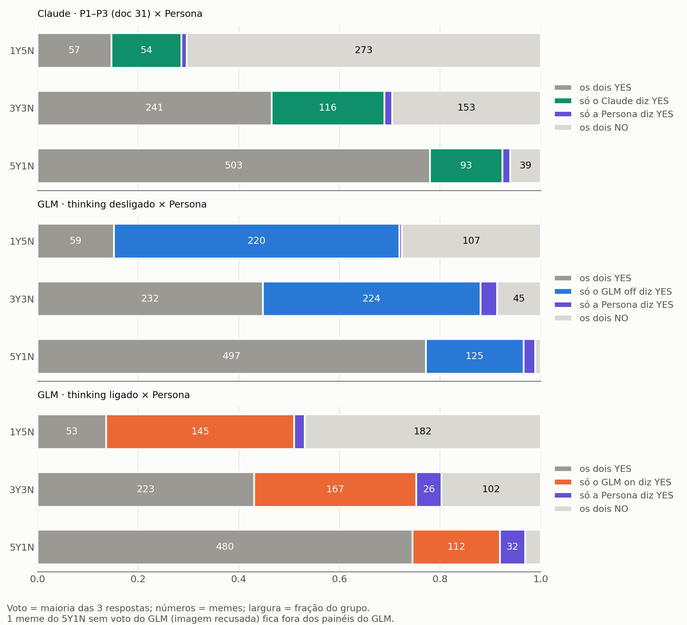
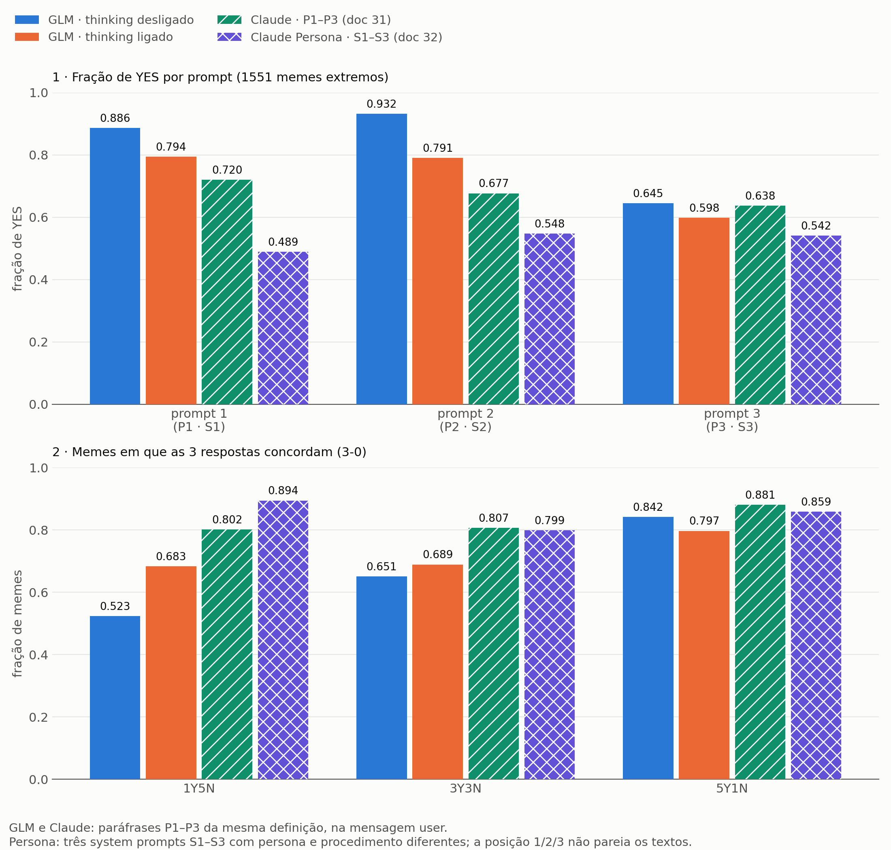
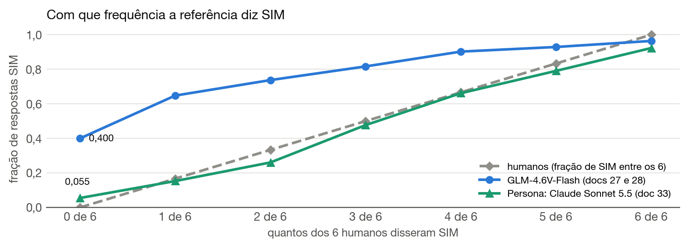
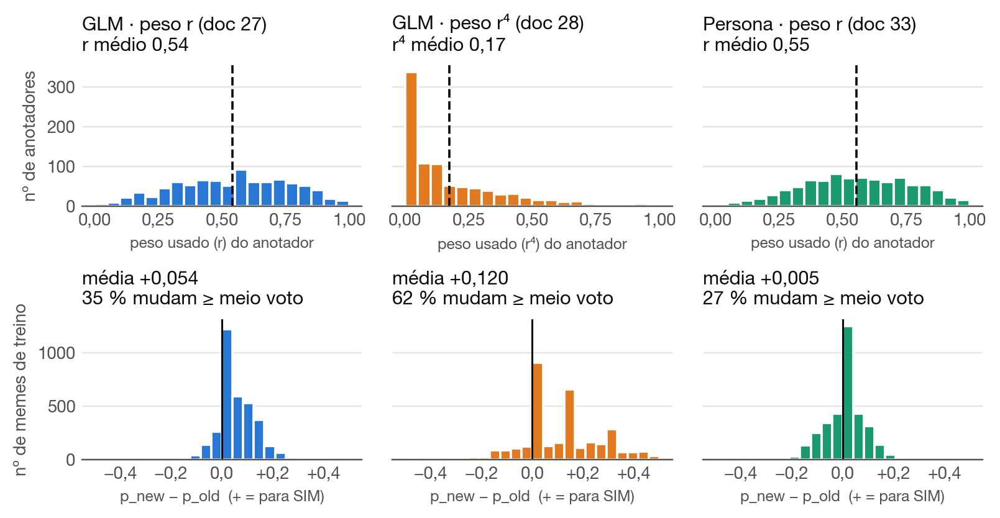
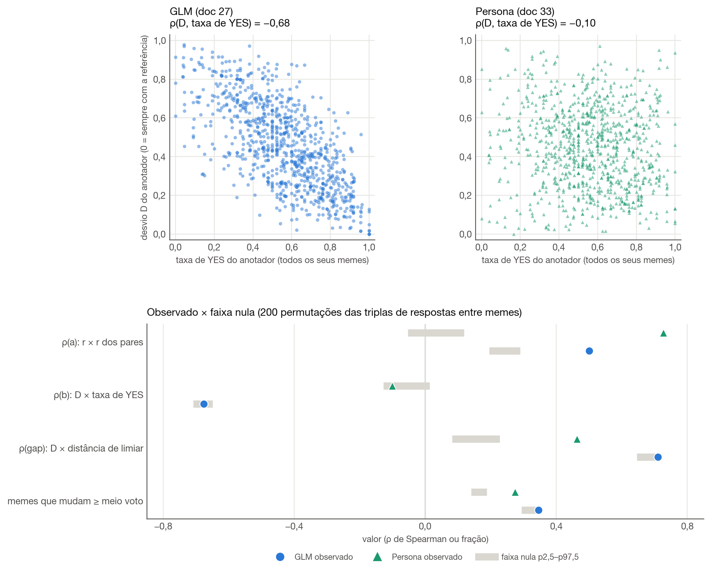
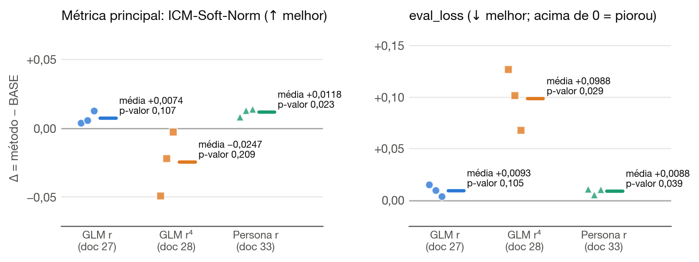
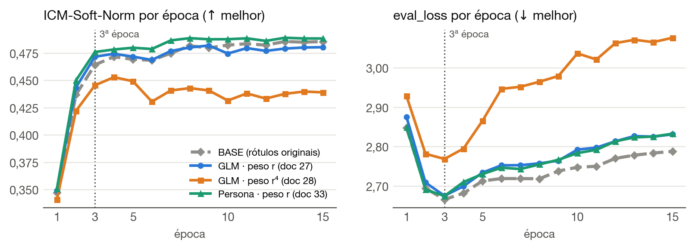

# Relatório: a Persona (Claude Sonnet 5.5 com três system prompts) como anotador e como referência — resultados dos docs 32 e 33

*Consolidado em 2026-10-30 para servir de base ao capítulo de resultados da tese. O método está no documento irmão, `METODOLOGIA_PERSONA.md`, citado como "Metodologia §x". O relatório do doc 32 (`RELATORIO_PERSONA.md`, 2026-10-28) continua valendo para os detalhes dos extremos (tabelas por idioma, McNemar entre prompts, κ) e é citado como "Relatório Persona §x". Os resultados do GLM e do Claude original estão no `RELATORIO_GLM_CLAUDE.md`, citado como "Relatório GLM/Claude §x". Convenção: `[MEDIDO]` (com artefato), `[HIPÓTESE]`, `[LIMITAÇÃO]`. Decimais com vírgula no texto; as figuras R1–R5 usam ponto, as demais vírgula.*

---

## 0. Resumo

**Estatuto.** O doc 32 é descritivo e sem regra de decisão. O doc 33 é exploratório, com portões e critério fixados antes (Metodologia §0).

**1. Com três system prompts, o Claude diz YES na taxa de um anotador humano típico** `[MEDIDO]`. Nos memes 1Y5N (5 de 6 humanos dizem NO), o voto YES (maioria de 3) vai de 0,286 (Claude com as paráfrases, doc 31, em outra rodada; nenhuma das duas tem seed) para **0,157** [0,124; 0,197]; por resposta, na mesma unidade de um anotador humano, 0,153 contra 0,167. O GLM sem raciocínio dá 0,719. Nos 3 386 memes de treino, a Persona diz YES em **0,525** das respostas, contra 0,555 dos humanos e 0,804 do GLM (§1, §7). `[LIMITAÇÃO]` Nos extremos, o número é dentro da amostra: S1–S3 foram escritos depois do doc 31 e avaliados nesses memes; fora deles, a calibração se manteve (§7).

**2. A separação entre os extremos não melhora** `[MEDIDO]` (pós-hoc). A AUC entre 5Y1N e 1Y5N é 0,859 na Persona e 0,860 no Claude, contra 0,742–0,753 no GLM. Muda o ponto de operação, não a capacidade de separar (§3).

**3. A Persona passa no portão G2 (o terceiro portão da tese), em que o GLM falhou** `[MEDIDO]`. Os três prompts dão a mesma resposta em 0,872 dos memes em inglês e 0,848 em espanhol (mínimo exigido: 0,70; GLM: 0,727 e 0,691). No GLM, a concordância é entre três paráfrases; na Persona, entre três procedimentos diferentes, então os dois números não medem a mesma coisa (§5). Repetir o piloto muda 10 de 180 respostas e 1 de 60 votos (§6, §8).

**4. Com a Persona, o peso carrega informação por meme e deixa de favorecer quem diz mais YES, mas quem se afasta do limiar da Persona, para qualquer lado, ainda perde peso** `[MEDIDO]`. ρ(desvio, taxa de YES do anotador) cai de −0,676 (GLM) para −0,101, e ρ(r, r dos pares) = 0,727 fica muito acima da faixa nula [−0,053; 0,118]. Mas ρ(gap) = 0,463 fica acima de 0,40 e da faixa nula. A leitura pré-registrada é **parcial** (§10, Figura R8).

**5. O retreino dá dois efeitos nominalmente significativos (p sem correção) em sentidos opostos, e o critério não é satisfeito** `[MEDIDO]`. Em E = argmin(`eval_loss`), a métrica principal (Task A ICM-Soft-Norm) sobe nas 3 seeds: **+0,0118**, t(2) = 6,49, p = 0,023. A `eval_loss` também sobe nas 3 seeds, ou seja, piora: **+0,0088**, p = 0,039. O critério exige `eval_loss` sem piora, e a leitura pré-registrada é **"efeito não detectado com 3 seeds; encerra"**. O controle `personashift` não roda (§11).

**6. Entre os três métodos de ponderação, o da Persona é o que menos mexe nos rótulos e o único com p < 0,05 na métrica principal (sem correção; não passa Bonferroni; critério não satisfeito)** `[MEDIDO]` (descritivo). Mudança média do alvo em módulo, |Δp|: 0,053 (Persona), 0,065 (GLM, r) e 0,154 (GLM, r⁴); com sinal: +0,0054, +0,054 e +0,120. Nos três, a `eval_loss` em E sobe em todas as seeds (§9, §11).

**7. Para a tese, o achado central é o 4 + 5.** A Discussão atual diz que uma estimativa de confiabilidade ficaria utilizável com painéis que compartilham itens e mais votos por anotador, ou com uma referência externa que concorde consigo mesma e não favoreça uma resposta. O doc 33 construiu uma referência assim, e ela deu o resultado mais promissor da investigação de confiabilidade: o maior ganho na métrica decisiva entre os estudos de retreino, nas 3 seeds (+2,5 %, cerca de 2 dp do BASE entre seeds), com alta da `eval_loss` nas 3 seeds (+0,0088, p = 0,039, menor que o dp do BASE entre seeds, 0,0108), que o critério pré-registrado não aceita. A segunda via da Discussão precisa ser atualizada (Parte V).

**Figuras deste relatório:**

| figura | arquivo | o que mostra |
|---|---|---|
| R1 | `persona_voto_yes.png` | voto YES dos quatro anotadores nos três grupos extremos |
| R2 | `persona_por_prompt.png` | fração de YES de S1, S2 e S3 em cada grupo extremo |
| R3 | `persona_acerto.png` | acordo dos quatro anotadores com a maioria humana |
| R4 | `persona_cruzamento.png` | votos cruzados de cada anotador com a Persona |
| R5 | `persona_prompts.png` | fração de YES por prompt e concordância entre as 3 respostas, quatro anotadores |
| R6 | `resultados_calibracao.png` | fração de YES da referência por número de YES humanos, GLM × Persona, treino inteiro |
| R7 | `resultados_labels.png` | pesos dos anotadores e mudança dos alvos, nos três métodos |
| R8 | `persona33_pesos.png` | desvio × taxa de YES (GLM e Persona) e faixa nula das checagens |
| R9 | `resultados_delta.png` | Δ contra o BASE por seed, nos três métodos |
| R10 | `resultados_curvas.png` | ICM-Soft-Norm e `eval_loss` por época, média das 3 seeds |

Todas em `glm_reference/reports/`, em PNG; R1–R5 e R8 também em PDF vetorial.

---

## Parte I — A Persona como anotador nos memes extremos (doc 32)

### 1. Voto YES por grupo

`[MEDIDO — claude32_claude-sonnet-5-5_think_off_extremes.md; Relatório Persona §6; voto = maioria das 3 respostas; IC 95 % de Wilson]`

| grupo | n | humanos | GLM off | GLM on | Claude (P1–P3) | **Persona (S1–S3)** |
|---|---|---|---|---|---|---|
| 1Y5N | 388 | 0,167 | 0,719 [0,672; 0,761] | 0,510 [0,461; 0,560] | 0,286 [0,243; 0,333] | **0,157 [0,124; 0,197]** |
| 3Y3N | 518 | 0,500 | 0,880 [0,850; 0,906] | 0,753 [0,714; 0,788] | 0,689 [0,648; 0,728] | **0,481 [0,438; 0,524]** |
| 5Y1N | 645 | 0,833 | 0,964 [0,947; 0,976] | 0,918 [0,894; 0,937] | 0,924 [0,901; 0,942] | **0,795 [0,763; 0,825]** |
| 1 551 memes | 1 551 | 0,555 | 0,875 | 0,761 | 0,686 | **0,531 [0,506; 0,555]** |

"Humanos" é a fração de YES de um anotador individual no grupo (k/6). No 5Y1N, 1 meme não tem voto do GLM e entra no denominador. O detalhe por idioma está no Relatório Persona §6.



*Figura R1 — Voto YES por grupo extremo, com IC 95 % de Wilson. O tracejado é a fração de YES humana do grupo. Fonte: `reports/persona_voto_yes.png` (`plot_persona.py`).*

**Leitura pelas métricas pré-registradas (SPEC_32 §3):**
- **1Y5N (principal):** 0,157, dentro da faixa ≤ 0,25 do SPEC_31 §3, com IC que contém 0,167. O Claude com as paráfrases ficava entre as faixas (0,286: PARCIAL), e o GLM acima de 0,40.
- **3Y3N (secundária):** 0,481, com IC que contém 0,5. Os outros três anotadores ficam com o IC inteiro acima de 0,5.
- **Em relação ao Claude do doc 31,** o voto cai nos três grupos: −0,129 (1Y5N), −0,208 (3Y3N) e −0,129 (5Y1N). A diferença vale para o pacote inteiro (texto, posição e tags) e pode incluir ruído entre rodadas (Metodologia §2.1, §6).

**Leitura descritiva (pós-hoc):**
- No 1Y5N e no 3Y3N, a ordem é GLM off > GLM on > Claude > Persona; no 5Y1N, o GLM off fica acima, GLM on (0,918) e Claude (0,924) ficam próximos, com IC sobrepostos, e a Persona fica abaixo. Nos três grupos, a Persona é a única com o ponto abaixo da taxa humana.
- **5Y1N:** só aqui o IC inteiro da Persona fica abaixo da taxa humana (0,795 contra 0,833). Os outros três ficam com o IC inteiro acima.

### 2. Cada prompt da Persona

`[MEDIDO — Relatório Persona §7.1; fração de YES de cada prompt; IC 95 % de Wilson]`

| grupo | humanos | S1 | S2 | S3 |
|---|---|---|---|---|
| 1Y5N | 0,167 | 0,129 [0,099; 0,166] | 0,175 [0,141; 0,216] | 0,155 [0,122; 0,194] |
| 3Y3N | 0,500 | 0,429 [0,387; 0,472] | 0,496 [0,453; 0,539] | 0,506 [0,463; 0,549] |
| 5Y1N | 0,833 | 0,755 [0,720; 0,787] | 0,814 [0,782; 0,842] | 0,803 [0,771; 0,832] |



*Figura R2 — Fração de YES de S1, S2 e S3 em cada grupo extremo, com IC 95 % de Wilson. O tracejado é a fração de YES humana. Fonte: `reports/persona_por_prompt.png` (`plot_persona.py`).*

- Aqui a unidade é a mesma dos humanos: uma resposta por meme. As taxas por prompt são pré-registradas; os IC e a comparação com a taxa humana são pós-hoc.
- **S2:** o IC contém a taxa humana nos 3 grupos e nos 2 idiomas (9 de 9 linhas). **S3:** em 8 de 9 (no 5Y1N total, o IC termina em 0,832). **S1:** fica abaixo da taxa humana nos 3 grupos, com o IC inteiro abaixo em 6 de 9 linhas.
- Pareado por meme, o S1 diz YES sozinho bem menos vezes que o S2 em todos os grupos (McNemar p ≤ 5,3·10⁻⁴), e que o S3 no 3Y3N e no 5Y1N. Entre S2 e S3 não se detecta diferença (p ≥ 0,13; Relatório Persona §7).
- O S1 é o mais longo e o único com o desempate `[CALIBRATE: default NO …]`. Esta onda não diz se algum desses traços explica a diferença.

### 3. Acordo com a maioria humana e separação entre os extremos (descritivo, pós-hoc)

`[MEDIDO — Relatório Persona §8; 1Y5N: maioria humana NO; 5Y1N: maioria humana YES]`

| anotador | NO no 1Y5N (n = 388) | YES no 5Y1N (n = 645) | média das duas | acurácia nos dois grupos (n = 1 033) | AUC 5Y1N × 1Y5N |
|---|---|---|---|---|---|
| GLM off | 0,281 | 0,964 | 0,623 | 0,708 | 0,742 |
| GLM on | 0,490 | 0,918 | 0,704 | 0,757 | 0,753 |
| Claude | 0,714 | **0,924** | **0,819** | **0,845** | **0,860** |
| **Persona** | **0,843** | 0,795 | **0,819** | 0,813 | 0,859 |



*Figura R3 — Acordo com a maioria humana nos grupos 1Y5N e 5Y1N. Fonte: `reports/persona_acerto.png` (`plot_persona.py`).*

- A Persona troca YES onde a maioria humana diz NO (1Y5N) por NO onde ela diz YES (5Y1N). A média das duas taxas e a AUC ficam praticamente iguais às do Claude, e muito acima do GLM.
- A acurácia nos dois grupos juntos é menor na Persona (0,813 contra 0,845) porque o 5Y1N, onde ela perde, é maior que o 1Y5N.
- `[LIMITAÇÃO]` 1Y5N e 5Y1N são maiorias humanas, não gold. Não há IC nem teste para as diferenças de AUC.

### 4. Cruzamento dos votos: a Persona é quase um subconjunto do Claude (descritivo, pós-hoc)

`[MEDIDO — Relatório Persona §9; b = só o outro anotador diz YES; c = só a Persona diz YES; 1 551 memes, 1 550 com o GLM]`

| par | acordo | κ de Cohen | b | c |
|---|---|---|---|---|
| Claude × Persona | 0,816 | 0,624 | **263** | **22** |
| GLM off × Persona | 0,611 | 0,185 | 569 | 34 |
| GLM on × Persona | 0,684 | 0,347 | 424 | 66 |



*Figura R4 — Votos cruzados de cada anotador com a Persona, por grupo. Fonte: `reports/persona_cruzamento.png` (`plot_persona.py`).*

- Dos 823 memes com voto YES da Persona, 801 também têm YES do Claude. Quando os dois discordam, o Claude diz YES sozinho em 263 de 285 casos.
- A queda de YES no 5Y1N vem desses casos: 93 memes que o Claude chama de YES e a Persona de NO, contra 10 no sentido oposto.
- `[LIMITAÇÃO]` Os McNemar (todos com p < 10⁻¹⁰) cobrem o ruído por meme, não uma variação da rodada inteira. Descrevem a assimetria; não testam o pacote.

### 5. Concordância entre as três respostas (descritivo, pós-hoc)

`[MEDIDO — Relatório Persona §7 e §10]`

| anotador | fração de YES por resposta (1 551) | maior − menor prompt | 3-0 (todos) | Fleiss κ (todos) |
|---|---|---|---|---|
| GLM off | 0,821 | 0,286 | 0,698 | 0,316 |
| GLM on | 0,728 | 0,196 | 0,732 | 0,551 |
| Claude | 0,678 | 0,083 | 0,836 | 0,750 |
| **Persona** | **0,526** | **0,059** | **0,848** | **0,797** |



*Figura R5 — Fração de YES por prompt (em cima) e concordância 3-0 por grupo (embaixo). Fonte: `reports/persona_prompts.png` (`plot_persona.py`).*

- No GLM, a P3 concentra a discordância (76 % dos memes 2-1 no GLM off). Na Persona, nenhum prompt concentra: o dissidente mais frequente é o S1, com 43 %.
- `[LIMITAÇÃO]` As duas concordâncias não medem a mesma coisa: entre P1–P3, robustez a uma reformulação; entre S1–S3, acordo entre três procedimentos. O κ depende da prevalência e o κ "todos" é inflado por juntar grupos com taxas de YES muito diferentes.

---

## Parte II — A Persona no treino inteiro (doc 33, F2)

### 6. Portão G2: aprovado

`[MEDIDO — reports/persona33_votes.md; GLM: Relatório GLM/Claude §4]`

| idioma | n | Persona: parse | Persona: confiante (3-0) | só nos 1 835 novos (descritivo) | GLM off: confiante |
|---|---|---|---|---|---|
| en | 1 715 | 1,000 | **0,872** | 0,876 | 0,727 |
| es | 1 671 | 1,000 | **0,848** | 0,866 | 0,691 ✗ |

Limiares: parse ≥ 0,98 e confiante ≥ 0,70 em cada idioma. A Persona passa nos dois; o GLM falhou em espanhol, e o doc 27 seguiu com o G2′ (só parse).

`[LIMITAÇÃO]` A coluna do GLM não é de igual para igual: lá a concordância é entre três paráfrases (robustez à redação); na Persona, entre três procedimentos diferentes (§5). O portão foi fixado no SPEC_33 depois de os extremos serem votados; a coluna "só nos 1 835 novos" é a parte votada depois.

**Execução:** 5 505 pedidos novos em 26 lotes, nenhum `?` no fim, 0 recusas, parse 1,000 nas 10 158 respostas do treino. Custo ≈ US$ 9,96 (US$ 18,64 com os extremos).

### 7. Calibração fora dos extremos: mantida

`[MEDIDO — reports/persona33_votes.md; fração de YES sobre as 3 respostas]`

| nº de YES humanos (de 6) | 0 | 1 | 2 | 3 | 4 | 5 | 6 | treino |
|---|---|---|---|---|---|---|---|---|
| n | 316 | 388 | 458 | 518 | 585 | 645 | 476 | 3 386 |
| humanos (k/6) | 0,000 | 0,167 | 0,333 | 0,500 | 0,667 | 0,833 | 1,000 | 0,555 |
| **Persona** | 0,055 | 0,153 | 0,261 | 0,477 | 0,662 | 0,791 | 0,923 | **0,525** |
| GLM off | 0,400 | 0,648 | 0,737 | 0,817 | 0,902 | 0,929 | 0,964 | 0,804 |
| amostra para S1–S3 | fora | dentro | fora | dentro | fora | dentro | fora | |



*Figura R6 — Fração de respostas YES de cada referência por número de YES humanos, nos 3 386 memes de treino ("SIM" no eixo = YES). Os grupos 1, 3 e 5 são os extremos em que S1–S3 foram avaliados (dentro da amostra); nos grupos 0, 2, 4 e 6, a distância entre a Persona e os humanos fica entre −0,077 e +0,055. Fonte: `reports/resultados_calibracao.png` (`relatorio_resultados_pdf.py`).*

- **Leitura de referência (SPEC_33 §2):** nos 1 835 memes fora da amostra, a Persona diz YES em 0,525 das respostas, contra 0,555 dos humanos. Distância de 0,030, dentro da faixa ≤ 0,05: **a calibração dos extremos se mantém fora deles.**
- A Persona acompanha a escada humana de 0 a 6: fica acima dela só no grupo 0 (0,055) e abaixo de 1 a 6. O GLM fica acima em todos os grupos menos o 6 e já diz YES em 0,400 dos memes que nenhum humano chamou de sexistas.
- **Por nível, fora dos extremos, três dos quatro grupos ficam mais longe da taxa humana que qualquer grupo dentro deles:** −0,077 (6 YES), −0,073 (2 YES) e +0,055 (0 YES), contra no máximo −0,043 nos grupos 1, 3 e 5; o grupo 4 fica em −0,005. Nos grupos 0 e 6 a taxa humana é 0 ou 1, então a distância só pode ir para um lado. O agregado de 0,030 mistura os dois sentidos. `[LIMITAÇÃO]` Dentro e fora da amostra coincidem com a rodada (Metodologia §6). `[MEDIDO — recalculado de persona_votes.csv e dos votos humanos]`
- Por prompt, fora dos extremos: S1 0,494, S2 0,537, S3 0,543. O S1 continua o que diz menos YES.

### 8. Ruído entre rodadas (descritivo)

`[MEDIDO — reports/persona33_drift.md; os 180 pedidos do piloto do doc 32, repetidos em 2026-10-29]`

| grupo | rótulos que mudaram | fração de YES, rodada 1 → 2 |
|---|---|---|
| 1Y5N (60 respostas) | 0 | 0,183 → 0,183 |
| 3Y3N (60) | 5 | 0,467 → 0,450 |
| 5Y1N (60) | 5 | 0,800 → 0,783 |
| **todos (180)** | **10 (5,6 %)** | 0,483 → 0,472 |

- **1 de 60 votos por maioria mudou.** Por prompt: S1 6 de 60 respostas, S2 3, S3 1.
- `[LIMITAÇÃO]` São 60 memes, de 20 por grupo, e um único par de datas. A medida dá a ordem de grandeza do ruído da Persona, sem IC útil por grupo. Ela é pequena perto das mudanças entre o doc 31 e o doc 32 (285 votos em 1 551 memes, §4), mas não mede o ruído do Claude com P1–P3 e, por isso, não permite dizer que parte dessas 285 mudanças é ruído.

---

## Parte III — A Persona como referência para ponderar anotadores (doc 33, F3–F5)

### 9. F3 — Pesos e novos alvos, nos três métodos

`[MEDIDO — config.json runtime.doc33.build; reports/persona33_checks.md (d); SPEC_27/28 e checks_summary.md para o GLM; recalculado e conferido por relatorio_resultados_pdf.py]`

| | GLM · r (doc 27) | GLM · r⁴ (doc 28) | **Persona · r (doc 33)** |
|---|---|---|---|
| peso médio dos anotadores | 0,542 | 0,17 (r⁴) | 0,554 |
| deslocamento médio do alvo, p_new − p_old | +0,054 | +0,120 | **+0,0054** |
| \|Δp\| médio | 0,065 | 0,154 | 0,053 |
| memes que mudam ≥ meio voto (`share_moved`) | 34,6 % | 62,5 % | 27,4 % |
| rótulos duros que mudam | 554 | 849 | 526 |
| ↳ empates 3-3 desfeitos (dos 518) | 518 | 518 | 518 (243 → NO, 275 → YES) |
| ↳ inversões NO ↔ YES | 36 (todas NO → YES) | 331 | **8** (4 em cada sentido) |



*Figura R7 — Em cima, o peso usado de cada anotador (r ou r⁴), com a média tracejada. Embaixo, a mudança do alvo de cada meme de treino (+ = para YES; "SIM" = YES). Fonte: `reports/resultados_labels.png` (`relatorio_resultados_pdf.py`).*

- **Os 887 anotadores têm meme incluído**, com mediana de 18 memes (mín. 7, máx. 45). O peso r_persona vai de 0,029 a 1,0 (mediana 0,554).
- **A Persona move os alvos para os dois lados**, e o GLM quase só para o YES. O deslocamento médio com sinal da Persona é dez vezes menor que o do GLM com r porque os dois sentidos se compensam; em módulo, a diferença é menor (|Δp| 0,053 contra 0,065; 27,4 % contra 34,6 % dos memes com meio voto ou mais).
- **Controle `personashift`:** Δ̄ = +0,0070 nos memes não unânimes, abaixo de 1/24 (≈ 0,042). Pela regra fixada, ele **não roda**: seria indistinguível do BASE, qualquer que fosse o resultado da F5.

### 10. F4 — O que o peso mede: checagens e portão G4

**Portão G4: aprovado** `[MEDIDO — reports/persona33_gate.md]`: `share_moved` 0,274 (≥ 0,05) e ρ(r_persona, r_peer) 0,727 (< 0,8). Retreino autorizado.

**Checagens lado a lado** `[MEDIDO — reports/persona33_checks.md (Persona); reports/checks_summary.md (GLM, doc 27)]`:

| checagem | GLM (doc 27) | **Persona (doc 33)** |
|---|---|---|
| (a) ρ(r, r_peer) | 0,501 | **0,727** |
| (b) ρ(D, taxa de YES do anotador) | −0,676 | **−0,101** |
| (b) ρ(gap) = ρ(D, \|limiar do anotador − limiar da referência\|) | 0,710 | **0,463** |
| (d) `share_moved` | 0,346 | 0,274 |
| (e) referência confiante contrariando meme unânime | 56/608 = 0,092 | **27/737 = 0,037** |
| (f) acordo do voto da referência com o rótulo duro humano (sem 3-3) | 0,707 | **0,806** |
| ↳ por divisão 6-0 · 5-1 · 4-2 | 0,828 · 0,708 · 0,615 | 0,933 · 0,813 · 0,703 |
| (g) largura mediana do IC 95 % de D | 0,456 | 0,531 |
| (h) massa Σw vinda de memes em que a referência fica 2-1 | 0,288 | 0,140 |
| (i) divisões 4-2 + 3-3: memes 2-1 × memes 3-0 | 0,522 × 0,436; +0,086 [+0,049; +0,123] | 0,605 × 0,438; **+0,167 [+0,119; +0,215]** |
| (j) ρ(r_persona, r_glm), mesmos 887 anotadores (calculado no doc 33) | — | 0,397 |

**Faixa nula (k)** `[MEDIDO — reports/persona33_checks.md; 200 permutações das triplas de respostas entre memes, dentro de cada idioma]`:

| estatística | GLM observado | faixa nula do GLM | **Persona observado** | faixa nula da Persona |
|---|---|---|---|---|
| ρ(a) | 0,501 | [0,195; 0,290] | **0,727** | [−0,053; 0,118] |
| ρ(b) | −0,676 | [−0,709; −0,649] | **−0,101** | [−0,128; 0,013] |
| ρ(gap) | 0,710 | [0,646; 0,714] | **0,463** | [0,082; 0,227] |
| `share_moved` | 0,346 | [0,293; 0,344] | **0,274** | [0,140; 0,188] |



*Figura R8 — Em cima: desvio D de cada um dos 887 anotadores contra a sua taxa de YES, com o GLM (esquerda) e com a Persona (direita) como referência. Embaixo: cada estatística observada (círculo = GLM, triângulo = Persona) contra a faixa nula p2,5–p97,5 (barra cinza), obtida embaralhando as triplas de respostas da referência entre memes do mesmo idioma. Fonte: `reports/persona33_pesos.png` (`plot_persona33.py`; os asserts conferem ρ(a) e ρ(b) contra os relatórios das checagens).*

**Leitura pré-registrada da (b) (SPEC_33 §5): parcial.**
- **O peso carrega informação por meme.** ρ(a) = 0,727 fica muito acima da faixa nula, que vai até 0,118. No GLM, ρ(a) também ficava acima da faixa (0,501 contra 0,290), mas com margem menor.
- **O peso deixou de seguir a taxa de YES do anotador.** ρ(b) = −0,101 fica dentro da faixa nula. No GLM, −0,676 fica dentro da faixa nula do GLM: o vínculo do peso do GLM com a taxa de YES é o que a taxa de YES do próprio GLM produz sozinha.
- **O peso ainda segue a distância de limiar.** ρ(gap) = 0,463 fica acima de 0,40 e acima da faixa nula. Um anotador que diz YES muito mais ou muito menos que a Persona ainda perde peso, mas agora nos dois sentidos, e não só quem diz NO.

**Outras leituras (descritivas):**
- **(e) e (f):** a Persona contraria menos os memes unânimes e concorda mais com o rótulo duro humano que o GLM, em todas as divisões.
- **(i):** os memes em que a Persona fica 2-1 têm mais divisões humanas fortes (+0,167 [+0,119; +0,215]; no GLM, +0,086 [+0,049; +0,123]). O ponto é maior, mas os IC se sobrepõem e a diferença entre os dois não foi testada; na Persona, um 2-1 é discordância entre procedimentos, no GLM entre paráfrases.
- **(h):** só 14 % da massa do desvio vem de memes em que a Persona fica 2-1, onde todo anotador leva pelo menos ⅓ de desvio (no GLM, 29 %).
- **(c) r por gênero × idade** `[MEDIDO — persona33_checks.md (c)]`: de 0,521 [0,489; 0,553] (homens 46+) a 0,591 [0,560; 0,624] (mulheres 23–45); os pontos dos outros quatro grupos ficam entre esses dois, e os IC deles se sobrepõem aos dois extremos. O par extremo foi escolhido depois de ver os dados e não foi testado; a não sobreposição dos dois IC é descritiva. A amplitude (0,070) fica entre a do r_peer (0,447–0,491) e a do GLM (0,461–0,596). No GLM, o peso favorecia as mulheres e as faixas etárias mais altas, que dizem mais YES (Relatório GLM/Claude §5).
- **(j):** ρ(r_persona, r_glm) = 0,397. As duas referências ordenam os anotadores de forma bem diferente, com r médio quase igual (0,554 e 0,542).

### 11. F5 — Retreino

**BASE reaproveitado** `[MEDIDO — SPEC_33 §12]`. A run nova `glmbase` seed 42 (2026-10-29) reproduziu a de 2026-10-09: as 15 `eval_loss` e as 15 `loss` de treino são idênticas, sem tolerância. Só métricas da Task C diferem, em no máximo 2,2·10⁻¹⁶ (arredondamento). As três runs `glmbase` do doc 27 servem de BASE.

**`personaw` contra o BASE, em E = argmin(`eval_loss`)** `[MEDIDO — reports/f5_report_personaw.md; E = 3ª época nas 6 runs]`:

| métrica | Δ 42 | Δ 7 | Δ 2025 | média | dp | t(2) | p |
|---|---|---|---|---|---|---|---|
| **A ICM-Soft-Norm (primária)** | +0,0082 | +0,0131 | +0,0140 | **+0,0118** | 0,0031 | 6,49 | **0,023** |
| A ICM-Norm hard | +0,0032 | +0,0305 | −0,0215 | +0,0041 | 0,0260 | 0,27 | 0,811 |
| **`eval_loss` (↓ melhor)** | +0,0106 | +0,0052 | +0,0106 | **+0,0088** (pior) | 0,0031 | 4,88 | **0,039** |
| B ICM-Soft-Norm | +0,0012 | −0,0009 | −0,0006 | −0,0001 | 0,0012 | −0,10 | 0,928 |
| B ICM-Norm hard | −0,0028 | +0,0007 | +0,0152 | +0,0044 | 0,0095 | 0,79 | 0,511 |
| C ICM-Soft-Norm | −0,0008 | −0,0092 | −0,0037 | −0,0046 | 0,0042 | −1,87 | 0,202 |
| C ICM-Norm hard | +0,0144 | −0,0059 | +0,0131 | +0,0072 | 0,0113 | 1,10 | 0,386 |

**Estado final (secundário, descritivo):** A ICM-Soft-Norm +0,0028 (p = 0,581); `eval_loss` +0,0448 (p = 0,073).

**Escala:** no BASE, a ICM-Soft-Norm em E é 0,464 (média das 3 seeds; dp 0,0059 entre seeds); o +0,0118 equivale a cerca de 2 dp. A `eval_loss` sobe +0,0088, menos que o dp do BASE entre seeds (0,0108), mas nas 3 seeds (p = 0,039). A `eval_loss` (2,666 no BASE) é a soma das perdas das três tasks, com a Task A contando em dobro, então uma porcentagem dela não se compara com a da métrica. A entropia cruzada soft da Task A sozinha também piora nas 3 seeds: +0,0071, +0,0029 e +0,0072, média +0,0057 (cerca de +0,6 %) `[MEDIDO — metrics_history, eval_task_a_crossentropy_soft em E]`.

**Critério (SPEC_33 §7): não satisfeito.** Duas das três condições passam (Δ > 0 e p < 0,05); a terceira falha, porque a `eval_loss` piora nas 3 seeds. Pela tabela do SPEC_33 §6 ("`eval_loss` pior"), a leitura é **efeito não detectado com 3 seeds; encerra**. O controle `personashift` não roda, por duas regras: o critério falhou, e |Δ̄| < 1/24 (§9). Tasks B e C sem sinal (p ≥ 0,2).

**Os três métodos lado a lado (descritivo, sem teste novo):**

| método | Δ A ICM-Soft-Norm | p | Δ `eval_loss` | p | leitura pré-registrada |
|---|---|---|---|---|---|
| GLM · r (doc 27) | +0,0074 | 0,107 | +0,0093 | 0,105 | efeito não detectado |
| GLM · r⁴ (doc 28) | −0,0247 | 0,209 | +0,0988 | **0,029** | efeito negativo registrado na `eval_loss` |
| **Persona · r (doc 33)** | **+0,0118** | **0,023** | +0,0088 | **0,039** | efeito não detectado (`eval_loss` pior) |

As leituras seguem o pré-registro de cada documento. O SPEC_28 declarou interesse em efeito "em qualquer direção", e o resultado datado do doc 28 registrou a piora da `eval_loss` como efeito negativo. O SPEC_33 §6 só define efeito negativo pela ICM-Soft-Norm, então a piora da `eval_loss` do doc 33 (p = 0,039) cai em "efeito não detectado". Lidos pelo mesmo critério, os três braços pioram a `eval_loss` nas 3 seeds, dois deles com p < 0,05 sem correção (GLM r⁴ e Persona).



*Figura R9 — Δ = método − BASE em cada seed (marcadores) e média (traço), em E = argmin(`eval_loss`). Esquerda: ICM-Soft-Norm da Task A (↑ melhor). Direita: `eval_loss` (↓ melhor; acima de 0 = piorou). O BASE é o `glmbase` (rótulos originais). Fonte: `reports/resultados_delta.png` (`relatorio_resultados_pdf.py`).*



*Figura R10 — ICM-Soft-Norm da Task A e `eval_loss` por época, média das 3 seeds, BASE e os três métodos. O pontilhado marca a 3ª época, o E de 11 dos 12 treinos (BASE e três métodos × 3 seeds; no doc 28, seed 42, E foi a 2ª). Fonte: `reports/resultados_curvas.png` (`relatorio_resultados_pdf.py`).*

- **A Persona tem o maior Δ da métrica principal e o único com p < 0,05.** A piora da `eval_loss` é do mesmo tamanho da do GLM com r e cerca de 1/11 da do GLM com r⁴.
- **Nos três métodos, a `eval_loss` em E sobe em todas as seeds**, qualquer que seja o sinal do Δ da métrica principal. `[HIPÓTESE]` Treinar com alvos diferentes dos da validação (que fica com os rótulos originais) aumenta a perda de validação por construção, mesmo quando a ICM-Soft-Norm sobe. Esta onda não testa isso.
- **Nas curvas (R10, média das 3 seeds),** a Persona fica acima do BASE na ICM-Soft-Norm nas 15 épocas, com a distância indo de +0,013 (2ª época) a +0,003 (15ª), sem cair a cada época. A `eval_loss` dela fica abaixo da do BASE só na 2ª época; a do GLM com r fica acima nas 15.
- `[LIMITAÇÃO]` **Comparações múltiplas.** Com Bonferroni para os três métodos (0,05/3 ≈ 0,017), o p = 0,023 não passaria. A tese reúne seis comparações de retreino na mesma tabela (0,05/6 ≈ 0,008). A correção enfraquece a alta da métrica principal; ela não muda a falha do critério, que depende do sinal da diferença média da `eval_loss`, não do p dela. A validação de 598 memes é usada pela terceira vez numa F5.

---

## Parte IV — Interpretação, limitações e pendências

### 12. Interpretação

**1. Com o mesmo modelo, o pacote S1–S3 deu outra taxa de YES** `[MEDIDO]`: 0,286 (P1–P3 na mensagem `user`, doc 31) e 0,157 (S1–S3 no `system`, doc 32) no 1Y5N, em rodadas diferentes e sem seed. `[HIPÓTESE]` O nível de YES de um LLM anotador depende do par modelo + instrução; aqui não se separa o pacote (texto, posição, tags) do ruído entre rodadas do Claude com P1–P3. A frase "o Claude também tem viés de YES" só vale junto com a instrução usada. A separação entre os extremos ficou praticamente igual (AUC 0,860 e 0,859).

**2. Com a Persona como referência, muda o que o peso mede** `[MEDIDO]`. Com o GLM, o peso reproduzia a taxa de YES do anotador, e a faixa nula mostra que essa relação é a que a taxa de YES do próprio GLM produz sozinha. Com a Persona, o peso deixa de seguir a taxa de YES (ρ(b) dentro da faixa nula), e o ρ(a) fica muito acima da faixa nula (0,727 contra até 0,118); no GLM, o ρ(a) também ficava acima da dele, com margem menor (0,501 contra até 0,290). Ele ainda segue a distância de limiar (ρ(gap) acima da faixa): leitura parcial. `[HIPÓTESE]` A calibração da referência explica a mudança em ρ(b) (a faixa nula apoia isso); a estabilidade das respostas não foi testada como causa.

**3. Mesmo assim, o retreino não melhora o modelo pelo critério fixado** `[MEDIDO]`. A métrica principal sobe nas 3 seeds e a perda de validação também. Uma alta da métrica principal acompanhada de piora na perda de validação não é aceita pelo critério, e a leitura é "efeito não detectado com 3 seeds".

**4. O alvo muda nos dois sentidos, e o saldo é quase nulo** `[MEDIDO]`. O deslocamento médio com sinal é +0,0054, mas o |Δp| médio é 0,053 (GLM com r: 0,065), e 27,4 % dos memes se movem meio voto ou mais, acima da faixa nula [0,140; 0,188]. As mudanças de rótulo duro são quase só os 518 empates desfeitos, mais 8 inversões. O Δ da métrica principal (+0,0118, cerca de 2 dp do BASE entre seeds) não foi aceito pelo critério. `[HIPÓTESE]` Com uma mediana de 18 memes incluídos por anotador (mín. 7; cerca de 23 votos de treino por anotador) e IC 95 % de D com largura mediana 0,53, o peso de cada anotador é estimado com pouca precisão, e isso limita o quanto qualquer referência pode mudar o alvo.

**5. Para a Discussão da tese:** as duas condições que a Discussão aponta para uma referência utilizável (concordar consigo mesma, não favorecer uma resposta) foram atendidas pela Persona, com a ressalva de que a concordância dela é entre procedimentos, e o critério não foi satisfeito. `[HIPÓTESE]` O viés de YES do GLM é uma explicação possível para o nulo do doc 27, não testada. No doc 33, a referência não tem esse viés de taxa (0,525 de YES contra 0,555 dos humanos; ρ(b) −0,10 contra −0,676), então o nulo do doc 33 não vem dele. O peso ainda segue a distância de limiar (leitura parcial), e um nulo com 3 seeds não mostra ausência de efeito (Parte V). Lido de forma descritiva, é o resultado mais promissor da investigação de confiabilidade: o maior ganho na métrica decisiva entre os estudos de retreino, nas 3 seeds, com custo pequeno na `eval_loss`. Ele motiva, como trabalho futuro, um retreino com mais seeds e uma tolerância para a `eval_loss` fixada antes.

### 13. Limitações

- `[LIMITAÇÃO]` **Três mudanças ao mesmo tempo** do doc 31 para o 32 (texto, posição, tags). As diferenças valem para o pacote.
- `[LIMITAÇÃO]` **Sem seed.** O ruído entre rodadas foi medido em 60 memes (5,6 % das respostas, 1 de 60 votos), sem IC útil por grupo.
- `[LIMITAÇÃO]` **A referência mistura duas rodadas** (extremos em 2026-10-28, resto em 2026-10-29), e a rodada coincide com a paridade da divisão humana dos memes não unânimes (Metodologia §6).
- `[LIMITAÇÃO]` **S1–S3 foram escritos depois do doc 31 e avaliados nos extremos.** Fora deles, a calibração se manteve (0,030), mas os prompts não foram testados em memes de validação ou de teste.
- `[LIMITAÇÃO]` **Só `think_off` e só um modelo.**
- `[LIMITAÇÃO]` **Três seeds, df = 2, e a validação reutilizada pela terceira vez**, sem correção para comparações múltiplas entre documentos.
- `[LIMITAÇÃO]` **O controle `personashift` não rodou.** Não se sabe se um deslocamento uniforme de +0,007 daria o mesmo resultado; pela regra, ele seria indistinguível do BASE.
- `[LIMITAÇÃO]` **Métricas pós-hoc:** nos extremos, só o voto YES e a fração por prompt foram pré-registrados.
- `[LIMITAÇÃO]` **Referência humana:** o voto do modelo é a maioria de 3 respostas, e a taxa humana é a de um anotador (k/6); a comparação de mesma unidade é a fração por resposta ou por prompt (§2, §7). 1Y5N e 5Y1N são maiorias humanas, não gold.
- `[LIMITAÇÃO]` **Portões:** o 1º e o 2º portões do doc 25 (visão e piloto com raciocínio ligado e desligado) não foram aplicados à Persona, e o G2 foi fixado depois de os extremos serem votados.

### 14. Pendências (nenhuma autorizada)

O doc 33 fechou duas pendências do doc 32 (Relatório Persona §14):

| pendência do doc 32 | estado |
|---|---|
| B. Medir o ruído entre execuções | **feito** (§8), só para a Persona |
| C. Persona no treino completo | **feito** (§6–§7) |
| A. Persona `think_on` nos extremos | aberta |
| D. Separar os três fatores do pacote (texto, posição, tags) | aberta |
| E. Revisão manual dos 93 memes do 5Y1N com Claude YES e Persona NO | aberta |

Novas, do doc 33:
- revisão manual dos 27 memes unânimes que a Persona contraria com 3-0 (`persona_ref/manual_review_unanimous.csv`);
- versões em inglês das figuras R6–R10 para a tese (as atuais estão em português).

---

## Parte V — Mapa para a tese

O texto da tese não está neste repositório. Esta parte compara os trechos colados pelo autor (capítulo de implementação, §`sec:reliability-llm`; capítulo de resultados, §`sec:reliability-results-retraining` e §`sec:results-discussion`) com os resultados dos docs 32 e 33. Nada foi escrito em `.tex`.

**Nomes dos portões.** G0, G1, G2 e G4 dos SPECs são o primeiro, o segundo, o terceiro e o quarto portões da tese. "O piloto", na tese, é o piloto de 240 memes do GLM; aqui, a repetição é dos 60 memes do piloto do doc 32.

### 15. Onde cada resultado entra

**Capítulo de implementação (`sec:reliability-llm`):**

| o que a tese diz hoje | o que os docs 32 e 33 acrescentam ou contrariam |
|---|---|
| *"Two further runs examined the tendency of the reference to say YES."* | com a Persona, são três execuções. Manter "Two" e abrir o parágrafo novo com "A third run …" (§16), ou trocar por "Further runs …" |
| último parágrafo, só o Claude com as paráfrases (doc 31) | parágrafo novo para a Persona: S1–S3 no `system`, tags, as duas rodadas, os portões aplicados, a repetição dos 60 memes, a faixa nula e o controle (Metodologia §2–§4; texto no §16) |
| *"Its interface does not accept a fixed temperature or a seed, so … their stability across seeds cannot be tested."* | continua valendo para o Claude com P1–P3, cujo ruído não foi medido. Para a Persona, o ruído entre duas datas foi medido em 60 memes: 10 de 180 respostas e 1 de 60 votos (§8) |
| *"No human vote is read while the reference is built"* | vale para o GLM. Com a Persona, o modelo nunca viu os votos, mas a referência não foi escolhida às cegas: S1–S3 foram escritos depois de o doc 31 ser comparado com os humanos, a Persona foi adotada depois de comparada com eles nos extremos, e o nº de YES humanos decidiu a rodada de cada meme (extremos em 2026-10-28, resto em 2026-10-29; Metodologia §6) |
| *"Three gates, fixed before the first call"* | vale para o GLM. Com a Persona, o 1º e o 2º portões não foram aplicados, e a decisão de aplicar o 3º, com os mesmos limiares do GLM (parse ≥ 0,98 e concordância ≥ 0,70 em cada idioma), foi tomada (SPEC_33, 2026-10-29) depois de os 1 551 extremos serem votados (2026-10-28) |
| *"Five of these memes have no reference"*; retentativa só por falha de transporte | vale para o GLM. Com a Persona, os 3 386 memes têm 3 respostas parseadas; 33 memes JPEG foram reconvertidos para PNG, com os mesmos pixels (21 já no primeiro envio, 12 reenviados uma vez depois de *"Could not process image"*); os outros PNG foram como estão, exceto o 210851, reduzido para 1 568 px e enviado em JPEG (Metodologia §2.1) |
| *"When the third gate failed, the weighting … was run … as a declared exploratory continuation"* | vale para o GLM. A Persona **passou** no terceiro portão (0,872 / 0,848); o doc 33 é exploratório por estatuto, declarado antes da segunda rodada, não por ter falhado num portão. A concordância da Persona é entre três procedimentos, não entre paráfrases (§5) |
| *"An annotator without any such meme keeps r_a = 1"* | sem mudança: como com o GLM, todos os 887 anotadores têm meme incluído também com a Persona; a regra não se aplicou a ninguém |

**Capítulo de resultados (`sec:reliability-results-retraining`):**

| o que a tese diz hoje | o que os docs 32 e 33 acrescentam ou contrariam |
|---|---|
| Tabela `tab:reliability-retraining`, 5 linhas | linha nova da Persona: +0,0118 · dp 0,0031 · t 6,49 · p 0,023. A `eval_loss` (+0,0088, p 0,039), que decide o critério, entra como **nota da tabela** e no texto. Renomear as linhas do GLM para "GLM-4.6V-Flash" e marcar as três linhas LLM como exploratórias (§16) |
| Figura `fig:reliability-retraining`; faixa cinza de 0,0059 | acrescentar a Persona. A fonte da figura da tese não está no repositório; `resultados_delta.png` (R9) tem os três métodos LLM, com BASE = `glmbase`. O dp do `glmbase` entre seeds em E também é 0,0059 |
| *"All the comparisons are read at epoch E, the third epoch in almost every run"* | vale também para a Persona: E = 3ª época nas 6 runs |
| *"No study detected an effect."* | continua compatível com a leitura pré-registrada do doc 33 ("efeito não detectado com 3 seeds"). Manter a frase e acrescentar logo depois uma frase sobre a Persona, o estudo que chegou mais perto: maior ganho da tabela, nas 3 seeds, com alta pequena da `eval_loss` (§16) |
| *"It also said YES to 80.4% of the training memes, or 71.1% with its reasoning switched on"* | 0,804 e 0,711 são frações de **respostas**, não de memes. Por voto de maioria, o GLM diz YES em 85,2 % dos 3 386 memes (74,4 % com raciocínio). Ao lado dos 52,5 % de respostas da Persona, a unidade precisa ser a mesma: *"said YES in 80.4\% of its answers on the training memes"* |
| *"the weights therefore measured mainly how often each annotator says YES (ρ = −0.68 …)"* | acrescentar, como análise feita depois (doc 33, descritiva): o mesmo ρ aparece com as respostas do GLM embaralhadas entre memes ([−0,709; −0,649]). Sugestão: *"A check made afterwards, which shuffles the answers of the reference among memes of the same language, gives the same correlation ($-0.71$ to $-0.65$)."* |
| *"although Claude is also above the 16.7% of YES votes …"* | com S1–S3, o mesmo modelo diz YES em 15,7 % desses memes (15,3 % das respostas). A diferença vale para o pacote de instrução e pode incluir ruído entre rodadas (§1, §12) |
| comparações múltiplas (não mencionadas no trecho) | com 6 linhas na tabela, Bonferroni dá 0,05/6 ≈ 0,008; o p = 0,023 não passaria. A correção não muda a falha do critério, que depende do sinal da diferença média da perda |
| Apêndice `app:results-llm`, tabela dos extremos com GLM e Claude | acrescentar a coluna da Persona (§1) e, se couber, a calibração por número de YES (§7) |

**Discussão (`sec:results-discussion`, último parágrafo):**

| o que a tese diz hoje | o que os docs 32 e 33 acrescentam ou contrariam |
|---|---|
| *"… and no estimate produced a detectable gain when used to build the training target."* | vale para as estimativas feitas só a partir dos votos. Com a Persona, a métrica decisiva subiu nas 3 seeds (p = 0,023 sem correção), com alta pequena da `eval_loss`. Restringir a frase: *"no estimate built from the votes alone produced a gain larger than the variation between seeds"* (§16) |
| *"An estimate of reliability would become usable if annotators shared items across panels and gave more votes each, or with an external reference that agrees with itself and does not favor one answer. None of these conditions holds in the meme dataset."* | a frase dá duas vias, e a segunda foi construída: os três prompts da Persona (não paráfrases) concordam em 0,872 / 0,848 (terceiro portão), ela não favorece o YES (0,525 contra 0,555; ρ(b) −0,10), e o peso carrega informação por meme, ainda que siga a distância de limiar (ρ(gap) 0,463; leitura parcial). No retreino, deu o maior ganho na métrica decisiva (+2,5 %, ≈ 2 dp do BASE, nas 3 seeds), com alta da `eval_loss` nas 3 seeds (+0,0088, p = 0,039, menor que o dp do BASE entre seeds) que o critério não aceita. **A frase precisa ser atualizada**: a segunda via é a que mais vale testar a seguir, e o estudo não estabelece um efeito (§16) |

<div class="pagebreak"></div>

### 16. Proposta de texto (inglês, para adaptar)

*Proposta para o autor revisar. Os números vêm deste relatório; o estilo segue os trechos colados. Os blocos podem ser encurtados: o essencial está marcado nas tabelas do §15.*

**Implementação — parágrafo novo, depois do parágrafo do Claude:**

```latex
A third run gave the same model three system prompts in place of the three
paraphrases. Each prompt states the EXIST definition of sexism, asks for a single
word, and adds its own annotator persona and procedure: a game of evidence squares
with a tie-break rule, an annotator without a demographic or personal position, and
an applied linguist who settles the target, the mechanism, and the channels of the
meme before answering. The prompts are therefore different procedures, not
paraphrases, and their agreement measures agreement between procedures rather than
robustness to wording. The instruction moved from the user message to the system
field, and the meme text was enclosed in tags that mark it as content to be judged.
The three changes were made together, so their effects cannot be separated. With
these prompts, the model first labeled the 1551 memes with one, three, or five YES
votes, in a descriptive study without a decision rule. A day later, in a
continuation declared exploratory before these calls, it labeled the other 1835
training memes, so that it could serve as the reference of
Equation~\ref{eq:reference-deviation}. The model never saw the human votes, but this
reference was not chosen blind to them: the prompts were written after the run with
the paraphrases had been compared with the annotators, and the reference was adopted
after its YES rate on the 1551 memes had been compared with theirs. Among the memes
that enter the deviation, those with one, three, or five YES votes come from the
first round and those with two or four from the second, so a change of behavior
between rounds would coincide with the parity of the human split. Images that the
interface could not process were sent in PNG with the same pixels, and every
training meme received three parsed answers. The first two gates were not applied to
this model: no blank-image test was run, and reasoning was kept off without the
pilot that compares it with reasoning on. The third gate, with the same parse and
agreement thresholds as for GLM-4.6V-Flash, was applied to this model by a decision
taken after the first round, and a failure in either language would have ended the
study. Since the interface accepts no seed, the stability of the answers was
measured by sending a second time the 180 requests for 60 memes of the first round,
20 from each group. The weights and the new target were computed with the code used
for GLM-4.6V-Flash, which reproduces the earlier weights and targets exactly when it
receives the earlier votes. A reference that says YES about as often as the
annotators lowers the correlation between the deviation and the YES rate by itself,
so this correlation, the correlation of the deviation with the distance between the
YES rates of the annotator and of the reference, and the two statistics of the
fourth gate were also computed after shuffling the three answers among memes of the
same language, 200 times. A reading fixed beforehand compared the correlation with
the weights from the other annotators with the 97.5th percentile of this null range,
the absolute correlation with the YES rate with limits of 0.40 and 0.60, and the
correlation with the distance with a limit of 0.40; it did not decide the
retraining, which needed only the fourth gate. The retraining reused the three runs
with the original target, after a new run with seed 42 reproduced the validation
loss of the earlier seed-42 run at every epoch, and the criterion was the same as
for GLM-4.6V-Flash: a mean gain in the decisive score with $p<0.05$ and no rise in
the mean validation loss at epoch $E$. A control that adds the mean change of the
new target to the original target of the memes that are not unanimous was frozen
with the weights, to be trained only if the criterion was met and that mean change
was at least 1/24.
```

**Resultados — linhas da Tabela `tab:reliability-retraining`** (as duas do GLM renomeadas, a da Claude nova, e uma nota):

```latex
Weighted by GLM-4.6V-Flash reference, $r$, vs.\ original target (exploratory)
    & +0.0074 & 0.0046 & 2.81 & 0.107 \\
Weighted by GLM-4.6V-Flash reference, $r^4$, vs.\ original target (exploratory)
    & $-$0.0247 & 0.0234 & $-$1.83 & 0.209 \\
Weighted by Claude Sonnet 5.5 reference, $r$, vs.\ original target (exploratory)$^{a}$
    & +0.0118 & 0.0031 & 6.49 & 0.023 \\
% nota, depois de \end{tabular}:
% $^{a}$The validation loss also rose for all three seeds ($+0.0088$, $t(2)=4.88$,
% $p=0.039$), so the criterion fixed beforehand was not met. All $p$ values are
% uncorrected; with a Bonferroni correction over the six rows ($0.05/6\approx0.008$)
% no row passes.
```

**Resultados — frase depois de *"No study detected an effect."*:**

```latex
The study with the Claude Sonnet 5.5 reference came closest: the decisive score rose
for all three seeds ($+0.0118$, uncorrected $p=0.023$), the largest gain in
Table~\ref{tab:reliability-retraining}, but the validation loss also rose for all
three seeds, by a small amount ($+0.0088$, $p=0.039$), which the criterion fixed
beforehand does not accept.
```

**Resultados — parágrafo novo, depois do parágrafo do GLM:**

```latex
With the three system prompts, Claude Sonnet 5.5 said YES to 15.7\% of the memes
that five of six annotators judged not sexist (15.3\% of its answers), against
28.6\% with the paraphrases in an earlier run (neither run could fix a seed), and it
said YES in 52.5\% of its answers on the training memes, against 55.5\% of the human
votes. On the 1835 memes labeled in the second round, its share of YES answers was
0.030 below the human share overall, with differences between $-0.077$ and $+0.055$
across the numbers of YES votes. Its three answers agreed on 87.2\% of the English
and 84.8\% of the Spanish memes (87.6\% and 86.6\% in the second round), so it
passed the third gate, and labeling the 60 memes again changed 10 of 180 answers and
1 of 60 votes. It also passed the fourth gate: 27.4\% of the memes moved by half a
vote or more, and the Spearman correlation between its weights and those obtained
from the other annotators was 0.73, below 0.8. This correlation lay far above its
range after shuffling the answers among memes ($-0.05$ to $0.12$), so the weights
carried information about individual memes. The deviation also no longer followed
the YES rate of the annotators ($\rho=-0.10$, within its shuffled range of $-0.13$
to $0.01$, against $-0.68$ with GLM-4.6V-Flash). It still followed the distance
between the YES rate of each annotator and that of the reference ($\rho=0.46$, above
the limit of 0.40 and the shuffled range of $0.08$ to $0.23$), so the reading fixed
beforehand was partial. Retraining with these weights raised the decisive score for
all three seeds, by $0.0118$ or 2.5\% ($t(2)=6.49$, $p=0.023$), about twice the
standard deviation of the original system across seeds. The validation loss also
rose for all three seeds ($+0.0088$, $p=0.039$), by less than its standard deviation
across seeds ($0.011$). Tasks B and C showed no significant change (Task C:
$-0.0046$, lower in all three seeds, $p=0.20$). The criterion fixed beforehand
required the loss not to rise, so the study did not meet it, and under the reading
fixed beforehand no effect was detected with three seeds; the control was not
trained. A Bonferroni correction for the six comparisons of
Table~\ref{tab:reliability-retraining}, a check that was not fixed beforehand, would
set the limit at 0.008, which $p=0.023$ does not pass. The correction does not
change the failure of the criterion, which depends on the sign of the mean
difference in the loss.
```

**Discussão — troca das três últimas frases do último parágrafo** (de *"The deviations of the annotators are stable personal thresholds"* até o fim):

```latex
The deviations of the annotators are stable personal thresholds, which the
estimators read as low reliability, and no estimate built from the votes alone
produced a gain larger than the variation between seeds when used to build the
training target. Among the external references, a calibrated one gave the most
encouraging result. Claude Sonnet 5.5 with three system prompts said YES about as
often as the annotators, its three answers mostly agreed, and its weights carried
information about individual memes and no longer rose with the YES rate of each
annotator, although they still depended on how far that rate was from the rate of
the reference, a partial result under the reading fixed beforehand. Retraining with
these weights raised the decisive score for all three seeds, by 2.5\% on average,
about twice the standard deviation of the original system across seeds and the
largest gain among the retraining studies. The validation loss also rose for all
three seeds ($p=0.039$), by less than its own standard deviation across seeds. The
criterion fixed beforehand accepted no rise in the loss, and the gain does not
survive a correction for the six comparisons, so the study does not establish an
effect. It makes an external reference of this kind the route most worth testing
next, with more seeds and a tolerance for the loss fixed beforehand. Annotators who
shared items across panels and gave more votes each would also help, but the meme
dataset does not provide them.
```

`[LIMITAÇÃO]` A última frase da Discussão descreve o resultado com 3 seeds; ela não afirma que a referência não tem efeito.

---

*Todos os números deste relatório vêm dos artefatos citados: `SPEC_32.md` §7, `SPEC_33.md` §12, `RELATORIO_PERSONA.md`, `reports/persona33_*.md`, `reports/checks_summary.md`, `reports/f5_report*.md`, `config.json` (`runtime.doc33`) e os scripts das figuras. O que não tem fonte não está aqui.*
