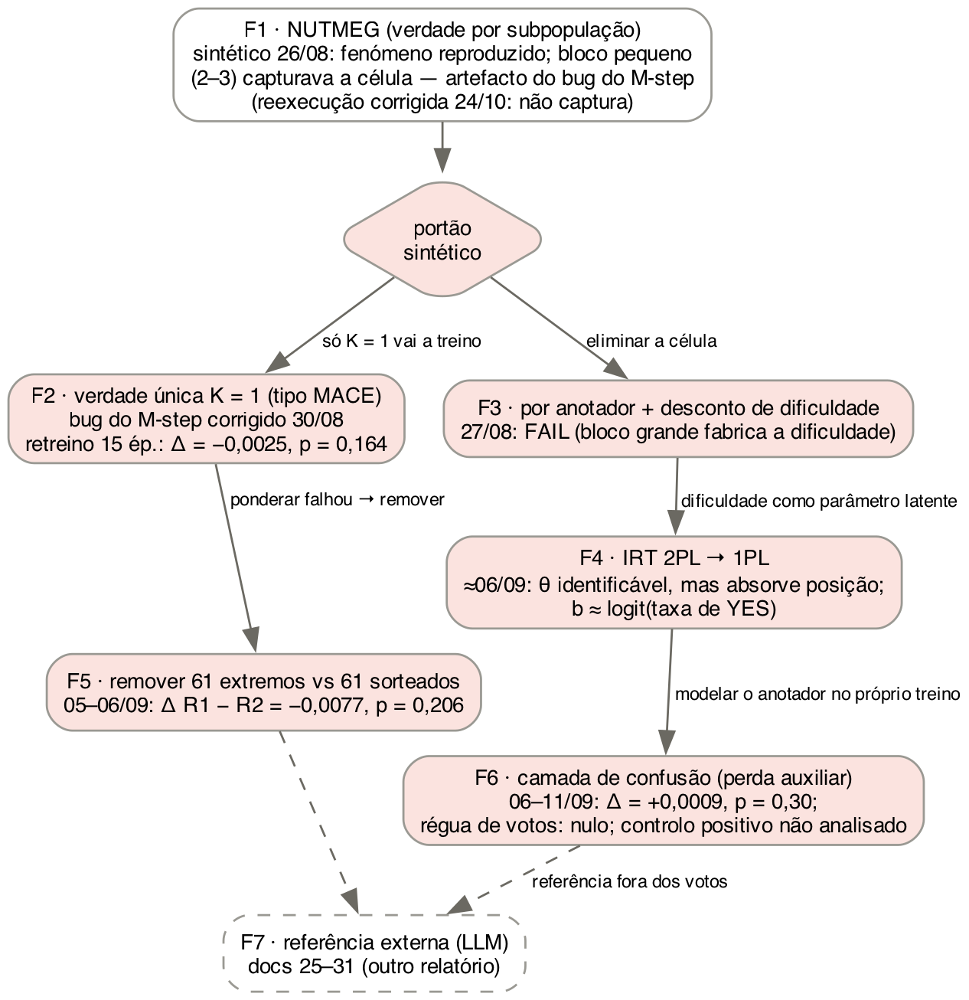

# Metodologia — estimadores de confiabilidade de anotadores na Task 2.1 (memes)

**O que é este documento.** É a descrição completa e reprodutível de *como* cada estimador de confiabilidade de anotadores foi construído, validado e (quando chegou a isso) usado para retreinar o modelo de memes do EXIST 2026. Cobre a linha `reliability/` (2026-08-26 a 2026-09-14). Os resultados numéricos estão no documento irmão, `RELATORIO_RELIABILITY.md`; aqui só aparecem os números necessários para descrever o desenho (tamanhos, limiares, parâmetros). A linha do anotador LLM (GLM-4.6V-Flash e Claude, docs 25 a 31) está descrita em `EXIST_MEMES/glm_annotator/METODOLOGIA_GLM_CLAUDE.md` e só é referida aqui.

Este texto serve de insumo para os capítulos de implementação e de resultados da dissertação. Tudo o que é número tem a fonte entre parênteses. Os artefactos citados estão em `reliability/outputs/` salvo indicação em contrário.

---

## 0. Convenções, escopo e mapa

### 0.1 Convenções

- `[MEDIDO]`: número observado, com o artefacto que o produziu.
- `[HIPÓTESE]`: interpretação plausível, não testada. Não escrever como facto.
- `[LIMITAÇÃO]`: restrição que o texto da tese tem de declarar.
- `[PÓS-HOC]`: decidido depois de ver um resultado. Nunca tem o estatuto de um resultado pré-registado.
- **Pré-registado** significa: o critério de PASS/FAIL foi fixado em código ou em documento *antes* de a execução que ele julga ter sido corrida. Onde isso não aconteceu, está dito.
- Os números deste documento e do relatório foram **recalculados de forma independente** a partir dos artefactos primários (dataset, ficheiros de θ, soft labels e logs de `EXIST_MEMES/metrics_history/`). Os scripts estão em `reliability/relatorio/verificacao/` (§13).

### 0.2 As famílias testadas

A pergunta comum a todas: *é possível estimar, a partir dos dados do EXIST, uma confiabilidade por anotador que separe ruído de discordância legítima, e usá-la para construir um alvo de treino melhor?* Sob o paradigma *Learning with Disagreement* (LeWiDi), a discordância é sinal; um estimador útil tem de punir ruído **sem** punir perspectivas minoritárias consistentes.

| # | Família | Unidade de estimação | Implementação | Foi a dados reais? | Foi a retreino? |
|---|---|---|---|---|---|
| F1 | **NUTMEG** (EM com verdade por subpopulação) | célula (item, subpopulação) | `reliability/nutmeg_em.py` (`NutmegEM`, K ≥ 2) | sim: θ em 6 definições de subpopulação | **não** |
| F2 | **Agregação bayesiana de verdade única** (tipo MACE) | anotador, verdade por item | o mesmo `NutmegEM` com K = 1 (`single_truth_K1`) | sim | **sim**: soft labels ponderadas por θ (A1) |
| F3 | **Por anotador com desconto de dificuldade** | anotador (~27 votos) | `reliability/perann_reliability.py` | **não** (reprovado no sintético) | não |
| F4 | **Teoria de Resposta ao Item** (IRT 2PL → 1PL) | anotador + item | `EXIST_MEMES/dataset_verifications.ipynb` | sim (ajuste por painel linguístico) | não |
| F5 | **Ablação de anotadores extremos** (remover, contra controlo pareado) | anotador (regra por `yes_rate`) | `EXIST_MEMES/reliability_tests.ipynb` | sim | **sim**: R1 vs R2 |
| F6 | **Camada de confusão** (matriz 2×2 por anotador como perda auxiliar) | anotador, aprendido no treino | `EXIST_MEMES/confusion_core.py` + `memes_confusion.ipynb` | sim | **sim** (Fase 1 e Fase 2, parcial) |
| — | Diagnósticos descritivos (não são estimadores) | — | `divisiveness.py`, `behavioral_profile.py`, `run_behavioral_diagnosis.py`, `validate_latent_dimension.py`, `EXIST_MEMES/Untitled.ipynb` | sim | não |
| F7 | Referência externa (LLM como anotador) | anotador, referência fora dos votos | `EXIST_MEMES/glm_annotator/` | sim | sim (docs 27, 28) — **fora deste documento** |

**Mapeamento com o `cap07.tex`.** A subsecção do IRT no `cap07.tex` diz que "quatro famílias independentes" foram avaliadas: *a Bayesian aggregation model, a subpopulation model, a heuristic estimator with difficulty discounting, and a psychometric model*. A correspondência é F2, F1, F3 e F4, respectivamente. **Evidência para "Bayesian aggregation model" = F2 (K = 1, tipo MACE):** (i) o mesmo parágrafo lista "subpopulation model" como item separado, e no texto da tese o NUTMEG é o modelo de subpopulação (`cap02.tex`, parágrafo de `ivey2025nutmeg`); (ii) o `cap02.tex` apresenta o MACE dentro dos "Bayesian models of annotation" (`paun2018comparing`); (iii) o estimador K = 1 usa priors Beta(0,5; 0,5) em θ e Dirichlet(0,5) em ξ e um M-step MAP, ou seja, é um modelo bayesiano de agregação (`em_convergence_diagnosis.md` §0). O autor concorda com o mapeamento (2026-10-24); a evidência acima é a que o sustenta. **Pendência:** com a camada de confusão (F6) as famílias passam a ser cinco, e o `CONFUSION_EXPERIMENT.md` §16 já regista que a frase do `cap07.tex` tem de ser corrigida; com a ablação (F5) e a referência LLM (F7) a contagem depende de como a tese agrupar "estimar" e "usar" uma estimativa (ver relatório §20).

### 0.3 Estado de cada experimento

| Experimento | Data | Pré-registo | Execução | Veredito |
|---|---|---|---|---|
| F1 · grade de recuperação (sintético) | 2026-08-26 | limiares em `validate.py` | 3 seeds × 5 divisividades × 3 taxas de spam × 2 densidades | fenómeno reproduzido; teto ≈ 0,60 na densidade do EXIST |
| F1 · preservação de minoria | 2026-08-26 | sim | 3 seeds | PASS |
| F1 · spammer de viés constante (20%) | 2026-08-26 | sim | 3 seeds × 3 modos × 2 rótulos | PASS (com uma célula de fronteira, §4.6) |
| F1 · stress-sweep de bloco pequeno | 2026-08-26 | diagnóstico secundário | 6 frações × 3 seeds | **quebra** com 2–3 spammers (estimador legado) |
| F1 · portões reexecutados com o estimador corrigido | 2026-10-24 (esta revisão) | mesmos critérios de `validate.py` | grade, minoria, viés, sweep | o legado reproduz bit a bit; com o corrigido **a quebra por bloco pequeno desaparece** (relatório §5) |
| F1/F2 · θ nos dados reais (7 definições) | 2026-08-26, refeito 2026-08-30 | — (descritivo) | CPU | ver relatório §8 |
| Divisividade empírica | 2026-08-26 | regra explícita | 50 permutações por nulo | estrutura demográfica marginal |
| F3 · portão sintético | 2026-08-27 | limiares em `validate.py` | 3 seeds | **FAIL** nas duas variantes |
| F2 · bug da responsabilidade do M-step | 2026-08-30 | critérios C1–C4 | — | corrigido; θ e soft labels regenerados (`_fixed`) |
| F2 · retreino a 2 épocas (θ legado) | 2026-08-30 | critério "efeito > ruído de seed" | 6 runs | nulo, **subtreinado** |
| F2 · retreino a 15 épocas (θ corrigido) | 2026-08-30/31 | t pareado bilateral, E = argmin(eval_loss) | 6 runs | **NULO** |
| F2 · nulo por permutação de θ | 2026-08-30 | P1–P5 | ficheiros gerados | **nunca treinado** |
| F4 · IRT (sintético + real) | ≈ 2026-09-06 | limiares no notebook | 3 seeds (+30 no controlo) | θ identificável; parâmetros inutilizáveis |
| F5 · ablação R1/R2 | runs 2026-09-05; critério 2026-09-06 | decisiva R1 − R2 | 9 runs | **NULO** |
| F6 · Fase 1 (controlo + grelha + braço `clr`) | 2026-09-06 a 09-09 | §6 do protocolo | 1 + 3 + 3 runs | grelha incompleta; braço exploratório nulo |
| F6 · Fase 2, run A (régua de votos) | 2026-09-11 | §12 do protocolo | 1 run | **NULO** |
| F6 · Fase 2, run B (controlo positivo) | 2026-09-11 | §12 do protocolo | 1 run | **treinada, nunca analisada** |
| F6 · Fase 2, runs C/D/E (viés congelado) | — | §17 do protocolo | — | não corridas (dependem da Porta 1) |
| Análise de painéis | 2026-09-14 | — (descritivo) | CPU | limiar pessoal estável (split-half 0,850) |



*Figura M1 — Ordem em que as famílias foram testadas e porque cada uma levou à seguinte. Losangos = portões; vermelho = reprovado ou nulo.*

---

## 1. Dados e estrutura de anotação

Todos os números desta secção foram recalculados a partir de `EXIST_MEMES/Dataset/memes/training/EXIST2026_training.json` (`verificacao/verify_part1.py`). **Atenção às populações**: várias grandezas parecidas referem-se a conjuntos diferentes, e a tabela diz sempre qual.

| Grandeza | Valor | População |
|---|---|---|
| itens (memes) | 3 984 | treino oficial completo |
| votos da Task 2.1 | 23 904 (6 por item, sem excepção) | 3 984 itens |
| anotadores distintos | 887 | 3 984 itens |
| votos YES | 13 286 (fracção **0,5558**) | 23 904 votos |
| votos NO | 10 618 | 23 904 votos |
| votos `UNKNOWN` na Task 2.1 | 0 | — |
| itens com 0…6 votos YES | 373 / 459 / 535 / 614 / 672 / 759 / 572 | 3 984 itens |
| itens unânimes | 945 (572 YES + 373 NO) | 3 984 itens |
| itens empatados (3 YES / 3 NO) | 614 | 3 984 itens |
| itens com maioria estrita YES | 2 003 (fracção 0,5028) | 3 984 itens |
| votos por anotador | média 26,95 · mediana 27 · mín. 9 · máx. 54 | 887 anotadores |
| anotadores com menos de 15 votos | 11 | 887 anotadores |
| α de Krippendorff (nominal) | **0,2791** | 3 984 itens, todos os anotadores |
| estratos linguísticos | 437 só ES · 431 só EN · 19 bilingues | 887 anotadores |
| painel ES (para o IRT) | 1 979 itens · 456 anotadores · 11 874 votos · 474 unânimes · YES 0,573 | itens `lang = es` |
| painel EN (para o IRT) | 2 005 itens · 450 anotadores · 12 030 votos · 471 unânimes · YES 0,539 | itens `lang = en` |
| painéis fixos de 6 anotadores | 151 (≈ 26,4 itens por painel) | 3 984 itens |
| anotadores num único painel | 868 de 887 (19 em dois painéis) | 887 anotadores |
| composição de cada painel | exactamente 1 anotador em cada célula género × idade (F/M × 18-22/23-45/46+) nos 151 painéis | 151 painéis |

Notas que evitam confusões frequentes:

1. **456 + 450 = 906 > 887** porque os 19 anotadores bilingues entram nos dois painéis do IRT. Os estratos disjuntos usados nas permutações são 437 / 431 / 19.
2. **Taxa base.** 0,5558 é a fracção de YES nos 23 904 votos; 0,5552 é a mesma fracção **só nos itens de treino** do split congelado (é a taxa usada na régua de votos da F6, §10.6); 0,5581 é a média das `yes_rate` dos 887 anotadores (média de proporções, não proporção global).
3. **Unanimidade esperada.** Se os anotadores fossem intercambiáveis com p = 0,5558, a fracção de itens unânimes seria p⁶ + (1 − p)⁶ = **0,037**. A observada é 945/3 984 = **0,237** (24% em cada painel).
4. **Painéis fixos.** O EXIST não sorteia anotadores por item: cada item é visto por um dos 151 painéis fixos, e 868 anotadores vêem só os ~27 itens do seu painel. Isto limita qualquer estimador que dependa de anotadores se cruzarem em itens: o grafo de co-anotação tem 132 componentes ligadas, a maior com 16 anotadores (`Untitled.ipynb`, passo 7).

### 1.1 Split congelado

`reliability/outputs/split_taskA_frozen.json`: **3 386 itens de treino / 598 de validação**, interseção vazia, `train_test_split` com `random_state = 42`, `test_size = 0,15`, estratificado pelo voto maioritário do alvo cru (`p_YES ≥ 0,5`), resolvido **uma vez** a partir do alvo cru (`make_soft_labels_taskA.py`). Todos os braços de todos os retreinos carregam este ficheiro. Razão: se o split fosse refeito a partir de cada alvo, 421 itens mudariam de estrato no braço ponderado e parte de qualquer Δ viria do split, não da intervenção (`soft_labels_taskA_report_fixed.md` §6). Distribuição de votos YES nos 3 386 itens de treino: 316 / 388 / 458 / 518 / 585 / 645 / 476. Os 598 itens de validação somam **3 588 votos** (usados como régua na F6, §10.6).

### 1.2 Alvo cru

`soft_labels_taskA_raw.json`: `{id_EXIST: [p_YES, p_NO]}` com `p_YES = n_YES / 6`. Verificado igual a `n_YES/6` em todos os 3 984 itens (máx. |Δ| = 0). `soft_labels_taskA_raw_fixed.json` e `soft_labels_taskA_A0_baseline.json` são idênticos a este (o alvo cru não depende de θ).

**Convenção de "cruzar 0,5".** Em todos os scripts do projecto, um item "cruza 0,5" entre dois alvos *a* e *b* quando `(a ≥ 0,5) ≠ (b ≥ 0,5)`. Como 614 itens têm `p_YES = 0,5` exacto no alvo cru, **qualquer** movimento desses itens para baixo de 0,5 conta como cruzamento, embora eles não tenham maioria. O relatório (§13) separa os cruzamentos em "resolve um empate" e "inverte uma maioria".

---

## 2. Princípios de desenho comuns

Estes princípios foram aplicados em toda a linha e devem ser descritos uma vez no capítulo de método.

1. **Pré-registo em código.** Os limiares de PASS/FAIL dos portões sintéticos são constantes em `reliability/validate.py` (e células do notebook do IRT), escritas antes da execução que julgam. Quando um limiar se revelou mal calibrado depois de visto o resultado, **não foi alterado**: o resultado ficou como FAIL e a má calibração foi registada como erro de desenho (F3 §7.5, F4 §8.4, F6 §10.4).
2. **"Nunca correr nos dados reais um componente que não passou no teste sintético."** É a razão de `run_perann_exist.py` não existir (F3) e de o NUTMEG com subpopulação nunca ter sido usado num retreino (F1).
3. **Nulos condicionados em vez de permutação ingénua.** Na divisividade, a permutação de anotadores altera a composição dos itens e produz z negativos por geometria; os vereditos usam o nulo condicionado *within-item* (§6). No θ, a permutação é estratificada por painel linguístico (§5.4).
4. **Intervenção só no alvo de treino da Task 2.1.** Em todos os retreinos, só muda `labels_task2_1_soft` dos itens de treino. A validação usa sempre o alvo cru (`raw`), as Tasks 2.2/2.3 não mudam, e o que se observa nelas é *spillover* do encoder partilhado, não efeito directo.
5. **Época reportada E = argmin(`eval_loss`).** Nunca a época de melhor métrica (seria escolher pelo resultado). O estado final (época 15) é reportado também, como secundário, pela **regra de simetria** (não misturar "pico de um lado, fim do outro").
6. **Comparações pareadas por seed** (42, 7, 2025), t de Student bilateral com df = 2, d_z de Cohen e número de seeds para 80% de poder (§12).
7. **Uma métrica decisiva por estudo** (Task A ICM-Soft-Norm na época E); as restantes 5 métricas × 2 pontos de leitura são contexto, e qualquer p < 0,05 avulso nelas é tratado como multiplicidade.
8. **Determinismo verificado.** Os estimadores CPU dão max|Δ| = 0 entre duas execuções com a mesma seed (NUTMEG, F3); o A0 re-corrido a 2026-09-06 reproduz o log de 2026-08-31 bit a bit (`CONFUSION_EXPERIMENT.md` §5).
9. **Desvios declarados com data.** Toda a alteração de protocolo depois do início está registada no documento do estudo, com a razão (exemplos: `CONFUSION_EXPERIMENT.md` §13, §5c, §5d).

---

## 3. O sistema de treino comum aos retreinos (F2, F5, F6)

- **Modelo**: o modelo de memes do sistema (XLM-RoBERTa large + CLIP ViT-L/14, fusão multimodal, três cabeças: A binária, B intenção, C multirrótulo), treinado sobre soft labels (`EXIST_MEMES/memes_core.py`, `memes_model.ipynb`). `memes_core.py` não foi alterado em nenhum destes estudos.
- **Selecção do alvo**: a célula 6 do `memes_model.ipynb` lê `../reliability/outputs/soft_labels_taskA_{ARM}.json`; mudar `ARM` é a única edição entre braços. A validação é sempre remapeada para `soft_labels_taskA_raw.json`.
- **Seeds**: `SEED ∈ {42, 7, 2025}`, que alimenta `seed` e `data_seed` do `TrainingArguments`; o split vem do ficheiro congelado e não depende da seed.
- **Épocas**: 15 nos estudos confirmatórios (F2 a 15 épocas, F5, F6). O estudo F2 a 2 épocas (§5.3) é anterior e foi declarado subtreinado.
- **Hiperparâmetros relevantes** (`CONFUSION_EXPERIMENT.md` §5c, §7, §5c-bis): `learning_rate` = 1e-5, weight decay 0,05, `task_a_weight` = 2,0, fp16, 795 passos de optimizador em 15 épocas.
- **Métricas**: ICM-Norm (hard) e ICM-Soft-Norm (soft) das Tasks A, B e C, via PyEvALL, sobre os 598 itens de validação. **Métrica decisiva: Task A ICM-Soft-Norm (`eval_task_a_icmsoftnorm_soft`) na época E.**
- **Logs**: um JSON por run em `EXIST_MEMES/metrics_history/<timestamp>_<RUN_TAG>_seed<S>.json`, com uma entrada por avaliação. A tabela de ficheiros usados em cada comparação está no relatório (§21).
- **Mínimo de `eval_loss`**: época 3 em todas as runs de 15 épocas, excepto `R2_rem_controle`/2025 e `conf_M1_lam0.1`/42 (época 4). A perda sobe depois: as épocas 4 a 15 são sobreajuste.

---

## 4. F1 — NUTMEG (`NutmegEM`, verdade por subpopulação)

### 4.1 Motivação

Um estimador de verdade única (MACE) define competência como concordância com a verdade que ele próprio infere; sob LeWiDi, isso converte discordância sistemática legítima em "incompetência". O NUTMEG (Ivey, Gauch e Jurgens, EMNLP 2025, `ivey2025nutmeg` no `refs.bib`) evita isso postulando uma verdade latente por **(item, subpopulação)**. A implementação do projecto é **própria** (EM com updates fechados), "no espírito do NUTMEG", e não o código dos autores; variational Bayes ficou documentado como extensão, não implementado (`nutmeg_em.py`, docstring). `[LIMITAÇÃO]` Antes de citar, conferir na fonte primária se o modelo do artigo coincide com o modelo abaixo.

### 4.2 Modelo

Para o anotador j, da subpopulação k = subpop[j], no item i:

```
T[i, k] ~ Uniforme({0, …, L−1})                        (L = 2 na Task 2.1)
voto_ij = T[i, k]                 com probabilidade θ_j   (não está a "spammar")
voto_ij ~ Multinomial(ξ_j)        com probabilidade 1 − θ_j
P(v | T = l) = θ_j · 1{v = l} + (1 − θ_j) · ξ_j[v]
```

θ é a probabilidade de **não spammar**, não a probabilidade de o voto coincidir com a verdade (é um modelo de spam ao estilo MACE, não Dawid-Skene simétrico). Com `subpop = zeros` (K = 1) a mesma classe é o baseline de verdade única (F2): sem segundo estimador, a comparação K = 1 contra K ≥ 2 é feita no mesmo código.

### 4.3 Estimação

- **E-step**: posterior de T[i, k] dados θ e ξ. Células (item, subpopulação) sem votos ficam no prior uniforme e não contribuem para a verosimilhança.
- **M-step**: responsabilidade de spam por voto → θ_j e ξ_j. Priors Beta(0,5; 0,5) em θ e Dirichlet(0,5) em ξ, logo o M-step é MAP (codificado como **média posterior** `(Σr + a)/(n + a + b)`, não o argmax `(Σr + a − 1)/(n + a + b − 2)`).
- **Inicialização** determinística: θ = 0,8 e ξ uniforme, o que faz o primeiro E-step colapsar no voto maioritário suavizado por célula; `n_restarts = 1`, nenhum RNG consumido.
- **Paragem**: |ΔLL| < 1e-6 na log-verosimilhança. `n_iter` máximo era 200 até 2026-08-30 e passou a 5 000.
- **Clip**: θ ∈ [0,001; 0,999] (nunca atingido nos dados reais).

### 4.4 O bug da responsabilidade do M-step (corrigido a 2026-08-30)

Diagnóstico em três etapas, todas sem alterar o estimador até à última (`em_convergence_diagnosis.md`, `monotonicity_alignment_report.md`, `mstep_responsibility_diagnosis.md`):

1. **Não-convergência.** O θ K = 1 original tinha `converged = false` em 200 iterações. Com `n_iter = 5000` converge na iteração **462**, e o θ convergido difere do interrompido em média 0,0011 (r = 0,9991); a não-convergência era cosmética.
2. **Quebras de monotonicidade.** A log-posterior, que o EM MAP garante não-decrescente, caía **273** vezes (a partir da iteração 83). Priors, clip, EPS e *label switching* foram excluídos como causa; ler a série no fim da iteração em vez do início não muda nada (274 quebras).
3. **Causa.** Marginalizando T, a responsabilidade correcta de "não-spam" é `r = p_true · θ / (θ + (1−θ)·ξ[v])`. O código calculava `r = θ·p_true / (θ·p_true + (1−θ)·ξ[v])`, que só é correcto se `p_true` for o posterior *leave-one-out*. Alimentado com o posterior completo, **conta o voto do próprio anotador duas vezes** e enviesa θ para cima, de forma não uniforme. Com a responsabilidade corrigida: 0 quebras em 291 transições, convergência em **292** iterações.

Critérios pré-registados do diagnóstico (`mstep_responsibility_diagnosis.md` §2): C1 (corrigir não piora o RMSE sintético em mais de 0,005) **FAIL** — os dois estimadores enviesam θ para baixo e o legado cancela parte desse viés por acaso; a correlação com o θ verdadeiro é igual nas duas variantes. C2 (zero quebras com a responsabilidade corrigida, variante ML-argmax) **PASS**; C2b (o controlo com a responsabilidade do código quebra) **PASS** (90 quebras). C4 (o deslocamento das soft labels é material, > 0,0072) **MATERIAL** (0,0246). Decisão do autor: regenerar θ e soft labels com o estimador corrigido. **Os ficheiros legados não foram tocados**; os novos têm sufixo `_fixed`, e o estimador legado continua acessível por `NutmegEM(responsibility="legacy")`.

**Os portões sintéticos do F1 (§4.6) foram corridos a 2026-08-26, com o estimador legado**, e nunca tinham sido repetidos depois da correcção. Nesta revisão (2026-10-24) foram reexecutados com o mesmo código e os mesmos critérios de `validate.py`, mudando só a responsabilidade do M-step (`verificacao/verify_nutmeg_gates.py`): primeiro com `responsibility="legacy"` e `n_iter = 200`, que reproduz **bit a bit** os ficheiros de 2026-08-26 (máx. |Δr| = 0 nas 180 linhas das duas grades; minoria, spammer e sweep idênticos), depois com `responsibility="fixed"`. Um controlo 2 × 2 (responsabilidade × `n_iter` ∈ {200, 5 000}) mostra que o número de iterações não altera nada; a diferença vem só da responsabilidade (`verificacao/verify_sweep_2x2.py`). Resultado no relatório §5: **uma das conclusões do F1 não sobrevive à correcção** (a captura por bloco pequeno). Esta reexecução não estava pré-registada; está datada e separada dos resultados originais. Os portões do F3 e do F4 não são afectados (código diferente).

`[LIMITAÇÃO]` Se a tese escrever "MACE", deve dizer que o estimador é **do tipo MACE** (modelo de spam com priors), implementado de raiz, e não o MACE de Hovy et al. (2013) tal como publicado; a correspondência exacta do M-step com o artigo não foi verificada (`mstep_responsibility_diagnosis.md` §7).

### 4.5 Definições de subpopulação (dados reais)

`run_exist.py`, KMeans determinístico (`n_init = 10`, seed fixa), K ∈ {4, 8}:

- `demo_base`: etnia + escolaridade + país, one-hot de 66 dimensões.
- `demo_extended`: + género + idade, one-hot de 71 dimensões.
- `behavioral`: perfil de voto em 6 dimensões (`yes_rate`, desvio médio do consenso, |desvio| médio, concordância com a maioria, desvio em itens contestados, fracção de votos contestados), padronizado. **Circular**: os clusters saem dos mesmos votos que o EM usa.
- `single_truth_K1`: K = 1 (F2).

Demografia inconsistente entre itens foi resolvida pela moda (2 anotadores). Duas tentativas de definição comportamental foram rejeitadas por evidência: concordância par-a-par (com painéis fixos a sobreposição esperada é ~0,15 itens por par) e `TruncatedSVD(32)` dos resíduos + KMeans, que deu clusters degenerados [883, 2, 1, 1] (K = 4) e [873, 2, 2, 2, 2, 2, 2, 3] (K = 8).

### 4.6 Validação sintética (`validate.py --all`, `--bias-spammer`)

Gerador `synthetic.generate_synthetic`: K = 2 subpopulações (minoria 25%), "divisividade" = fracção de itens em que as verdades das duas subpopulações diferem; θ ~ Beta com média `1 − spam_rate` e concentração 8; 6 votos por item; seeds 42, 7, 2025.

| Teste | Desenho | Critério pré-registado |
|---|---|---|
| Grade de recuperação | divisividade ∈ {0; 0,15; 0,30; 0,50; 0,70} × spam ∈ {0,15; 0,30; 0,45} × 3 seeds; densidade confortável (800 itens, 60 anotadores, 80 votos/anotador) e densidade do EXIST (3 984 itens, 887 anotadores, 26,9 votos/anotador) | descritivo: Pearson r(θ̂, θ) por estimador |
| Preservação de minoria | minoria 25% com θ fixo 0,90, divisividade 0,70, spam médio 0,35 na maioria | θ̂ minoria ≥ 0,70; gap (maioria − minoria) ≤ 0,10; separação contra spammers ≥ 0,25 |
| Spammer de viés constante | 3 populações explícitas: fiáveis, 20% spam uniforme (θ = 0,25), 20% "vota sempre o mesmo rótulo" (θ = 0,25); divisividade 0,30; rótulo YES e rótulo NO; modos `subpop_aware`, `subpop_adversarial` (os enviesados recebem uma subpopulação só deles, um oráculo do que um clustering comportamental faria) e `single_truth` | c1 θ̂ enviesado ≤ 0,60; c2 θ̂ fiável − θ̂ enviesado ≥ 0,20; c3 \|θ̂ enviesado − θ̂ uniforme\| ≤ 0,15 |
| Stress-sweep | modo `subpop_adversarial`, fracção de enviesados ∈ {0,03; 0,05; 0,10; 0,20; 0,35; 0,50} | diagnóstico secundário (não altera o veredito); comparado com o teto 0,60 |

### 4.7 Execução nos dados reais

`python -m reliability.run_exist` (CPU): θ para as 7 definições (6 com subpopulação + K = 1), com diagnósticos de cobertura de células, votos por célula, flags de degenerescência (`CÉLULAS_QUASE_SINGULARES` abaixo de 1,5 votos por célula) e ρ de Spearman contra duas métricas descritivas com viés de consenso conhecido (concordância com a maioria e Δα de Krippendorff *leave-one-out*). Estas métricas **não** são critério de correcção do θ: penalizam por construção a minoria que o método quer proteger; o árbitro é o teste sintético de preservação de minoria (`summary_taskA_fixed.md` §1).

---

## 5. F2 — Agregação de verdade única (tipo MACE) e soft labels ponderadas por θ

### 5.1 Estimador

`NutmegEM` com K = 1 sobre os 23 904 votos (§4.2–4.4). θ corrigido: `theta_taskA_single_truth_K1_fixed.json` (887 anotadores, convergido em 292 iterações, θ ∈ [0,0294; 0,9521], mediana 0,4861, média 0,4826). θ legado: `theta_taskA_single_truth_K1.json` (média 0,5352).

### 5.2 Construção do alvo (`make_soft_labels_taskA.py`)

```
p_YES_ponderado(i) = Σ_j θ_j · v_ij / Σ_j θ_j        (v_ij = 1 se YES; soma sobre os 6 anotadores do item)
```

Seguida **literalmente**, sem clip nem piso (decisão do autor): um anotador com θ < 0,5 é atenuado mas o voto dele nunca é invertido. Verificações obrigatórias (todas PASS): identidade do alvo cru, domínio [0, 1] sem NaN, Σ dos pesos normalizados = 1 por item (máx. desvio 2,2e-16), 0 anotadores sem θ, split a particionar os itens. Verificado nesta revisão que `soft_labels_taskA_weighted_fixed.json` é exactamente Σθv/Σθ com o θ **corrigido** (máx. |Δ| = 2,2e-16) e `soft_labels_taskA_weighted.json` o mesmo com o θ **legado** (3,3e-16). `[NOTA]` O §2 de `soft_labels_taskA_report_fixed.md` escreve o nome do ficheiro de θ sem o sufixo `_fixed`; os números desse relatório (0,0617; 421) são os do θ corrigido. É um erro de texto, não de dados.

### 5.3 Braços e protocolo

| Estudo | Braços (RUN_TAG) | θ | Épocas | Critério |
|---|---|---|---|---|
| A0/A1 a 2 épocas (2026-08-30) | `raw` vs `weighted` | legado | 2 | efeito na primária > ruído de seed do baseline (amplitude entre seeds); t pareado como secundário |
| A0/A1 a 15 épocas (2026-08-30/31) | `raw` vs `weighted_fixed` | corrigido | 15 | t pareado bilateral sobre 3 seeds na primária em E |

O estudo a 2 épocas foi declarado **subtreinado** depois de corrido: em todas as 6 runs a `eval_loss` ainda descia da época 1 para a 2 e a métrica primária ainda subia ~+0,03 por época; o "2" do `memes_model.ipynb` era resquício dos smoke tests de 2026-08-04, e o sistema real treinava com 30 (`theta_arms_comparison.md` §5). **Os dois estudos não são medições do mesmo alvo** (θ legado vs corrigido) **nem com o mesmo critério**; o de 2 épocas fica como registo, não como referência.

### 5.4 Nulo por permutação de θ (gerado, nunca treinado)

`make_permuted_soft_labels.py`: θ corrigido permutado entre anotadores **dentro de três estratos disjuntos** (437 só ES, 431 só EN, 19 bilingues), seeds 101, 202, 303, 404, 505; o alvo é reconstruído com Σθv/Σθ. Razão da estratificação: permutar entre línguas destruiria estrutura que não é confiabilidade e daria um nulo fácil de bater. Critérios: P1 multiconjunto de θ idêntico por estrato; P2 sem fuga entre estratos; P3 fracção de pontos fixos < 0,05 (estratos com n ≥ 20); P4 estratos particionam os anotadores; P5 (descritivo) magnitude da perturbação contra a do A1 real. Os cinco ficheiros `soft_labels_taskA_permuted_seed*_fixed.json` existem e passam P1–P4, mas **nenhum retreino os usou**.

---

## 6. Divisividade empírica (diagnóstico, `divisiveness.py`)

Pergunta: as subpopulações explicam a discordância melhor do que uma partição ao acaso? Três indicadores por definição de subpopulação:

- **A.1 Item divisivo**: existe uma subpopulação com taxa de YES > 0,5 e outra < 0,5 no item (empates exactos não contam). Subconjunto "confiável": itens com ≥ 2 subpopulações com ≥ 2 votos cada.
- **A.2 Decomposição**: por item, `SS_total = Σ_j (v_ij − m_i)²`, `SS_between = Σ_k n_ik (m_ik − m_i)²`; rácio entre/total agregado sobre itens com ≥ 2 votos.
- **A.3 α de Krippendorff intra-subpopulação**, ponderado.

Dois nulos, 50 permutações cada: **Nulo A** (permuta anotadores entre clusters, mantendo tamanhos) e **Nulo B** (condicionado *within-item*: mantém partição e composição de cada item e permuta só os votos entre os anotadores do item). O Nulo A está confundido: altera o número de subpopulações distintas por item (2,77 observado contra 3,13 permutado em `demo_base_K4`), e menos células dão menos divisividade espúria. **Os vereditos usam o Nulo B**; o z-score é a grandeza que interessa.

---

## 7. F3 — Competência por anotador com desconto de dificuldade (`perann_reliability.py`)

### 7.1 Motivação

Eliminar a célula como unidade: agregar os ~27 votos de cada anotador (1–2 ordens de grandeza mais dados por parâmetro do que o F1). Para não colapsar em MACE ingénuo, descontar a discordância em itens genuinamente divididos.

### 7.2 Estimador (determinístico, não iterativo)

```
dificuldade(i) = H(p_i) / log 2          p_i = fracção de YES no pool do item i (votos crus)
peso(i)        = 1 − dificuldade(i)
competência(j) = Σ_i peso(i) · 1[voto_j(i) = maioria(i)]  /  Σ_i peso(i)
```

Votos em itens empatados (e pools LOO pares ou vazios) são excluídos do numerador e do denominador em todas as configurações, para que a linha de base sem desconto seja comparável.

### 7.3 Configurações comparadas

| Nome | `discount` | `leave_one_out` | O que é |
|---|---|---|---|
| `mace_naive` | não | não | concordância com a maioria, mesmo caminho de código |
| `discount_raw` | sim | não | **literal da especificação**: o voto do próprio anotador entra na dificuldade |
| `discount_loo` | sim | sim | variante acrescentada (não estava na especificação): dificuldade e maioria vistas por j excluem o voto de j |

Razão da variante LOO: na forma literal, um dissidente num item unânime de 6 votos dá p = 1/6, dificuldade 0,65 e peso 0,35 em vez de 1,0, ou seja, infla com o próprio voto a dificuldade do item que o vai julgar. Reportada ao lado, não em substituição.

### 7.4 Portão sintético (`validate.py --perann`)

Gerador `generate_difficulty_synthetic`: item **fácil** tem verdade única e o pool concorda; item **difícil** tem convicção Bernoulli(0,5) independente por anotador (ambiguidade genuína com anotadores competentes); voto = convicção com prob. θ, ruído com prob. 1 − θ. Seeds 42, 7, 2025.

| Teste | Desenho | Critério pré-registado |
|---|---|---|
| 2.1 Recuperação | `hard_frac` ∈ {0; 0,2; 0,4; 0,6} × densidade confortável (80 votos/anotador) e do EXIST (27,1) | r(hard = 0,4, confortável) ≥ 0,60 **e** vantagem sobre `mace_naive` ≥ 0,05 em todo `hard_frac` ≥ 0,4 |
| 2.2 Minoria, braços *matched* | mesma fracção (0,25), θ (0,95) e nº de itens de discordância (30%); braço `hard` (minoria discorda em itens ambíguos: deve ser protegida) e `easy` (discorda em itens de consenso: é ruído, deve ser punida) | hard: θ̂ minoria ≥ 0,70 e gap ≤ 0,10; easy: θ̂ minoria ≤ 0,60 e gap ≥ 0,20 |
| 2.3 Spammer de viés constante | 20% sempre YES | θ̂ enviesado ≤ 0,60 e gap ≥ 0,20 |
| Sweep de bloco (diagnóstico) | fracção do bloco ∈ {0,03; 0,08; 0,15; 0,25; 0,35}, braço easy e braço spammer | descritivo |

### 7.5 Escala dos limiares (erro de desenho declarado)

Os limiares absolutos (teto 0,60, piso 0,70) foram herdados do F1, onde θ tem chão 0. A competência do F3 é uma taxa de concordância com chão de acaso ≈ 0,5: um spammer com θ real 0,25 tem concordância esperada 0,25 + 0,75 × 0,5 = 0,625, acima do teto **por construção**. Os limiares não foram alterados; o relatório separa este FAIL "de escala" do FAIL "de fundo" (comparação de gaps).

---

## 8. F4 — Teoria de Resposta ao Item (`dataset_verifications.ipynb`, células 2–13)

### 8.1 Motivação

Nos estimadores anteriores a dificuldade do item (quando existe) é uma estatística dos votos, logo capturável por um bloco. No IRT a dificuldade b_i é um **parâmetro latente** estimado em conjunto com a competência θ_j, o que remove a circularidade competência → dificuldade por construção.

### 8.2 Modelo e estimação

```
2PL:  P(voto_ij = YES) = σ( a_i · (θ_j − b_i) )        1PL (Rasch): a_i = 1
```

Máxima verosimilhança marginal por EM (MML-EM) com quadratura de Gauss-Hermite de 21 pontos (`hermegauss`, pesos normalizados), θ_j ~ N(0, 1) como distribuição de integração; competência final por EAP (`θ̂ = post @ nós`). M-step por item com L-BFGS-B, limites a ∈ [0,05; 5], b ∈ [−10; 10]; no 2PL, prior log-normal em a com σ = 0,5. Paragem |ΔLL| < 1e-5, até 200 iterações. A monotonicidade da log-verosimilhança marginal é verificada em cada iteração como teste de implementação. Estimação conjunta (JML) foi evitada porque enviesa os parâmetros de item com poucas respostas por pessoa.

### 8.3 Ordem dos testes

1. **Sondagem de implementação** (densidade confortável: 1 000 itens, 200 anotadores, 50 votos/item, seed 42), critério r ≥ 0,80 nos três parâmetros. Só serviu para verificar o código; **não** podia informar os limiares da densidade real. Três diagnósticos para o FAIL em a: exclusão de itens no limite do optimizador, alinhamento linear da escala, e varrimento da dispersão verdadeira de a (σ ∈ {0,3; 0,6; 1,0}).
2. **Recuperação na densidade do EXIST** (1 000 itens, 220 anotadores, 6 votos/item → mediana 27 votos/anotador; seeds 42, 7, 2025), critério pré-registado: θ ≥ 0,60, b ≥ 0,50, a ≥ 0,40. Segundo o `cap07.tex`, o limiar de θ (0,60) foi escolhido para igualar a recuperação "do estimador de ponderação de votos" na mesma densidade; o valor medido que lhe corresponde é o do NUTMEG com subpopulação na densidade do EXIST (r = 0,599, §4.6), não o do K = 1 (0,473). `[AMBIGUIDADE]` Rever a expressão "vote weighting estimator" no `cap07.tex`: o estimador que pondera votos no retreino é o K = 1.
3. **Decisão pré-registada 2PL → 1PL**: se a falhar, adoptar o 1PL, desde que θ e b não piorem mais de 0,01.
4. **Bloco correlacionado** (critério fixado antes do gerador): k ∈ {5, 20, 60, 120} de 220 anotadores (2,3%, 9,1%, 27,3%, 54,5%) com a **mesma** distribuição de competência mas dificuldade deslocada por δ ∈ {0; 1; 2} em todos os itens (diferença consistente de limiar, não incompetência); 1PL; 3 seeds. Métrica: gap = θ̂ médio do bloco − θ̂ médio da maioria (valor esperado 0 num estimador que não confunda posição com capacidade). Critério: controlo (δ = 0) com max|gap| < 0,10, senão "bug"; tratamento: max|gap| < 0,20 RESISTE, ≥ 0,50 CAPTURA, entre os dois PARCIAL.
5. **Seguimento do controlo k = 5** (30 seeds, 1000–1029), depois de o controlo falhar: IC 95% do gap.
6. **Ajuste aos dados reais**: 1PL separado por painel linguístico (ES e EN), porque os painéis são quase disjuntos e, sem itens comuns, não há base para pôr as duas escalas na mesma métrica. Itens unânimes retidos na estimação (informam a competência de quem os viu), excluídos da análise de b.

### 8.4 Notas de estatuto

- O controlo do bloco **falhou** em k = 5 pelo critério pré-registado (|gap| = 0,449); a reclassificação dessa célula como "sem poder" (o critério foi fixado sem calcular o erro-padrão esperado por tamanho de bloco) é **pós-hoc** e está declarada como tal no `cap07.tex`. O critério não foi alterado; a célula foi excluída.
- O limiar da sondagem para a (0,80) estava alto demais; registado como erro de desenho, não como propriedade dos dados.
- A Task 2.2 foi avaliada só quanto a viabilidade: mediana de 15 votos por anotador na B contra 27 na A, 65,7% dos anotadores com menos de 2 observações por parâmetro num modelo de 9 parâmetros (`dataset_verifications.ipynb` célula 14). Não foi ajustado nenhum modelo na B.

---

## 9. F5 — Ablação de anotadores extremos (`reliability_tests.ipynb`, células 2–15)

### 9.1 Definição dos extremos

`yes_rate_j = n_YES_j / n_votos_j` sobre os 23 904 votos. Extremo: `yes_rate > 0,90` (lado alto) ou `< 0,10` (lado baixo). Resultado: **61 anotadores**, 40 altos e 21 baixos; por língua, EN 19 altos + 16 baixos, ES 21 altos + 5 baixos, nenhum bilingue; votos por anotador dos extremos: mediana 27, mín. 12. Plausibilidade: com p = 0,5558 e os n de cada anotador, uma simulação binomial (seed 42) dá sd de `yes_rate` 0,0971 contra 0,2132 observado, e **0 anotadores esperados** acima de 0,90 ou abaixo de 0,10 contra 40 e 21 observados (célula 3). Os extremos são desviantes **face aos itens que viram** (desvio médio contra os outros 5 do item: altos +0,32 a +0,36; baixos −0,41 a −0,46; célula 6), não um artefacto do painel.

### 9.2 Braços

| Braço | RUN_TAG | Alvo de treino da Task A |
|---|---|---|
| A0 | `raw` | os 6 votos de cada item (reutiliza as runs A0 do F2) |
| R1 | `R1_rem_extremos` | média dos votos **sem** os 61 extremos |
| R2 | `R2_rem_controle` | média dos votos sem **61 anotadores sorteados** entre os não extremos |

Sorteio do controlo (`sortear_controle(42)`): para cada estrato (língua, `n_votos`) dos extremos, sorteiam-se tantos não extremos do mesmo estrato quantos os extremos nele, sem reposição (`default_rng(42)`); se o estrato exacto não chega, relaxa-se para `n_votos ± 3` mantendo a língua. Resultado: 61 anotadores, 35 EN e 26 ES (igual aos extremos), `yes_rate` média 0,559 (mín. 0,148, máx. 0,833). Os dois braços removem exactamente o mesmo número de votos (**1 597**). Os anotadores removidos saem **só** do alvo da Task A; continuam a contar em B e C.

Também foram construídos, e **nunca treinados**, dois braços de substituição: S1 (voto dos 61 extremos trocado pela maioria dos outros 5 do item) e S2 (o mesmo para o controlo); mantêm 6 votos por item e a grade de 7 valores (célula 9).

Verificado nesta revisão: recalcular R1 e R2 a partir do dataset com o código do notebook reproduz os ficheiros `soft_labels_taskA_R1_rem_extremos.json` e `soft_labels_taskA_R2_rem_controle.json` **exactamente** (máx. |Δ| = 0), o que confirma que o sorteio do controlo é o de `default_rng(42)`.

### 9.3 Critério (fixado a 2026-09-06, antes de qualquer métrica de R1/R2 ser lida)

**Decisivo: R1 − R2, Task A ICM-Soft-Norm, época E.** R1 − A0 e R2 − A0 são contexto: misturam o critério de remoção com a perda de densidade (e com a fragmentação da grade do alvo, que passa de 7 para 13 valores distintos). Em R1 − R2 a remoção de votos está nos dois lados e cancela no pareamento. As verificações feitas antes de 2026-09-06 foram só de integridade das runs e do deslocamento do alvo, nenhuma métrica ICM (`experiment_taskA_ablation_report.md` §0). Cada braço é lido no seu próprio E (forçar a mesma época nos dois lados seria escolher a época por conveniência).

---

## 10. F6 — Camada de confusão como perda auxiliar (`CONFUSION_EXPERIMENT.md`)

### 10.1 Intervenção

```
L = L_soft(A, B, C) + λ · L_aux(A)
p_latente(i) = [P(YES), P(NO)] = [1 − σ(logit_a), σ(logit_a)]      (convenção do baseline: σ(head_a) = P(NO))
C_a[i, j] = P(voto = j | latente = i)    linhas normalizadas por softmax
p_voto(a, i) = p_latente(i) @ C_a
L_aux = CE(p_voto(a, i), voto observado), MÉDIA sobre os pares (anotador, item) com voto no batch
```

Duas correcções ao *handoff* original, declaradas: `C_a @ p` com linhas normalizadas não devolve uma distribuição (usa-se `p @ C`), e usa-se a média em vez da soma para λ ficar na escala da `L_soft`. A auxiliar entra **só no treino**: a validação nunca recebe votos, `eval_loss` continua a ser a `L_soft` pura, e E = argmin(`eval_loss`) é o mesmo selector nos dois lados.

### 10.2 Métodos (pesos de regularização fixados a priori, um valor cada, sem grelha)

| id | Referência (a verificar na fonte primária) | `C_a` | Regularização |
|---|---|---|---|
| M1 | Chu et al., AAAI 2021, **adaptado** (decomposição comum + individual; não é o CoNAL com portão dependente da instância) | `row_softmax(L_comum + Δ_a)`, `L_comum` com init 3·I | L2 em Δ_a, peso 0,01 |
| M2 | Tanno et al., CVPR 2019 | individual completa | traço, peso 0,01 |
| M3 | Rodrigues e Pereira, AAAI 2018 (*crowd layer*) | individual completa | nenhuma |

A regularização é multiplicada por λ: com λ = 0 o mecanismo inteiro está desligado. Os parâmetros de confusão estão fora do weight decay. Todos os *lookups* são comparação + matmul (determinísticos em CUDA); a auxiliar corre com autocast desligado. O split é por item, não por anotador: os anotadores de treino aparecem na validação, o que **favorece** o método (limitação declarada).

### 10.3 Fase 1 — ordem de execução pré-registada

1. **Controlo** M1, λ = 0, seed 42 (obrigatório antes de tudo).
2. **Grelha** M1 × λ ∈ {0,1; 0,3; 1,0} × seeds {42, 7, 2025} (9 runs).
3. Δ_null: λ = 0 nas seeds 7 e 2025 (recomendado).
4. **Paragem antecipada**: se o M1 falhar em todos os λ, não correr M2 nem M3.
5. **Critério do resultado** (§6 do protocolo, "não alterar"): por método, Δ = método − A0 no melhor λ (escolha pós-hoc, declarada), t pareado bilateral; PASS da família se algum método tiver Δ > 0 e p < 0,0167 (Bonferroni, 3 métodos).

**Critério do controlo (recalibrado a 2026-09-07, depois de ver o controlo, declarado):** matrizes congeladas, A0 reproduzível, |Δ primária em E| < 1 sd do A0 entre seeds e Δ `eval_loss` em E dentro da amplitude entre seeds. A versão inicial exigia reprodução bit a bit da `eval_loss` nas 15 épocas (máx. |Δ| < 1e-3); foi retirada porque, num sistema caótico, uma perturbação de 1 ulp no passo 1 amplifica para escala macro e esse máximo não distingue 1 ulp de um bug. O mecanismo da perturbação foi isolado num teste de 2 passos: a `loss` do passo 1 é bit a bit igual; a divergência nasce no `grad_norm` devolvido por `clip_grad_norm_` (diferença relativa 6,08e-8), porque dois tensores extra com gradiente zero mudam a árvore de redução.

### 10.4 Achados de desenho da Fase 1 (que mudam a leitura da grelha)

- **Com o LR do encoder (1e-5) as matrizes não se movem**: 795 passos de AdamW dão no máximo ~8e-3 em logit, Δp ≈ 3,6e-4 no ponto de init; medido 6e-4. E **λ não corrige isto**: o AdamW é invariante à escala do gradiente e a auxiliar é a única fonte de gradiente das matrizes.
- **Com C ≈ I a auxiliar é a própria BCE da Task A** (somar a CE dos 6 votos de um item = CE contra a frequência dos votos). Confirmado no log: `loss` do passo 50 com λ = 0,1 excede a do A0 em 0,0767 = 0,1 × 0,767. Logo a grelha pré-registada mede **uma ablação do peso da Task A** (2,0 → 2,1 / 2,3 / 3,0), não modelação do anotador.
- **Braço exploratório `CONF_LR = 1e-2`** (pós-hoc, fora da estatística confirmatória): as matrizes num grupo de parâmetros próprio com lr 1e-2, valor escolhido como "expressividade máxima" (para Δp ≈ 0,2 é preciso Δlogit ≈ 4,4 em 795 passos), sem grelha.
- **Disco cheio (2026-09-07)**: a partir daí `save_strategy = "no"` e sem modelo final em disco; neutro para a análise porque E é escolhido dos logs por época. Uma escrita truncou o notebook e o protocolo, reconstruídos no mesmo dia; nenhum log se perdeu. Por isso a seed 42 do braço `clr` tem três ficheiros: `20260907_171842` (1 avaliação, interrompida), `20260907_223901` (14 avaliações) e `20260907_234357` (15 avaliações, a usada; idêntica à anterior na época E).

### 10.5 Fase 2 — porque existiu

Três factos da Fase 1, nas 3 seeds do braço `clr`: as matrizes colapsam no viés marginal (88,7% da variância; `viés = 0,827 · yes_rate − 0,420`, R² ≈ 0,91); não movem o ICM; e o sd do A0 entre seeds (0,0059) é 6× o efeito. O ICM compara dois *treinos* e tem o ruído de seed por baixo; faltava uma régua que comparasse *preditores dentro do mesmo treino* e um **controlo positivo**.

### 10.6 Fase 2 — desenho

**Régua: os 3 588 votos individuais dos 598 itens de validação** (nunca entraram em `L_soft` nem `L_aux`; pergunta "anotador conhecido, item novo"). Reter votos de itens de treino teria fuga (o alvo de treino é a média dos 6 votos). Implementada como *callback* em `on_evaluate` com loaders próprios; não entra na perda e não é `eval_dataset`.

| Preditor | O que usa |
|---|---|
| `a` | só a probabilidade do item (matriz = identidade) |
| `b` | a ficha aprendida: probabilidade do item ajustada por C_a |
| `b_perm` | a ficha de outra pessoa do mesmo estrato linguístico (437/431/19) |
| `c` | só o histórico: `yes_rate_a` de treino, constante |
| `d3` | logística em x1, x2, x3 |
| `d4` | logística em x1, x2, x3, x4 — **é quem decide** |

`x1 = −logits_a` (logit P(YES) do item); `x2 = logit(yes_rate suavizada)`; `x3 = logit(concordância suavizada com a maioria leave-one-out)`; `x4 = |logit(yes_rate) − logit(taxa base do painel)|`. `yes_rate` recalculada só do treino com Laplace (n_YES + 1)/(n + 2). `d3`/`d4` ajustadas num subconjunto fixo de 600 itens de treino (`default_rng(0)`, "critério") e na própria validação ("oráculo", barra superior).

**Armadilha medida (T12):** `b` bate `a` já no init (NLL 0,7997 contra 0,8250), por encolhimento da previsão para 0,5 (calibração global, `softmax([3,0])` dá diagonal 0,9526). Por isso `b − a` é só descritivo; o contraste limpo do sinal *individual* é `b − b_perm` (mesma calibração, só muda quem recebe que ficha), e o critério é `b − d4_train`.

**Reparametrização `sd`** (2 parâmetros por anotador em vez de 4 redundantes): `u_a = s_c + d_c + s_a`, `v_a = s_c − d_c + s_a`; competência = 2σ(s_c + s_a) − 1; no modo congelado, d_a ≡ 0 e o invariante é `u_a − v_a = 2·d_c` em espaço de logit. No init as duas parametrizações são numericamente idênticas (T9), mas as runs da Fase 1 não são comparáveis bit a bit com as novas.

**Controlo positivo (run B):** 120 anotadores (20 por nível) com 0/10/20/30/40/50% dos votos invertidos, seleccionados estratificados por estrato linguístico e por nº de votos, ordem dos níveis sorteada dentro de cada bloco; 828 votos invertidos (3,46%). A run B reconstrói alvo de treino **e** gold de validação a partir da tabela corrompida; **o ICM da run B não se compara com nada**. Manifesto: `corruption_manifest_conf_M1sdcrp_lam0.1_clr0.01_seed2025.json`.

**Critério (fixado antes da run A):** sensibilidade (run B, Porta 1): competência dos corrompidos a cair monotonicamente com o nível, e o nível ≥ 40% a separar do nível 0%. Sinal (runs C/D/E, viés congelado): extrai sinal se e só se `NLL(b) < NLL(d4_train)`. Vereditos pré-declarados que **não** são passagem: `b > d3` mas `b < d4` ("a matriz aprendeu o U na taxa base"); `b > d_train` mas `b < d_val` (má calibração do ajuste); `b ≈ b_perm` (a vantagem não vem de conhecer a pessoa). Se a run B falhar, nenhum nulo de C/D/E é interpretável.

**Plano escalonado** (§17): A (viés livre + régua) → B (controlo positivo, Porta 1) → C (congelado, Porta 2) → D, E. Fixos: M1, λ = 0,1, `CONF_LR` = 1e-2, 15 épocas. **Desvio 13:** a run A correu com a seed **2025** (a que estava no notebook), não 42; os braços a comparar passam a partilhar a seed 2025.

**Testes que bloqueiam a execução:** `EXIST_MEMES/confusion_selftest.py`, 41 verificações em CPU (T1–T14), mais uma guarda de RNG activa em todas as runs (aborta se o *callback* deslocar o gerador).

---

## 11. Apêndice metodológico — análises descritivas dos anotadores

Não são estimadores de confiabilidade; descrevem a estrutura dos dados que condiciona todos eles.

### 11.1 Análise de painéis e limiar pessoal (`EXIST_MEMES/Untitled.ipynb`, 2026-09-14)

- **Resíduo por voto**: `resid_ij = v_ij − média dos outros 5 do item` (o item fica controlado); por anotador, `resid_j` = média dos seus resíduos.
- **Nulo de amostragem**: 200 permutações do rótulo de anotador entre votos (`default_rng(42)`); variância de amostragem = sd² médio sob o nulo.
- **Decomposição**: variância observada de `resid_j` = amostragem + real entre pessoas; parte real explicada pelos 6 grupos género × idade.
- **Estabilidade split-half**: 25 partições aleatórias dos votos de cada anotador em duas metades (anotadores com ≥ 12 votos), correlação entre metades e correcção de Spearman-Brown `2r/(1 + r)`; nulo por permutação.
- **Viés de painel sem circularidade**: limiar *leave-one-out* de cada anotador, média por item, encolhido pela confiabilidade (0,850).
- **Estrutura de painéis**: painéis distintos, componentes do grafo de co-anotação, composição demográfica, efeito de célula com IC por reamostragem de painéis.
- **Pré-verificação com embeddings** (células 9–11, XLM-R + CLIP congelados, Ridge/boosting com `GroupKFold` por painel): o painel explica resíduo do rótulo fora da amostra? Descrita no relatório só como contexto.

### 11.2 Perfil e diagnóstico comportamental (`behavioral_profile.py`, `run_behavioral_diagnosis.py`, 2026-08-27/28)

12 features por anotador calculadas sem consenso nem verdade inferida (`yes_rate`, taxas de `UNKNOWN` nas Tasks B e C, nº de categorias distintas, entropia de categorias, rótulos por item, três incoerências hierárquicas, `yes_rate` por língua, `lang_gap`). Critérios pré-registados: feature *dispersa* se ≥ 10 valores distintos, nenhum bin com > 60% e IQR ≥ 10% da amplitude; clustering útil se nenhum cluster < 5% e silhouette > 0,25; KMeans seed 42, K = 2…6, política *complete-case*.

### 11.3 Dimensão latente (`validate_latent_dimension.py`, 2026-08-29)

Teste, ao nível individual (n = 844), da afirmação de que 4 features formam uma dimensão "expansivo ↔ parcimonioso". Spearman primário; PCA com régua pré-registada (PC1 > 55% e loadings do mesmo sinal = dimensão única; 35–55% estrutura parcial; < 35% nenhuma); controlo do denominador `n_sexist_items` por correlação parcial e por estratificação na banda 12–18.

---

## 12. Definições estatísticas

- **Δ pareado**: Δ_s = métrica(braço) − métrica(referência) na mesma seed s, cada braço lido no seu próprio E.
- **t pareado**: t = média(Δ) / (sd(Δ)/√n), sd com ddof = 1, n = 3, df = 2; **p bilateral** da t de Student (os analisadores integram a densidade numericamente; recalculado nesta revisão com `scipy.stats.t.sf`, mesmas 3 casas).
- **d_z** = média(Δ)/sd(Δ). **Seeds para 80% de poder** ≈ ⌈(2,802/|d_z|)²⌉ (aproximação normal, α = 0,05 bilateral); ordem de grandeza, não estimativa.
- **sd do A0 entre seeds**: sd (ddof = 1) da primária do A0 em E nas 3 seeds = **0,0059**. **"Spread" no estudo a 2 épocas**: amplitude (máx − mín) da primária do baseline entre seeds (0,0107), não um sd (o sd seria 0,0054).
- **Pearson r de recuperação**: entre θ̂ e θ verdadeiro no sintético, média sobre seeds.
- **Krippendorff α nominal** binário, com coincidências por item (6 votos).
- **Wilson, κ, McNemar**: não usados nesta linha (são da linha GLM/Claude).

---

## 13. Artefactos e reprodução

| O quê | Onde |
|---|---|
| Estimadores e validação | `reliability/nutmeg_em.py`, `synthetic.py`, `validate.py`, `perann_reliability.py`, `divisiveness.py`, `run_exist.py`, `exist_data.py` |
| Diagnósticos do EM | `diagnose_em_convergence.py`, `diagnose_monotonicity_alignment.py`, `diagnose_mstep_responsibility.py`, `compare_theta_legacy_vs_fixed.py` |
| Alvos | `make_soft_labels_taskA.py`, `make_permuted_soft_labels.py`; ablação em `EXIST_MEMES/reliability_tests.ipynb` |
| Análises dos retreinos | `analyze_theta_arms.py` (2 ép.), `analyze_arm_experiment.py` (15 ép.), `analyze_ablation_experiment.py`, `analyze_confusion_experiment.py`, `analyze_votes_experiment.py`, `check_control_trajectory.py` |
| Camada de confusão | `EXIST_MEMES/confusion_core.py`, `confusion_selftest.py`, `memes_confusion.ipynb`, `memes_confusion_step2.ipynb`, `memes_model_step2.ipynb` |
| IRT | `EXIST_MEMES/dataset_verifications.ipynb`; figuras `EXIST_MEMES/irt_*.pdf` (no `images/` da tese: `irt_b_vs_yesrate.png`, `block-size-competence.png`) |
| Painéis | `EXIST_MEMES/Untitled.ipynb` (citado noutros documentos como `panel_analysis.ipynb`) |
| Verificação desta revisão | `reliability/relatorio/verificacao/verify_part1.py` (dados, alvos, θ, runs), `verify_part2.py` (sintéticos, ablação, Fase 2), `verify_confusion_matrices.py`, `verify_ablation_panels.py`, `verify_irt.py`, `verify_panel.py` (reexecução dos notebooks), `verify_nutmeg_gates.py`, `verify_sweep_2x2.py`, `verify_gates_compare.py` (portões do F1 com os dois estimadores), com os logs `.log` ao lado |
| Figuras | `reliability/relatorio/plot_relatorio.py` → `reliability/relatorio/figs/` |
| PDF | `reliability/relatorio/relatorio_pdf.py` → `reliability/outputs/relatorio_reliability.pdf` |

Reexecuções desta revisão: `verificacao/gates_legacy/` e `verificacao/gates_fixed/` (grades, minoria, spammer de viés e sweep do F1, por estimador); `verificacao/sweep_2x2.json`. A reexecução do notebook do IRT reproduz todos os números pré-registados com 4 casas; só a sondagem converge em 118 iterações com 10 quebras de monotonicidade, contra 102 e 3 no notebook (diferença de ambiente numpy/scipy; a recuperação é idêntica).

Artefacto órfão: `reliability/outputs/loo_sensitivity.json` (2026-08-29; viés naive/LOO/oráculo por votos por item, seeds 42, 7, 2025, 101, 777). Nenhum script do repositório o produz nem o lê; não é usado neste relatório.

Comandos (da raiz do repositório):

```bash
python3 -m reliability.validate --all            # F1 sintético
python3 -m reliability.validate --bias-spammer   # F1 spammer de viés
python3 -m reliability.validate --perann         # F3
python3 -m reliability.divisiveness
python3 -m reliability.run_exist                 # θ nos dados reais
python3 -m reliability.analyze_arm_experiment    # F2, 15 épocas
python3 -m reliability.analyze_ablation_experiment
python3 -m reliability.analyze_confusion_experiment
python3 -m reliability.analyze_votes_experiment  # ATENÇÃO: sobrescreve experiment_votes_report.* (hoje só com a run A)
python3 reliability/relatorio/verificacao/verify_part1.py .      # e verify_part2.py, verify_confusion_matrices.py, verify_ablation_panels.py
python3 reliability/relatorio/verificacao/verify_irt.py EXIST_MEMES/Dataset/memes/training/EXIST2026_training.json   # idem verify_panel.py
python3 reliability/relatorio/verificacao/verify_nutmeg_gates.py . /tmp/gates_fixed fixed   # ou legacy
python3 reliability/relatorio/plot_relatorio.py .
python3 reliability/relatorio/relatorio_pdf.py ""   # depois o Chrome headless (docstring do script)
```
