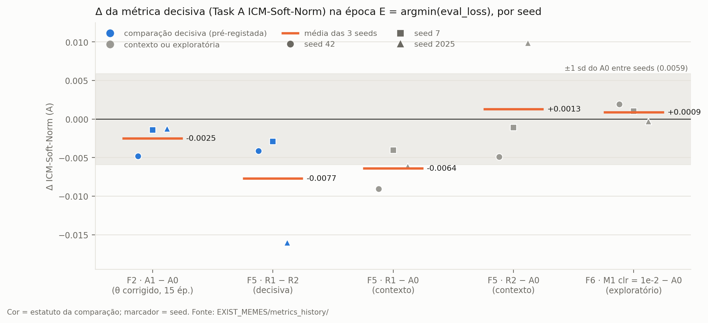
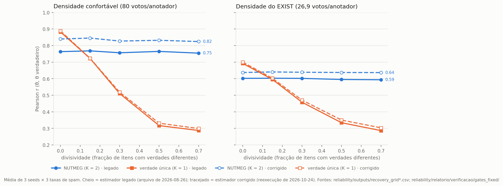
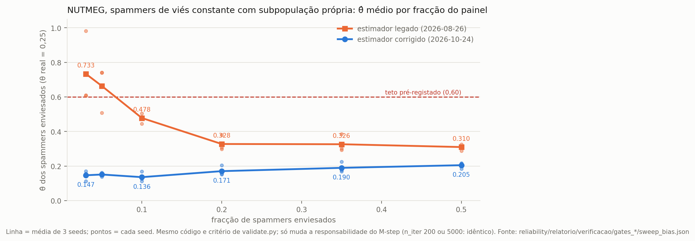
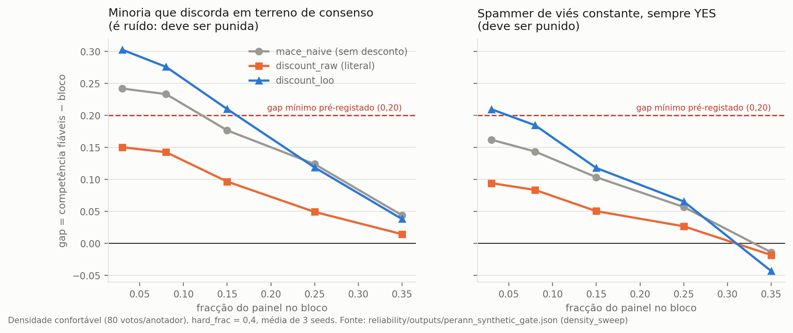
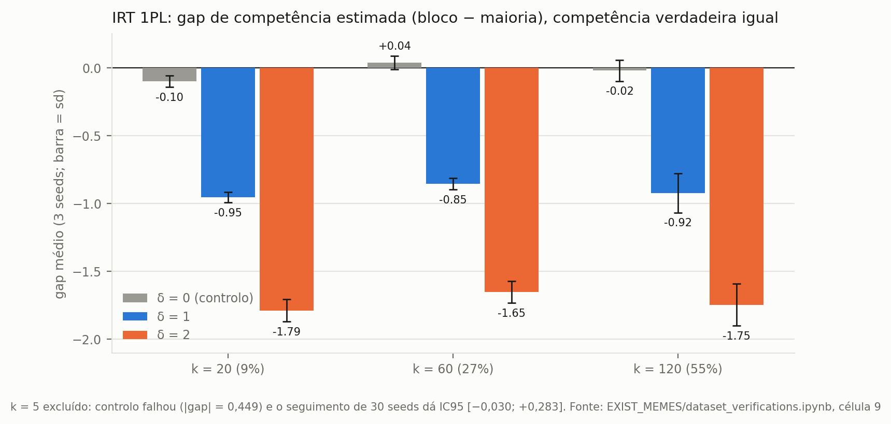
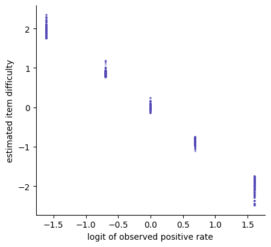
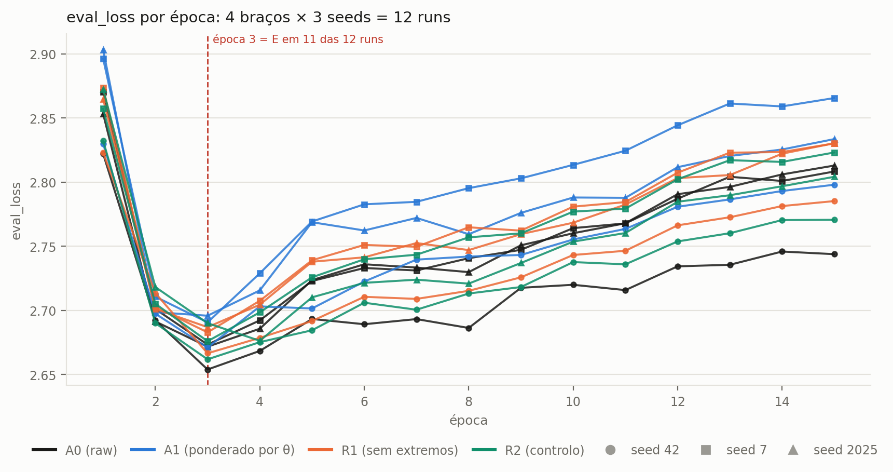
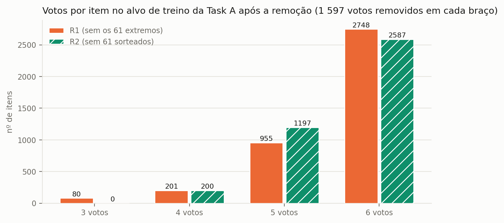
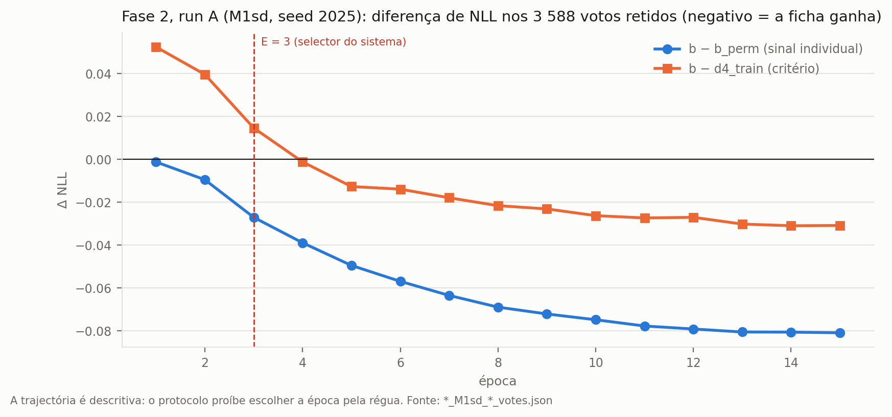

# Relatório de resultados — estimadores de confiabilidade de anotadores (Task 2.1, memes)

**O que é este documento.** Os resultados numéricos de todas as famílias de estimadores de confiabilidade testadas na linha `reliability/` (2026-08-26 a 2026-09-14), com os números verificados de forma independente nesta revisão (2026-10-24). O *como* de cada passo está em `METODOLOGIA_RELIABILITY.md`; as referências "M§x" apontam para lá. A linha do anotador LLM (docs 25 a 31) tem relatório próprio (`EXIST_MEMES/glm_annotator/RELATORIO_GLM_CLAUDE.md`).

**Convenções.** `[MEDIDO]`, `[HIPÓTESE]`, `[LIMITAÇÃO]`, `[PÓS-HOC]` como em M§0.1. **Decisivo** = a única comparação que o pré-registo do estudo declara como teste; tudo o resto é contexto. Números com 3 ou 4 casas, como nos artefactos. Datas absolutas.

---

## 0. Sumário

### 0.1 O que foi testado e o que deu

| Família | O que se mediu | Número decisivo | Veredito |
|---|---|---|---|
| F1 · NUTMEG (verdade por subpopulação) | recuperação de θ no sintético e robustez a blocos | densidade do EXIST: r = 0,599 (legado) / **0,638** (corrigido) contra 0,473 / 0,485 do K = 1 | fenómeno reproduzido; **nunca foi a retreino** (fragmentação: 1,2 a 2,3 votos por célula nos dados reais) |
| F1 · captura por bloco pequeno | θ̂ de 2–3 spammers com subpopulação própria | legado: θ̂ = 0,733 (teto 0,60) · **corrigido: θ̂ = 0,147** | **a captura era artefacto do bug do M-step** (§5) |
| F2 · verdade única K = 1 (tipo MACE) → soft labels ponderadas | Δ ICM-Soft-Norm (A) em E, A1 − A0, 15 épocas, 3 seeds | **Δ = −0,0025**, sd 0,0020, t(2) = −2,16, **p = 0,164**, d_z = −1,25 | **NULO** |
| F3 · por anotador com desconto de dificuldade | portão sintético, 3 testes | vantagem mínima sobre o MACE ingénuo = −0,003 (exigido ≥ 0,05) | **FAIL** nas duas variantes; nunca foi a dados reais |
| F4 · IRT 2PL → 1PL | recuperação, robustez a bloco, ajuste real | θ recupera a r = 0,877; bloco com a mesma competência recebe gap de −0,85 a −1,79; b vs logit(taxa de YES): r = −0,996 / −0,993 | identificável, **inutilizável** para ponderar (absorve posição em θ; b repete a contagem) |
| F5 · remover 61 extremos contra 61 sorteados | Δ ICM-Soft-Norm (A) em E, R1 − R2 | **Δ = −0,0077**, sd 0,0072, t(2) = −1,84, **p = 0,206**, d_z = −1,06 | **NULO** |
| F6 · camada de confusão (Fase 1) | Δ contra A0, braço exploratório `clr = 1e-2` | Δ = +0,0009, sd 0,0011, t(2) = 1,38, p = 0,30 | grelha pré-registada incompleta; exploratório **nulo** |
| F6 · camada de confusão (Fase 2, run A) | NLL nos 3 588 votos retidos: `b − d4_train` em E | **+0,0147** (positivo = a ficha perde) | **NULO**; controlo positivo (run B) **treinado e não analisado** |

*Figura R1 — Δ da métrica decisiva em E por seed (marcador = seed; azul = comparação decisiva pré-registada, cinzento = contexto ou exploratória; traço laranja = média). A faixa cinzenta é ±1 sd do A0 entre seeds (0,0059): nenhuma média sai dela, excepto R1 − R2 (−0,0077) e R1 − A0 (−0,0064), ambas negativas.*

### 0.2 Cinco achados para a tese

1. **Ponderar e remover não rendem.** As duas formas canónicas de usar uma estimativa de confiabilidade para construir o alvo (F2 e F5) dão nulo no regime real de treino (15 épocas, 3 seeds, E = argmin(eval_loss)); nos dois casos a direcção é ligeiramente negativa.
2. **O limite está na informação, não no estimador.** Com ~27 votos por anotador e painéis fixos, qualquer estimador que infira a verdade dos votos tem teto de recuperação ≈ 0,60–0,64 (F1), e os parâmetros que um modelo psicométrico separa (F4) reduzem-se a quantidades que uma contagem já dá.
3. **[Novo nesta revisão] A "captura por bloco pequeno" do NUTMEG não sobrevive à correcção do M-step.** Com o estimador corrigido, 2–3 spammers com subpopulação própria recebem θ̂ = 0,147 (contra 0,733 no legado). Uma das duas pontas da "tese central" das notas de 2026-08-27 cai (§5, §20).
4. **[Novo nesta revisão] A comparação decisiva da ablação tem um resíduo de densidade.** R1 e R2 removem o mesmo nº de votos (1 597) mas distribuem-nos de forma diferente pelos itens: 2 035 itens ficam com densidades diferentes nos dois braços, e só R1 tem itens com 3 votos (80). Era a limitação deixada em aberto no relatório da ablação; fica fechada, e confirma-se (§14.2).
5. **[Novo nesta revisão] "421 itens mudam de lado da maioria" sobrestima a intervenção do F2.** 360 desses 421 eram empates 3/3 no alvo cru, sem maioria; só **61** invertem de facto uma maioria (§13.1).

---

# Parte I — Estimadores no sintético

## 1. F1 · NUTMEG: recuperação de θ (grade)

`[MEDIDO]` Pearson r(θ̂, θ verdadeiro), média de 3 seeds × 3 taxas de spam (`recovery_grid*.csv`; verificado: médias recalculadas idênticas às do `stage1_report.md`).

| divisividade | confortável: NUTMEG | confortável: K = 1 | Δ | EXIST: NUTMEG | EXIST: K = 1 | Δ |
|---|---|---|---|---|---|---|
| 0,00 | 0,763 | **0,883** | −0,119 | 0,602 | **0,692** | −0,090 |
| 0,15 | 0,768 | 0,723 | +0,045 | 0,603 | 0,596 | +0,007 |
| 0,30 | 0,757 | 0,510 | +0,246 | 0,602 | 0,458 | +0,144 |
| 0,50 | 0,765 | 0,317 | +0,448 | 0,595 | 0,334 | +0,261 |
| 0,70 | 0,754 | 0,287 | +0,467 | 0,594 | 0,287 | +0,307 |
| **global** | **0,761** | **0,544** | **+0,217** | **0,599** | **0,473** | **+0,126** |

Estimador legado (2026-08-26). Leitura:

- **O fenómeno do NUTMEG reproduz-se**: o modelo de subpopulação fica plano ao longo da divisividade (0,754–0,768) e o de verdade única degrada monotonicamente (0,883 → 0,287). O artigo reporta r ≈ 0,81 contra 0,58 (a confirmar na fonte primária); a ordem de grandeza e a direcção batem.
- **O ganho não é incondicional**: sem divisividade o K = 1 ganha, porque junta os 6 votos numa célula em vez de os fragmentar. O cruzamento fica perto de 0,15 de divisividade.
- **Na densidade do EXIST o teto cai para ≈ 0,60.** É o custo de estimar θ com 27 votos em vez de 80, qualquer que seja o estimador.
- `[LIMITAÇÃO]` **Convergência** (verificado nesta revisão a partir das colunas `converged`/`n_iter`): com o estimador legado e o limite de 200 iterações então em vigor, convergiram 76% das execuções do NUTMEG na densidade confortável e **só 7%** na do EXIST (K = 1: 87% e 36%). Os r da coluna EXIST vêm, na maioria, de execuções interrompidas. A conclusão de que interromper o EM era "cosmético" (M§4.4, item 1) foi medida só para o K = 1 nos dados reais (Δθ médio 0,0011); para estas execuções sintéticas do NUTMEG o efeito da interrupção não foi medido em 2026-08-26. Com o estimador corrigido convergem 100% e r sobe até 0,638 (§5); a diferença é um limite para o custo conjunto de interrupção e bug, não uma atribuição a um dos dois (o 2 × 2 do §5 mostra que, no sweep, `n_iter` não muda nada).

*Figura R2 — Linha cheia: estimador legado (arquivo de 2026-08-26). Tracejado: estimador corrigido (reexecução de 2026-10-24, §5).*

## 2. F1 · Preservação de minoria

`[MEDIDO]` Minoria de 25% com θ = 0,90 fixo que discorda da maioria em 70% dos itens; densidade confortável (`minority_preservation.json`).

| seed | θ̂ minoria | θ̂ maioria fiável | θ̂ spammers | gap (maioria − minoria) | separação | veredito |
|---|---|---|---|---|---|---|
| 42 | 0,955 | 0,890 | 0,521 | −0,065 | +0,434 | PASS |
| 7 | 0,960 | 0,874 | 0,509 | −0,086 | +0,451 | PASS |
| 2025 | 0,921 | 0,885 | 0,419 | −0,036 | +0,501 | PASS |

Critérios: θ̂ minoria ≥ 0,70, gap ≤ 0,10, separação ≥ 0,25. **PASS** nas 3 seeds: a minoria consistente fica **acima** da maioria fiável; o modelo não pune discordância legítima por desenho. O `stage1_report.md` §5 reporta também PASS na densidade do EXIST (θ̂ minoria 0,921–0,927, gap −0,051 a −0,067); esses números não têm ficheiro próprio em `outputs/` e não foram recalculados.

## 3. F1 · Spammer de viés constante (20% do painel)

`[MEDIDO]` θ̂ médio dos spammers enviesados (θ real = 0,25), por modo e seed; estimador legado (`bias_spammer_test_label*.json`).

| modo | sempre YES: θ̂ enviesado (42/7/2025) | sempre NO: θ̂ enviesado (42/7/2025) | veredito (YES / NO) |
|---|---|---|---|
| `subpop_aware` | 0,246 / 0,247 / 0,222 | 0,231 / 0,244 / 0,221 | PASS / **FAIL** |
| `subpop_adversarial` (oráculo: subpopulação própria) | 0,298 / 0,379 / 0,306 | 0,312 / 0,365 / 0,247 | PASS / PASS |
| `single_truth` | 0,252 / 0,234 / 0,224 | 0,225 / 0,245 / 0,215 | PASS / PASS |

c1 (θ̂ ≤ 0,60) e c2 (gap para os fiáveis ≥ 0,20) passam nas 18 linhas. O único FAIL é de c3 (|θ̂ enviesado − θ̂ uniforme| ≤ 0,15) em `subpop_aware`, sempre NO, seed 2025: |Δ| = **0,1504**, exactamente na fronteira (no braço sempre YES a mesma célula dá 0,1496 e passa). É ruído de fronteira num critério secundário; o `stage1b_report.md` reporta-o assim. Dar aos enviesados uma subpopulação própria empurra o θ̂ para cima em +0,05 a +0,13, mas a 20% do painel não chega para inverter o veredito.

## 4. F1 · Stress-sweep: blocos pequenos com subpopulação própria (estimador legado)

`[MEDIDO]` Modo `subpop_adversarial`, θ̂ médio dos enviesados por fracção do painel (diagnóstico secundário; reproduzido nesta revisão, idêntico ao `stage1b_report.md`):

| fracção | θ̂ médio | por seed (42 / 7 / 2025) | contra o teto 0,60 |
|---|---|---|---|
| 0,03 (≈ 2 pessoas) | **0,733** | 0,611 / 0,607 / 0,981 | acima |
| 0,05 (3 pessoas) | **0,663** | 0,742 / 0,740 / 0,507 | acima |
| 0,10 | 0,478 | 0,483 / 0,445 / 0,505 | abaixo |
| 0,20 | 0,328 | 0,298 / 0,379 / 0,306 | abaixo |
| 0,35 | 0,326 | 0,301 / 0,385 / 0,293 | abaixo |
| 0,50 | 0,310 | 0,316 / 0,325 / 0,289 | abaixo |

Lido em 2026-08-26 como "a vulnerabilidade é inversa ao tamanho do grupo: com 2–3 pessoas numa célula, a verdade da célula é o voto delas". A secção seguinte mostra que este resultado depende do bug do M-step.

## 5. [2026-10-24] F1 reexecutado com o estimador corrigido

**O que se fez** (M§4.4): os portões do F1 foram reexecutados com o código e os critérios de `validate.py`, mudando apenas a responsabilidade do M-step. Com `legacy` e `n_iter = 200` os ficheiros de 2026-08-26 reproduzem-se **bit a bit** (verificação PASS). Depois correu-se com `fixed`. Um controlo 2 × 2 mostra que `n_iter` (200 ou 5 000) não muda nenhum número; a diferença é só da responsabilidade. **Não estava pré-registado**; fica como resultado datado desta revisão.

### 5.1 O que muda

| Teste | Legado (2026-08-26) | Corrigido (2026-10-24) |
|---|---|---|
| Grade, confortável: NUTMEG / K = 1 (global) | 0,761 / 0,544 | **0,834 / 0,552** |
| Grade, EXIST: NUTMEG / K = 1 (global) | 0,599 / 0,473 | **0,638 / 0,485** |
| Grade: execuções convergidas (NUTMEG, confortável / EXIST) | 76% / 7% | **100% / 100%** |
| Minoria: θ̂ minoria / maioria (42, 7, 2025) | 0,955/0,890 · 0,960/0,874 · 0,921/0,885 | 0,890/0,811 · 0,883/0,799 · **0,829/0,828** |
| Minoria: veredito | PASS | PASS (margem da seed 2025 cai para gap −0,001) |
| Viés, `subpop_adversarial`: θ̂ enviesado sempre YES (42/7/2025) | 0,298 / 0,379 / 0,306 | 0,152 / 0,205 / 0,155 |
| Viés, `subpop_adversarial`: veredito (YES / NO) | PASS / PASS | **FAIL / FAIL** (c3, na direcção contrária: ver abaixo) |
| Viés, `subpop_aware`: veredito (YES / NO) | PASS / FAIL (fronteira) | PASS / PASS |
| **Sweep, 3% do painel: θ̂ enviesado (42/7/2025)** | **0,733** (0,611 / 0,607 / 0,981) | **0,147** (0,157 / 0,113 / 0,171) |
| Sweep, 5% | 0,663 | 0,151 |
| Sweep, 10% / 20% / 35% / 50% | 0,478 / 0,328 / 0,326 / 0,310 | 0,136 / 0,171 / 0,190 / 0,205 |

*Figura R3 — θ̂ dos spammers de viés constante com subpopulação própria. Laranja: estimador legado; azul: corrigido. O teto pré-registado é 0,60. Mesmo código e critério de `validate.py`; só muda a responsabilidade do M-step (com `n_iter` = 200 ou 5 000 os números são idênticos).*

**O novo FAIL do `subpop_adversarial`.** c1 e c2 passam em todas as linhas; c3 falha na seed 2025 (|Δ| = 0,151 no braço sempre YES, 0,171 no sempre NO), mas **na direcção contrária à captura**: os enviesados recebem θ̂ (0,135–0,205) **abaixo** do dos spammers uniformes (0,273–0,306). O estimador corrigido pune mais o spammer enviesado do que o uniforme; o critério pedia que os dois fossem tratados de forma parecida. É um FAIL pelo critério pré-registado e fica escrito como tal, mas não é uma vulnerabilidade.

### 5.2 Porquê `[HIPÓTESE apoiada na derivação]`

A responsabilidade legada conta duas vezes o voto do próprio anotador (M§4.4). O excesso é máximo quando o posterior da verdade da célula é quase só o voto do anotador, ou seja, exactamente em células com 2–3 anotadores que votam igual. Nesse regime o legado infla o θ̂ do bloco; o corrigido não. A derivação está em `mstep_responsibility_diagnosis.md` §1; a ligação ao sweep é uma interpretação, consistente com o 2 × 2 (só a responsabilidade muda o resultado).

### 5.3 O que isto muda e o que não muda

Muda:

- A "tese central" das notas de 2026-08-27 (`reliability/NOTAS_PARA_TESE.md` §1) dizia que a vulnerabilidade a blocos correlacionados existe **nas duas pontas** (bloco pequeno captura o NUTMEG; bloco grande captura o F3). **Com o estimador corrigido, a ponta do bloco pequeno não se verifica.** A ponta do bloco grande (F3, §6) não depende do EM e mantém-se.
- A "regra operacional" do `stage1b_report.md` (clusters de subpopulação ≥ 10% do painel) perde a evidência do sweep. Pode continuar a fazer sentido por outra razão (o KMeans comportamental degenerado [883, 2, 1, 1] deixa células com 1–2 votos, §8), mas já não pode citar o sweep.
- O teto de recuperação na densidade do EXIST passa de 0,599 para 0,638 (NUTMEG) e de 0,473 para 0,485 (K = 1).
- A frase do `cap07.tex` (IRT) "*contradicts the pattern observed for the subpopulation estimator discussed earlier, where the breaking point was the size of the group*" fica sem suporte.

Não muda:

- Os retreinos do F2 já usavam θ corrigido; os θ reais das 7 definições já foram regenerados com o estimador corrigido (`summary_taskA_fixed.md`, §8); a divisividade não usa o EM; F3, F4, F5 e F6 usam outro código.
- O fenómeno qualitativo (NUTMEG plano, K = 1 a degradar de 0,889 a 0,299) fica mais forte; o cruzamento continua entre 0,10 e 0,15.
- **O NUTMEG continua a não poder ir a retreino**, pela razão que já era a principal: a fragmentação dos dados reais (§8).

## 6. F3 · Por anotador com desconto de dificuldade

`[MEDIDO]` `perann_synthetic_gate.json`, 3 seeds, determinismo max|Δ| = 0. Valores recalculados do JSON, iguais aos do `perann_gate_report.md`.

### 6.1 Recuperação (Pearson r vs θ real)

| densidade | `hard_frac` | votos/anotador | `mace_naive` | `discount_raw` | `discount_loo` |
|---|---|---|---|---|---|
| confortável | 0,0 | 80 | **0,893** | 0,856 | 0,865 |
| confortável | 0,2 | 80 | 0,818 | 0,810 | **0,819** |
| confortável | 0,4 | 80 | 0,712 | 0,730 | **0,736** |
| confortável | 0,6 | 80 | 0,613 | 0,696 | **0,699** |
| EXIST | 0,0 | 27,1 | **0,711** | 0,638 | 0,658 |
| EXIST | 0,2 | 27,1 | **0,629** | 0,587 | 0,604 |
| EXIST | 0,4 | 27,1 | 0,503 | 0,500 | **0,510** |
| EXIST | 0,6 | 27,1 | 0,354 | **0,389** | 0,389 |

Critério: r(0,4; confortável) ≥ 0,60 (passa: 0,730 e 0,736) **e** vantagem sobre `mace_naive` ≥ 0,05 em todo `hard_frac` ≥ 0,4 (falha: **−0,003** e **+0,007**). O desconto só compensa quando a ambiguidade genuína domina (+0,083 em 0,6); empata em 0,4 e perde em ≤ 0,2. Na densidade do EXIST todos os r caem ≈ 0,2.

### 6.2 Minoria (braços *matched*) e spammer

| config | hard: minoria | hard: fiáveis | easy: minoria | easy: fiáveis | spammer: θ̂ | spammer: fiáveis | spammer: gap |
|---|---|---|---|---|---|---|---|
| `mace_naive` | 0,940 | 0,845 | 0,728 | 0,851 | 0,774 | 0,855 | +0,081 |
| `discount_raw` | 0,983 | 0,947 | **0,896** | 0,945 | **0,906** | 0,944 | **+0,037** |
| `discount_loo` | 0,940 | 0,842 | **0,702** | 0,820 | **0,733** | 0,823 | +0,089 |

- **hard PASSA** nas duas variantes: a minoria em terreno ambíguo fica acima dos fiáveis (gap −0,036 e −0,098). A protecção LeWiDi funciona.
- **easy FALHA** nas duas: a minoria que discorda em terreno de consenso devia cair para ≤ 0,60 com gap ≥ 0,20; fica em 0,896 e 0,702 (gaps +0,049 e +0,118).
- **spammer FALHA** nas duas; e o `discount_raw` dá ao spammer um gap **menor** que a linha de base sem desconto. A hipótese de desenho ("os erros do spammer caem em itens fáceis, logo o desconto não o protege") fica refutada.

### 6.3 Sweep do bloco (diagnóstico)

`[MEDIDO]` gap = competência dos fiáveis − do bloco (maior é melhor); densidade confortável, `hard_frac` = 0,4.

| fracção | easy: mace | easy: raw | easy: loo | spammer: mace | spammer: raw | spammer: loo |
|---|---|---|---|---|---|---|
| 0,03 | +0,242 | +0,150 | **+0,302** | +0,162 | +0,094 | **+0,209** |
| 0,08 | +0,233 | +0,142 | **+0,276** | +0,143 | +0,083 | **+0,184** |
| 0,15 | +0,176 | +0,096 | **+0,210** | +0,103 | +0,050 | **+0,118** |
| 0,25 | **+0,124** | +0,049 | +0,118 | +0,057 | +0,026 | **+0,065** |
| 0,35 | **+0,044** | +0,014 | +0,038 | −0,014 | −0,018 | −0,043 |

A discriminação cai monotonicamente com o tamanho do bloco nas três configurações; a 35% de spammers sempre-YES o gap é **negativo** em todas (o bloco recebe mais competência do que os fiáveis, porque a essa densidade ele é a maioria em muitos itens). **Mecanismo:** a dificuldade sai dos votos; um bloco grande fabrica a dificuldade dos itens em que discorda, e o desconto passa a protegê-lo. O desconto quebra a circularidade competência → dificuldade, não a circularidade bloco → dificuldade.

### 6.4 Escala contra fundo, e a variante LOO

- **Escala (erro de desenho, M§7.5):** os limiares absolutos herdados do F1 não servem para uma taxa de concordância (chão ≈ 0,5); um spammer com θ = 0,25 tem concordância esperada 0,625 > 0,60 por construção. Os limiares não foram mexidos.
- **Fundo (não depende de limiar):** só em gaps, `discount_raw` perde para `mace_naive` em **10/10** linhas do sweep.
- **LOO domina a forma literal:** r maior em 7/8 linhas da §6.1 (na oitava, empate a 3 casas), gap maior em 9/10 do sweep, e continua a passar o braço hard. Contra `mace_naive` ganha 7/10, só em blocos ≤ 0,15.

**Estado:** portão não passado; pela regra do projecto, `run_perann_exist.py` não foi escrito.

## 7. F4 · IRT no sintético

`[MEDIDO]` Reexecução de `dataset_verifications.ipynb` nesta revisão: todos os números abaixo reproduzem com 4 casas.

### 7.1 Sondagem (50 votos/item, só para validar o código)

θ r = **0,978**, b r = **0,915**, a r = **0,526** (critério 0,80: FAIL em a). Diagnósticos: 0 itens no limite do optimizador; o alinhamento linear da escala não muda r; com σ_a ∈ {0,3; 0,6; 1,0} a recuperação de a fica em 0,551 / 0,745 / 0,681. Conclusão registada: limite de informação, não erro de implementação; o limiar de 0,80 para a estava alto demais (erro de desenho, não dos dados).

### 7.2 Densidade do EXIST (1 000 itens, 220 anotadores, 6 votos/item)

| parâmetro | seed 42 | seed 7 | seed 2025 | média | limiar | veredito |
|---|---|---|---|---|---|---|
| competência θ | 0,8656 | 0,8632 | 0,9028 | **0,8772** | 0,60 | PASS |
| dificuldade b | 0,6092 | 0,5890 | 0,6075 | **0,6019** | 0,50 | PASS |
| discriminação a | 0,1362 | 0,1722 | 0,1758 | **0,1614** | 0,40 | **FAIL** |

Decisão pré-registada: adoptar o 1PL. Com a = 1 fixo: θ = 0,8778 e b = 0,6005 (Δ = +0,0006 e −0,0014 contra o 2PL, abaixo da variação entre seeds). O IRT recupera a competência bem acima do NUTMEG na mesma densidade (0,877 contra 0,599 legado / 0,638 corrigido).

### 7.3 Bloco correlacionado (1PL)

Gap médio (bloco − maioria) de competência estimada, com competência verdadeira **igual** nos dois grupos; 3 seeds (média, sd).

| k (fracção) | δ = 0 (controlo) | δ = 1 | δ = 2 | r(θ) com δ = 2 |
|---|---|---|---|---|
| 5 (2,3%) | **−0,449** (0,381) | −1,217 | −1,965 | 0,854 |
| 20 (9,1%) | −0,099 (0,043) | −0,954 | −1,789 | 0,781 |
| 60 (27,3%) | +0,039 (0,049) | −0,855 | −1,653 | 0,666 |
| 120 (54,5%) | −0,020 (0,078) | −0,922 | −1,745 | 0,602 |

- **Critério pré-registado do controlo** (max|gap| < 0,10): **FAIL** por causa de k = 5 (0,449). Seguimento com 30 seeds (`[PÓS-HOC]`): gap médio +0,127, sd 0,436, erro-padrão 0,080, IC95 [−0,030; +0,283], que contém 0. A célula foi excluída por falta de poder (o critério tinha sido fixado sem calcular o erro-padrão esperado por tamanho de bloco); o critério não foi alterado.
- **Tratamento:** max|gap| = 1,965 (≥ 0,50) → **CAPTURA** pelo critério pré-registado; nas células válidas o gap vai de −0,85 a −1,79, 2 a 3 vezes o limiar.
- **A direcção é o achado:** o bloco é **penalizado**, não promovido. O 1PL tem um só parâmetro por pessoa, e uma diferença consistente de limiar não tem onde ser representada a não ser nesse parâmetro: perspectiva sistemática e baixa competência são, para este modelo, a mesma quantidade. O gap acompanha δ e é quase constante em k; a recuperação geral degrada com o tamanho do bloco (0,781 → 0,602 com δ = 2).

---

# Parte II — Dados reais, sem retreino

## 8. θ do NUTMEG e do K = 1 nos dados reais

`[MEDIDO]` Estimador corrigido (`summary_taskA_fixed.md`, 2026-08-30).

| definição | K | cobertura de células | votos/célula | θ médio | θ sd | θ < 0,5 | ρ(θ, concordância) | tamanhos dos clusters |
|---|---|---|---|---|---|---|---|---|
| `demo_base_K4` | 4 | 69,3% | 2,17 | 0,461 | 0,206 | 519 | +0,301 | 253 / 318 / 210 / 106 |
| `demo_extended_K4` | 4 | 85,7% | 1,75 | 0,446 | 0,192 | 571 | +0,178 | 232 / 203 / 246 / 206 |
| `behavioral_K4` | 4 | 64,7% | 2,32 | 0,480 | 0,212 | 501 | +0,457 | 287 / 69 / 278 / 253 |
| `demo_base_K8` | 8 | 49,6% | 1,51 | 0,429 | 0,190 | 634 | +0,193 | 152 / 74 / 123 / 86 / 146 / 30 / 180 / 96 |
| `demo_extended_K8` | 8 | 62,7% | **1,20** | 0,395 | 0,162 | 742 | +0,041 | 120 / 90 / 144 / 147 / 105 / 93 / 84 / 104 |
| `behavioral_K8` | 8 | 41,1% | 1,83 | 0,461 | 0,205 | 560 | +0,415 | 126 / 135 / 68 / 126 / 150 / 22 / 139 / 121 |
| `single_truth_K1` | 1 | 100% | 6,00 | 0,483 | 0,219 | 458 | **+0,615** | 887 |

- **Fragmentação:** com subpopulação, cada célula (item, subpopulação) tem 1,2 a 2,3 votos. A "verdade da subpopulação" fica praticamente o voto de uma ou duas pessoas. Esta é a razão principal de o NUTMEG nunca ter ido a retreino.
- **O K = 1 é quase uma reexpressão do consenso** (ρ = +0,615 com a concordância com a maioria). As definições com subpopulação descolam dessa métrica (+0,04 a +0,46), o que é o efeito pretendido, mas não prova sucesso: a prova está no sintético (§2).
- **Confound:** o θ médio cai à medida que os votos por célula caem (6,00 → 1,20 votos/célula: 0,483 → 0,395); a dispersão de θ não é comparável entre definições com densidades de célula diferentes.
- Flags do `run_exist`: `demo_extended_K8` tem células quase singulares (< 1,5 votos/célula) e 48 quebras de monotonicidade; `behavioral_K4` 385 quebras; `demo_base_K8` 30 quebras (M-step de média posterior, não argmax).
- α de Krippendorff global: **0,2791**.

## 9. Divisividade empírica

`[MEDIDO]` `divisiveness_report.md`; vereditos pelo Nulo B (condicionado *within-item*), 50 permutações.

| definição | itens divisivos (confiável) | z | rácio entre/total | z | α intra | z | itens no subconjunto confiável |
|---|---|---|---|---|---|---|---|
| `demo_base_K4` | 0,304 | −0,08 | 0,362 | **+2,16** | 0,288 | **+2,03** | 2 878 (72,2%) |
| `demo_extended_K4` | 0,329 | +0,30 | 0,499 | **+2,09** | 0,288 | +1,37 | 3 455 (86,7%) |
| `behavioral_K4` | 0,411 | +18,33 | 0,460 | +31,82 | 0,336 | +12,80 | 2 750 (69,0%) |
| `demo_base_K8` | 0,424 | −0,37 | 0,597 | +0,77 | 0,284 | +0,49 | 2 153 (54,0%) |
| `demo_extended_K8` | 0,467 | +1,48 | 0,802 | −0,85 | 0,285 | −0,02 | **698 (17,5%)** |
| `behavioral_K8` | 0,459 | +13,02 | 0,591 | +31,16 | 0,355 | +14,46 | 2 071 (52,0%) |

- As definições **demográficas**, as únicas não circulares, mostram estrutura no máximo **marginal**: z ≈ 2,1 em 2 de 3 indicadores, só em `demo_base_K4`; nula em K = 8. `demo_extended_K8` é inconclusiva por esparsidade.
- As **comportamentais** dão z enormes, mas são circulares (os clusters saem dos mesmos votos) e não são evidência independente.
- O Nulo A (permutar anotadores entre clusters) dava z negativos por **geometria**: os itens reais têm menos subpopulações distintas do que os permutados (2,77 contra 3,13 em `demo_base_K4`), logo menos fragmentação e menos divisividade espúria. Lido ingenuamente, pareceria "menos estrutura do que o acaso".
- Divisividade **acima do nulo** (observada − nula) em todas as definições: entre −0,042 e +0,075, longe do cruzamento ≈ 0,15 do sintético. A comparação é direccional (o sintético usa K = 2 e verdades limpas).

## 10. IRT nos dados reais

`[MEDIDO]` 1PL por painel linguístico (reexecutado nesta revisão, idêntico ao notebook).

| | painel ES | painel EN |
|---|---|---|
| itens · anotadores · votos | 1 979 · 456 · 11 874 | 2 005 · 450 · 12 030 |
| votos/anotador (mín · mediana · máx) | 9 · 27 · 27 | 12 · 27 · 27 |
| taxa de YES | 0,573 | 0,539 |
| iterações · quebras de monotonicidade | 32 · 0 | 32 · 0 |
| itens unânimes · itens com b no limite (\|b\| ≥ 9,9) · sobreposição | 474 · 474 · 474 | 471 · 471 · 471 |
| itens não unânimes | 1 505 | 1 534 |
| **b vs logit(taxa de YES): Pearson · Spearman** | **−0,9955** · −0,9766 | **−0,9933** · −0,9789 |
| b (não unânimes): média · sd · amplitude | −0,316 · 1,351 · [−2,487; +2,345] | −0,160 · 1,410 · [−2,584; +2,789] |

- **Unanimidade**: 24% dos itens em cada painel, contra ≈ 3,7% esperado se os anotadores fossem intercambiáveis. Parte grande do corpus produz acordo forte; a discordância concentra-se no resto.
- **Itens unânimes não têm dificuldade finita**; o conjunto de itens no limite do optimizador coincide **exactamente** com o de unânimes (causa única e entendida). Ficam na estimação, fora da análise de b.
- **b é quase colinear com o logit da taxa de YES** (menos de 1% de variância que uma contagem não dê). Razão estrutural: o que distingue uma dificuldade de Rasch de uma proporção é o ajuste pela competência de quem viu o item; com painéis fixos de 6 e competência média quase constante entre painéis, não há variação para esse ajuste exprimir.
- **Task 2.2**: mediana de 15 votos por anotador (A: 27); 125 anotadores (14,1%) com menos votos do que parâmetros num modelo de 9; 583 (65,7%) com menos de 2 observações por parâmetro. Nenhum modelo foi ajustado.

*Figura R4 — Painel ES, itens não unânimes (n = 1 505), r = −0,9955. Fonte: `images/irt_b_vs_yesrate.png` da tese.*

## 11. O estimador K = 1: convergência e o bug do M-step

`[MEDIDO]` (M§4.4)

| | θ legado | θ corrigido |
|---|---|---|
| iterações até convergir | 200 sem convergir; 462 com `n_iter = 5000` | **292** |
| quebras da log-posterior | 273 | **0** |
| θ médio | 0,5352 | **0,4826** |
| anotadores com θ < 0,5 | — | 458 (51,52% dos votos) |
| Pearson / Spearman (legado × corrigido) | 0,8923 / 0,8977 | |
| média · máximo de \|Δθ\| | 0,0794 · 0,7166 | |
| anotadores que cruzam θ = 0,5 | 95 | |
| anotadores com \|Δθ\| > 0,05 | 409 (46,1%) | |
| θ legado ≥ θ corrigido | 74,6% dos anotadores (direcção prevista pela derivação) | |

Interromper o legado a 200 iterações em vez de 462 era cosmético (r = 0,9991 com o convergido; deslocamento das soft labels 0,000317). A responsabilidade não era: o deslocamento das soft labels entre θ corrigido e legado é 0,0246 em média (77 vezes o da convergência), 134 itens cruzam 0,5 entre os dois alvos ponderados (Pearson 0,9893), e a intervenção do F2 encolhe de 0,0720 para 0,0617.

---

# Parte III — Retreinos do modelo de memes

## 12. F2 a 2 épocas (θ legado, 2026-08-30) — registo, não referência

`[MEDIDO]` `theta_arms_comparison.md`; recalculado.

| seed | raw | ponderado | Δ (época 2) |
|---|---|---|---|
| 42 | 0,4239 | 0,4269 | +0,0031 |
| 7 | 0,4203 | 0,4301 | +0,0099 |
| 2025 | 0,4309 | 0,4314 | +0,0005 |
| média | | | **+0,0045** (sd 0,0048, t = 1,604, p = 0,250) |

Critério do estudo: efeito maior que o "spread" do baseline entre seeds. O spread usado é a **amplitude** (máx − mín = 0,0107), não um sd (o sd seria 0,0054). Veredito do estudo: nulo. **Subtreinado**: a `eval_loss` ainda descia e a primária ainda subia ~+0,03 por época nas 6 runs. Alvo diferente do de 15 épocas (θ legado) e critério diferente; não comparar os dois Δ.

## 13. F2 a 15 épocas (θ corrigido, 2026-08-30/31)

### 13.1 Tamanho da intervenção no alvo

`[MEDIDO]` `weighted_fixed` contra `raw`, 3 984 itens (recalculado):

| grandeza | valor |
|---|---|
| média · sd · p50 · p90 · p99 · máx de \|Δp_YES\| | 0,0617 · 0,0656 · 0,0445 · 0,1511 · 0,2638 · 0,3525 |
| itens com \|Δ\| > 0,05 · > 0,10 | 1 861 (46,7%) · 934 (23,4%) |
| Pearson (raw, ponderado) | 0,9661 |
| itens que "cruzam 0,5" (convenção do código, `≥ 0,5`) | 421 (10,6%) |
| … dos quais eram **empates 3/3** no alvo cru | **360** |
| … que **invertem uma maioria** estrita | **61** (1,5%) |
| peso normalizado de um voto (uniforme = 0,1667) | mín 0,0084 · mediana 0,1655 · máx 0,4445 |

`[LIMITAÇÃO]` O relatório original escreve "421 itens mudam de lado da maioria". 360 deles não tinham maioria (614 itens estão em 3/3 no alvo cru; qualquer descida abaixo de 0,5 conta como cruzamento). A intervenção continua material (média |Δ| = 0,0617, 23,4% dos itens movem mais de 0,10), mas a frase deve dizer "resolve 360 empates e inverte 61 maiorias". O mesmo vale para o alvo legado (443 = 353 empates + 90 inversões).

### 13.2 Resultado decisivo

`[MEDIDO]` E = época 3 nas 6 runs. Ficheiros na §21.

| seed | A0 (raw) | A1 (ponderado) | Δ = A1 − A0 |
|---|---|---|---|
| 42 | 0,4711 | 0,4663 | −0,0048 |
| 7 | 0,4610 | 0,4596 | −0,0014 |
| 2025 | 0,4608 | 0,4595 | −0,0013 |
| **média** | | | **−0,0025** |

sd(Δ) = 0,0020 · t(2) = −2,16 · **p = 0,164** · d_z = −1,25 · mesmo sinal em 3/3 · ≈ 6 seeds para 80% de poder. **Veredito: NULO.**

### 13.3 As seis métricas, em E e no estado final

| métrica | Δ em E (42 / 7 / 2025) | média | p | Δ final (ép. 15) | p |
|---|---|---|---|---|---|
| A ICM-Norm hard | −0,0025 / −0,0075 / −0,0256 | −0,0118 | 0,234 | −0,0238 | 0,009 |
| **A ICM-Soft-Norm soft** | −0,0048 / −0,0014 / −0,0013 | **−0,0025** | **0,164** | −0,0066 | 0,111 |
| B ICM-Norm hard | −0,0063 / −0,0043 / +0,0122 | +0,0006 | 0,933 | +0,0079 | 0,459 |
| B ICM-Soft-Norm soft | −0,0039 / −0,0007 / −0,0048 | −0,0031 | 0,126 | −0,0001 | 0,987 |
| C ICM-Norm hard | −0,0036 / +0,0012 / +0,0057 | +0,0011 | 0,719 | +0,0066 | 0,486 |
| C ICM-Soft-Norm soft | −0,0029 / −0,0048 / −0,0133 | −0,0070 | 0,160 | −0,0035 | 0,304 |

`[LIMITAÇÃO]` O p = 0,009 de "A ICM-Norm hard, estado final" (d_z = −6,02) é uma célula entre 12 e lê-se como multiplicidade: a época 15 está em sobreajuste profundo (a `eval_loss` sobe desde a época 3 nas 6 runs). B e C não mudaram de alvo; o que se vê nelas é *spillover* do encoder.

*Figura R5 — `eval_loss` por época nos 12 retreinos de 15 épocas: 4 braços (cor: A0, A1, R1, R2) × 3 seeds (marcador: ○ 42, □ 7, △ 2025), uma linha por run. Mínimo na época 3 em 11 de 12 runs (época 4 em R2/2025).*

### 13.4 Nulo por permutação de θ (preparado, nunca treinado)

`[MEDIDO]` P1–P4 PASS nas 5 permutações (fracção máxima de pontos fixos 0,0046). P5: |Δp_YES| médio das labels permutadas contra a crua = 0,0510 a 0,0531 (média 0,0514), contra 0,0617 do A1 real: **razão 0,832**. O nulo perturba o alvo quase tanto quanto a intervenção real, o que o tornaria um controlo forte; mas as 5 runs nunca foram feitas.

## 14. F5 · Ablação de anotadores extremos

### 14.1 O alvo, antes do treino

`[MEDIDO]` (recalculado; os dois ficheiros de alvo reproduzem-se exactamente a partir do notebook)

| grandeza | R1 (sem 61 extremos) | R2 (sem 61 sorteados) |
|---|---|---|
| votos removidos | 1 597 | 1 597 |
| itens afectados | 998 | 1 054 |
| \|Δ\| médio (afectados) · (todos) | 0,1023 · 0,0256 | 0,0866 · 0,0229 |
| itens que cruzam 0,5 (convenção `≥ 0,5`) · dos quais empates 3/3 no cru | 150 · 128 | 114 · 103 |
| valores distintos no alvo (A0 tem 7) | 13 | 13 |
| média · P(p_YES > 0,5) | 0,5504 · 0,5168 | 0,5561 · 0,5251 |

Distância directa R1 ↔ R2: diferem em **1 653** itens, |Δ| médio 0,0445 (todos) e 0,1073 (afectados), **232** itens cruzam 0,5 entre eles: mais do que R1 ou R2 contra o A0. A intervenção era grande à entrada.

### 14.2 [2026-10-24] Densidade dos votos por item: o resíduo que ficava em aberto

O relatório da ablação deixou por verificar se R1 e R2 removem votos na mesma distribuição de itens (`experiment_taskA_ablation_report.md` §3.1). Verificado nesta revisão:

| votos por item no alvo | R1 | R2 |
|---|---|---|
| 3 | **80** | 0 |
| 4 | 201 | 200 |
| 5 | 955 | 1 197 |
| 6 | 2 748 | 2 587 |

**2 035 itens** ficam com densidades diferentes nos dois braços. Os extremos estão mais concentrados nos painéis: os 61 extremos caem em 47 dos 151 painéis (36 painéis com 1 extremo, 8 com 2, **3 com 3**), os 61 sorteados em 53 painéis (45 com 1, 8 com 2, nenhum com 3). Por isso R1 tira os mesmos 1 597 votos de menos itens (1 236 itens perdem pelo menos um voto, contra 1 397 em R2), e os ~80 itens dos 3 painéis com 3 extremos ficam com metade dos votos. O sorteio do controlo estratificou por língua e nº de votos, não por painel (M§9.2). **A comparação decisiva R1 − R2 controla o número de votos removidos, mas não a sua distribuição por item.** Há portanto um resíduo de densidade dentro do teste decisivo. A direcção do viés que ele introduz não é óbvia (itens com 3 votos dão um alvo mais ruidoso a R1, o que tende a prejudicar R1, mas também são itens onde o voto removido era extremo). `[LIMITAÇÃO]` a declarar junto do resultado.

### 14.3 Resultado decisivo — R1 − R2 em E

`[MEDIDO]` E = 3 em todas as runs excepto R2/2025 (E = 4); cada braço lido no seu E.

| seed | R1 | R2 | Δ = R1 − R2 |
|---|---|---|---|
| 42 | 0,4621 | 0,4662 | −0,0041 |
| 7 | 0,4570 | 0,4599 | −0,0029 |
| 2025 | 0,4546 | 0,4706 | −0,0160 |
| **média** | | | **−0,0077** |

sd(Δ) = 0,0072 · t(2) = −1,84 · **p = 0,206** · d_z = −1,06 · mesmo sinal em 3/3 · ≈ 7 seeds para 80% de poder. **Veredito: NULO.**

### 14.4 As três comparações na métrica decisiva

| comparação | Δ por seed (42 / 7 / 2025) | média | sd | p (E) | p (final) |
|---|---|---|---|---|---|
| **R1 − R2 (decisiva)** | −0,0041 / −0,0029 / −0,0160 | **−0,0077** | 0,0072 | **0,206** | 0,128 |
| R1 − A0 (contexto) | −0,0090 / −0,0041 / −0,0061 | −0,0064 | 0,0025 | 0,048 | 0,040 |
| R2 − A0 (contexto) | −0,0049 / −0,0011 / +0,0099 | +0,0013 | 0,0077 | 0,799 | 0,339 |

- O p = 0,048 de R1 − A0 **não é um achado**: foi declarado contexto antes de os números serem lidos (mistura critério, perda de densidade e fragmentação da grade), é uma célula entre 36 (3 comparações × 6 métricas × 2 pontos), e o teste que isola o critério não o sustenta.
- **Porque os dois p diferem com médias quase iguais:** o denominador. R1 e A0 sobem e descem juntos entre seeds (sd(Δ) = 0,0025); R2 não acompanha nenhum dos dois (sd(Δ) = 0,0072, 2,9×). A dispersão entre seeds em nível é comparável nos três braços (A0 0,0059; R1 0,0038; R2 0,0054). A instabilidade introduzida por remover anotadores **ao acaso** é da mesma ordem do deslocamento causado por remover os extremos.
- `[HIPÓTESE]` As três leituras apontam no mesmo sentido: remover a densidade sozinha não custa nada (R2 − A0 = +0,0013), remover os extremos custa um pouco. A magnitude está dentro do ruído a n = 3; mais seeds podiam, no melhor caso, estabelecer um custo pequeno, nunca um ganho.
- A régua favorece o A0 por construção (o gold de validação é o alvo cru, com 6 votos); essa desvantagem cancela em R1 − R2.

Tabela completa das 6 métricas × 3 comparações × 2 pontos: `experiment_taskA_ablation_report.md` §5–§6 (todas recalculadas nesta revisão, sem diferenças).

## 15. F6 · Camada de confusão, Fase 1

### 15.1 Controlo (M1, λ = 0, seed 42, 2026-09-06)

| quantidade | valor | régua |
|---|---|---|
| Δ primária em E | −0,0017 | sd do A0 entre seeds = 0,0059 |
| Δ `eval_loss` em E | +1,8e-3 | amplitude entre seeds = 1,94e-2 |
| E | 3 nos dois | — |
| matrizes: max\|C − C_init\| | 7e-9 (arredondamento do softmax) | congeladas |

**PASS** pelo critério recalibrado (M§10.3). O λ = 0 só correu na seed 42: o Δ_null nas seeds 7 e 2025, recomendado no protocolo, **não foi corrido**.

### 15.2 Grelha pré-registada (só a seed 42 correu)

| λ | E | A ICM-Soft-Norm | A0 | Δ | peso efectivo da Task A |
|---|---|---|---|---|---|
| 0,1 | 4 | 0,4716 | 0,4711 | +0,0005 | 2,1 |
| 0,3 | 3 | 0,4715 | 0,4711 | +0,0003 | 2,3 |
| 1,0 | 3 | 0,4727 | 0,4711 | +0,0016 | 3,0 |

A grelha ficou **incompleta** (seeds 7 e 2025 não correram) e por isso **o teste pré-registado (t pareado, Bonferroni p < 0,0167) nunca foi calculado**. `[NOTA]` O `experiment_confusion_report.md` imprime "Veredicto da família: NULO" com todas as linhas "não corrido"; a formulação correcta é "teste não executado". Mais importante: com o LR partilhado as matrizes moveram-se no máximo 6e-4 e ficaram presas perto da identidade, onde a auxiliar é a própria BCE da Task A; a grelha mede uma ablação do peso da Task A (2,0 → 2,1/2,3/3,0), não modelação do anotador (M§10.4).

### 15.3 Braço exploratório `CONF_LR = 1e-2` (3 seeds)

| seed | ficheiro | E | A ICM-Soft-Norm | A0 | Δ |
|---|---|---|---|---|---|
| 42 | `20260907_234357_…_clr0.01_seed42` | 3 | 0,4730 | 0,4711 | +0,0019 |
| 7 | `20260908_192123_…_clr0.01_seed7` | 3 | 0,4620 | 0,4610 | +0,0010 |
| 2025 | `20260909_225545_…_clr0.01_seed2025` | 3 | 0,4605 | 0,4608 | −0,0003 |

Média **+0,0009**, sd 0,0011, t(2) = 1,38, p = 0,30. Exploratório e pós-hoc; fora da estatística confirmatória. **Nulo.**

### 15.4 O que as matrizes aprenderam (época E = 3; recalculado)

| seed | viés = a·yes_rate + b | R² | fracção da variância das off-diagonais na direcção do viés | sd da competência | r(competência, \|yes_rate − 0,55\|) | r(competência, yes_rate) |
|---|---|---|---|---|---|---|
| 42 | 0,827·yes_rate − 0,420 | 0,910 | 0,887 | 0,066 | −0,758 | −0,155 |
| 7 | 0,771·yes_rate − 0,391 | 0,906 | 0,888 | 0,061 | −0,731 | −0,162 |
| 2025 | 0,794·yes_rate − 0,406 | 0,908 | 0,886 | 0,064 | −0,747 | −0,146 |

Viés = C[NO→YES] − C[YES→NO]; competência = C[YES,YES] + C[NO,NO] − 1. As matrizes **colapsam no viés marginal** do anotador (a taxa de YES dele), e a competência aprendida é em grande parte o **desvio à taxa base** (forma em U), não algo linear na taxa de YES. `[NOTA]` O *handoff* escreve "viés = 0,827·yes_rate − 0,420" como se fosse comum às três seeds; é a recta da seed 42. A "fracção da variância" de 88,7% é a variância de (c₁₀ − c₀₁)/√2 sobre a variância total das duas off-diagonais (definição recuperada nesta revisão; dá 0,887 / 0,888 / 0,886).

## 16. F6 · Camada de confusão, Fase 2

### 16.1 Run A (M1sd, viés livre, seed 2025, 2026-09-11)

`[MEDIDO]` NLL nos 3 588 votos retidos, época E = 3 (`experiment_votes_report.json`; recalculado):

| preditor | NLL | acerto |
|---|---|---|
| `a` (só o item) | 0,6234 | 65,8% |
| `b` (ficha aprendida) | 0,5989 | 68,3% |
| `b_perm` (ficha de outra pessoa) | 0,6260 | 65,0% |
| `c` (só o histórico) | 0,6301 | 63,2% |
| `d3_train` | 0,5845 | 68,8% |
| **`d4_train` (critério)** | **0,5843** | 69,0% |
| `d3_val` (oráculo) | 0,5680 | 69,0% |
| `d4_val` (oráculo) | 0,5676 | 68,8% |

| contraste | valor | leitura |
|---|---|---|
| b − a | −0,0244 | descritivo (b bate a já no init, por calibração global) |
| **b − b_perm** | **−0,0271** | a ficha individual carrega sinal: conhecer *aquela* pessoa ajuda |
| **b − d4_train** | **+0,0147** | **critério: a ficha não bate a logística de 4 ingredientes → NULO** |

Diagnóstico das fichas em E: competência média 0,768, sd 0,053; r(viés, yes_rate) = +0,975; r(competência, |yes_rate − taxa base|) = −0,519; r(competência, concordância) = +0,574. **Leitura pelos vereditos pré-declarados:** `b` bate `b_perm` (há sinal individual) mas perde para `d4_train`: o que a ficha sabe sobre o anotador é recuperável por uma logística com a taxa de YES, a concordância com a maioria e o desvio à taxa base.

`[MEDIDO, descritivo]` Ao longo das épocas, `b − d4_train` passa a negativo na época 4 (−0,0012) e chega a −0,031 na época 15; `b − b_perm` vai de −0,001 (época 1) a −0,081 (época 15). **Não muda o veredito**: o protocolo proíbe escolher a época pela régua (seria escolher pela métrica reportada), e E = 3 é o selector do sistema. `[HIPÓTESE]` O modelo de anotador e o sistema têm óptimos de época diferentes; testá-lo exigiria um selector próprio, pré-registado.

### 16.2 Run B (controlo positivo) e runs C/D/E

- **Run B** (`M1sdcrp`, seed 2025, 120 anotadores corrompidos, 828 votos invertidos): treinada a 2026-09-11, 15 avaliações, E = 3. **Nunca analisada.** O `experiment_votes_report.*` é anterior a ela e só contém a run A. A Porta 1 (a competência dos corrompidos cai com o nível? o nível ≥ 40% separa do 0%?) **não tem veredito**. Por desenho, o ICM da run B não se compara com nada (gold de validação corrompido).
- **Runs C/D/E** (viés congelado): não corridas; dependem da Porta 1.
- Consequência: pelo próprio protocolo, enquanto a run B não for analisada **o nulo da run A não é atribuível** (não se sabe se o mecanismo detectaria um anotador sabidamente diferente).

---

# Parte IV — Verificação desta revisão

## 17. O que foi recalculado

Scripts e logs em `reliability/relatorio/verificacao/`. Tudo PASS salvo o indicado.

| Bloco | Como | Resultado |
|---|---|---|
| Constantes do dataset (§1 da metodologia) | recontagem directa do JSON de treino; α recalculado | todas iguais |
| Split e alvo cru | igualdade com `n_YES/6`; 3 386/598; 3 588 votos de validação | iguais |
| Alvos ponderados | Σθv/Σθ com θ corrigido e legado contra os ficheiros | iguais a 2e-16 / 3e-16 |
| Estatísticas do alvo F2, θ legado × corrigido, permutações P5 | recalculadas | iguais (cruzamentos: ver §13.1) |
| 2 épocas, 15 épocas, ablação (6 métricas × 2 pontos), confusão | recalculados dos logs `metrics_history` com `scipy.stats.t` | iguais a 3–4 casas |
| Alvos R1/R2 | recalculados com o código do notebook | idênticos aos ficheiros; densidade nova (§14.2) |
| NUTMEG sintético | reexecução com o estimador legado | bit a bit; mais o corrigido (§5) |
| Por anotador | valores do JSON contra o relatório | iguais |
| IRT | reexecução do notebook | iguais a 4 casas (sondagem: 118 vs 102 iterações, 10 vs 3 quebras; ambiente) |
| Painéis | reexecução do notebook (células 1–8, 12) | iguais |
| Fase 2, run A | contrastes de NLL do JSON | iguais |
| Matrizes da Fase 1 | recalculadas dos *dumps* `_confusion.json` | iguais (com as precisões da §15.4) |

Não recalculados: as pré-verificações com embeddings do notebook de painéis (células 9–11; dependem de XLM-R/CLIP), a minoria na densidade do EXIST (§2; sem ficheiro), o diagnóstico comportamental (Apêndice A; só lido).

## 18. Ambiguidades e erros encontrados nas fontes

| # | Onde | O problema | Como fica neste relatório |
|---|---|---|---|
| 1 | `soft_labels_taskA_report_fixed.md` §1, §8 | "421 itens mudam de lado da maioria": 360 eram empates 3/3 | "resolve 360 empates e inverte 61 maiorias" (§13.1) |
| 2 | `experiment_taskA_ablation_report.md` §3.1 | densidade por item de R1/R2 "não verificada" | verificada: 2 035 itens com densidades diferentes (§14.2) |
| 3 | `NOTAS_PARA_TESE.md` §1, `stage1b_report.md` | captura do NUTMEG por bloco pequeno | artefacto do estimador legado (§5) |
| 4 | `recovery_grid_existdensity.csv` | 93% das execuções do NUTMEG não convergiram (limite de 200) | declarado (§1); o corrigido converge 100% |
| 5 | `soft_labels_taskA_report_fixed.md` §2 | cita o ficheiro de θ sem `_fixed` | os números são do θ corrigido (verificado) |
| 6 | `theta_arms_comparison.md` | "spread do baseline 0,0107" | é amplitude, não sd (sd = 0,0054) |
| 7 | `HANDOFF_CONFUSION_FASE2.md` | "resultados todos replicados em 3 seeds" | o controlo λ = 0 e a grelha têm só a seed 42; só o braço `clr` tem 3 |
| 8 | `HANDOFF_CONFUSION_FASE2.md` | "viés = 0,827·yes_rate − 0,420" | é a recta da seed 42 (§15.4) |
| 9 | `experiment_confusion_report.md` §5 | "Veredicto da família: NULO" com testes "não corridos" | "teste pré-registado não executado; grelha incompleta" |
| 10 | `CONFUSION_EXPERIMENT.md` §17 | plano com seed 42 na run A | a run A correu com a seed 2025 (desvio 13) |
| 11 | `cap07.tex` (IRT) | "four independent families" | são cinco com a camada de confusão (seis com a ablação, sete com o LLM, consoante o agrupamento; §20) |
| 12 | `cap07.tex` (IRT) | limiar de 0,60 "to match … the vote weighting estimator" | o 0,599 é do NUTMEG (subpopulação), não do K = 1 que pondera votos; e passa a 0,638 com o estimador corrigido |
| 13 | `cap07.tex` (IRT) | "the breaking point was the size of the group" | sem suporte depois do §5 |
| 14 | `cap07.tex` | figura `block-size-competence.png` | é a figura do notebook `irt_block_gap.pdf` com outro nome; confirmar que é a mesma versão |
| 15 | `behavioral_diagnosis.md` §7 | correlações com θ do NUTMEG | usam os ficheiros de θ **legados** (sem `_fixed`); as conclusões (\|ρ\| ≤ 0,28) não foram refeitas com o θ corrigido |
| 16 | `reliability/outputs/loo_sensitivity.json` | sem produtor nem consumidor no repositório | órfão; não usado |
| 17 | `behavioral_diagnosis.md` §9 vs §7 | "todas as associações são fracas (\|ρ\| ≤ 0,24)" | o máximo da própria tabela do §7 é 0,280 |

---

# Parte V — Síntese

## 19. Interpretação

**O fio que liga as famílias (revisto nesta data).** Todos os estimadores que inferem a verdade de referência a partir dos próprios votos esbarram em dois limites deste dataset, e cada família falha por uma razão específica da sua estrutura:

1. **Densidade.** ~27 votos por anotador e 6 por item em painéis fixos põem o teto de recuperação de θ em ≈ 0,60–0,64 para os estimadores de agregação (F1, F2), e a fragmentação em células de 1,2 a 2,3 votos tira o NUTMEG do jogo nos dados reais, independentemente do bug.
2. **Circularidade com blocos.** Quando a "dificuldade" ou a "verdade" sai dos votos, um bloco correlacionado grande fabrica-a (F3, gap negativo a 35%). Com o estimador corrigido, o NUTMEG **não** é capturado por blocos pequenos com subpopulação própria (§5); a formulação "as duas pontas" deixa de valer, fica a ponta do bloco grande.
3. **Posição absorvida como competência.** Quando o modelo tem um só parâmetro por pessoa e trata a dificuldade como latente (F4), uma diferença consistente de limiar é lida como baixa competência; e com painéis fixos a dificuldade reduz-se à contagem.
4. **Usar a estimativa não rende.** Ponderar (F2: Δ = −0,0025) e remover (F5: Δ = −0,0077) dão nulo no regime real de treino, com a direcção ligeiramente negativa nos dois casos. Modelar o anotador dentro do treino (F6) aprende sobretudo o viés marginal de cada pessoa, e o que aprende é recuperável por uma logística de 4 ingredientes.

**Porque isto é coerente com o resto dos dados.** A análise de painéis (Apêndice A.1) mostra que o desvio de cada anotador é sobretudo um **limiar pessoal estável** (split-half 0,850; 81,3% da variância é real entre pessoas; a demografia género × idade explica 11,5% dela). Sob LeWiDi isso é perspectiva, não ruído; um estimador que o trate como incompetência apaga exactamente o desacordo que a tarefa quer modelar. É o mesmo diagnóstico, por outra via, da referência externa por LLM (docs 25–31): o desvio de cada anotador face a uma referência fora dos votos também não se converteu em ganho (relatório GLM/Claude).

## 20. Limitações e pendências

### 20.1 Limitações a declarar no texto

- **n = 3 seeds** em todos os retreinos: os testes são fracos por construção; d_z e o nº de seeds para 80% de poder (6 a 7 nas comparações decisivas) são ordens de grandeza.
- **Task 2.1 apenas.** Nenhum estimador foi aplicado às Tasks 2.2/2.3 (a 2.2 tem 15 votos por anotador; a 2.3 é multirrótulo). Um nulo na A não prevê a utilidade em B/C.
- **Split por item, não por anotador** (F6): favorece o método.
- **Ambiguidade genuína não é observável nos dados reais** (F3): só existe a dificuldade empírica, que é a quantidade capturável.
- **O IRT modelou o bloco como deslocamento uniforme** de dificuldade; um bloco que discorda só num subconjunto de itens não foi testado.
- **Resíduo de densidade** na comparação decisiva da ablação (§14.2).
- **O estimador K = 1 é "do tipo MACE"**, implementado de raiz; a correspondência exacta com o M-step de Hovy et al. (2013) não foi verificada.
- **Referências a verificar na fonte primária antes de citar:** NUTMEG (`ivey2025nutmeg`), MACE (`hovy2013mace`), Chu et al. 2021, Tanno et al. 2019, Rodrigues e Pereira 2018 (o projecto já apanhou duas referências fabricadas noutra auditoria).

### 20.2 O que mudar no texto da tese

1. `cap07.tex`, subsecção do IRT: "four independent families" → contagem actualizada (pelo menos cinco: + camada de confusão).
2. `cap07.tex`, mesma subsecção: retirar ou reformular "where the breaking point was the size of the group" (§5).
3. `cap07.tex`, limiar de 0,60: atribuir ao NUTMEG (não ao estimador de ponderação) e decidir se se cita 0,599 (legado, o que existia quando o limiar foi fixado) com nota do 0,638 corrigido.
4. Qualquer frase que use "421 itens mudam de lado da maioria" → "360 empates resolvidos e 61 maiorias invertidas".
5. Se a tese reproduzir a "tese central" de `NOTAS_PARA_TESE.md` §1: reescrever com uma só ponta (bloco grande, F3) e citar §5 deste relatório.
6. Subsecção da camada de confusão (se existir no texto final): "a competência não correlaciona com nada" → correlaciona −0,73 a −0,76 com o desvio à taxa base (já registado em `CONFUSION_EXPERIMENT.md` §16).

### 20.3 Trabalho que ficou por fazer (não autorizado; só listado)

| Pendência | Custo | O que resolveria |
|---|---|---|
| Analisar a run B (Porta 1) | CPU, minutos (`analyze_votes_experiment`; sobrescreve o relatório actual da run A) | torna o nulo da run A atribuível ou não |
| 5 retreinos do nulo por permutação de θ | ~5 runs de 15 épocas | separaria "θ não carrega informação" de "qualquer perturbação do alvo dá isto" |
| Δ_null (λ = 0) nas seeds 7 e 2025 | 2 runs | banda empírica do offset do invólucro |
| Braços S1/S2 da ablação (substituir em vez de remover) | 6 runs | ablação sem perda de densidade nem fragmentação da grade |
| Refazer as correlações do diagnóstico comportamental com θ corrigido | CPU | fecha a ambiguidade #15 |
| Nota datada em `NOTAS_PARA_TESE.md` §1 a apontar para §5 deste relatório | texto | evita que a tese cite a versão antiga |

## 21. Ficheiros de log usados em cada comparação

| Braço | seed 42 | seed 7 | seed 2025 |
|---|---|---|---|
| A0 `raw` (15 ép.) | `20260831_065521_raw_seed42` | `20260831_075933_raw_seed7` | `20260830_225133_raw_seed2025` |
| A1 `weighted_fixed` | `20260830_205756_…_seed42` | `20260830_215815_…_seed7` | `20260830_194907_…_seed2025` |
| R1 `R1_rem_extremos` | `20260905_112128_…_seed42` | `20260905_122152_…_seed7` | `20260905_140756_…_seed2025` |
| R2 `R2_rem_controle` | `20260905_150442_…_seed42` | `20260905_155802_…_seed7` | `20260905_222414_…_seed2025` |
| 2 ép. `raw` / `weighted` | `20260830_030421` / `20260830_151242` | `20260830_154057_raw_seed7` / `20260830_155444_weighted_seed7` | `20260830_163503_raw_seed2025` / `20260830_162416_weighted_seed2025` |
| Confusão λ = 0 (controlo) | `20260906_184642_conf_M1_lam0.0_seed42` | — | — |
| Confusão λ = 0,1 / 0,3 / 1,0 | `20260907_084812` / `20260908_080902` / `20260908_175204` | — | — |
| Confusão `clr = 1e-2` | `20260907_234357` | `20260908_192123` | `20260909_225545` |
| Fase 2 run A / run B | — | — | `20260911_011116_conf_M1sd…` / `20260911_092137_conf_M1sdcrp…` |

`20260906_215142_raw_seed42` e `20260907_083217_raw_seed42` são repetições do A0 (a primeira com curva idêntica, prova de reprodutibilidade; a segunda é o teste de 2 passos). `20260907_083944_conf_M1_lam0.0_seed42` é o teste de 2 passos do invólucro (sem avaliações). `20260907_171842` (1 avaliação) e `20260907_223901` (14 avaliações) são as tentativas interrompidas do `clr`/42 durante o incidente de disco cheio.

---

## Apêndice A — Análises descritivas dos anotadores

### A.1 Painéis e limiar pessoal (`EXIST_MEMES/Untitled.ipynb`, 2026-09-14; reexecutado)

| Grandeza | Valor |
|---|---|
| sd do resíduo por anotador: observado · sob o nulo · razão | 0,2096 · 0,0905 · **2,32** |
| variância do resíduo: observada · amostragem · real entre pessoas | 0,04393 · 0,00819 (18,7%) · 0,03573 (**81,3%**) |
| variância entre os 6 grupos género × idade | 9,4% da observada · **11,5% da real** |
| amplitude das 6 médias de grupo · sd individual depois de centrar no grupo | 0,178 · 0,200 |
| estabilidade entre metades (881 anotadores com ≥ 12 votos): r · nulo · **Spearman-Brown** | 0,739 · 0,001 · **0,850** |
| "instabilidade" individual: confiabilidade entre metades · Spearman-Brown | 0,032 · 0,062 (não é um traço; anotadores acima do limiar simulado: 0 de 881) |
| viés de painel sem circularidade: sd · encolhido · em votos | 0,0069 · 0,0059 · 0,04 de 6 (razão obs/nulo 0,22; 0 itens mudam ≥ 1/12) |
| painéis · componentes do grafo de co-anotação · maior componente | 151 · 132 · 16 anotadores |
| colegas distintos por anotador (mediana · máx) · densidade do grafo | 5 · 10 · 0,58% |
| painéis com exactamente 1 anotador por célula género × idade | 151 de 151 |
| efeito de célula (contraste dentro do painel, IC95 por reamostragem) | M 18-22 −0,112 [−0,137; −0,087] · M 23-45 −0,046 · F 18-22 −0,018 · F 23-45 +0,053 · M 46+ +0,055 · F 46+ +0,068 [0,042; 0,091] |
| efeito de célula ajustado por etnia + escolaridade | muda ≤ 0,013 |
| mistura gaussiana do resíduo: BIC com 1 · 2 · 3 componentes | −242,3 · −226,3 · −202,6 (unimodal) |

Leitura: cada anotador tem um **limiar pessoal estável** para marcar YES (confiabilidade 0,850), que é real (81% da variância) e só em pequena parte demográfico (11,5%). A distribuição é unimodal (não há "tipos"), e os painéis têm todos a mesma mistura de perfis (variância entre painéis / entre pessoas = 0,0015). O efeito de género × idade é consistente (M 18-22 o mais restritivo; mulheres e homens 46+ os mais permissivos) e sobrevive ao ajuste por etnia e escolaridade.

### A.2 Diagnóstico comportamental (2026-08-27/28; lido, não recalculado)

- **Coerência hierárquica perfeita** entre tasks: 0 votos NO na Task A com categoria de sexismo na C ou intenção na B (10 618 NO ↔ 10 618 "-" na B e na C). A família "erro objectivo" não existe neste corpus. `[HIPÓTESE]` imposta pela interface de anotação.
- **Dispersão:** só `yes_rate` (0 a 1) e `category_entropy` (0,15 a 0,99) são dispersas sobre o painel completo.
- **Anomalias:** 66 anotadores (7,4%) disparam pelo menos um critério; 61 por taxa de YES extrema (os mesmos 61 do F5), 5 por `lang_gap` > 0,30 (em 19 bilingues); sobreposição zero.
- **Clustering:** passa o critério pré-registado em K = 2…6, mas o melhor silhouette (K = 2, [792, 52]) separa quem alguma vez usou `UNKNOWN` (3 das 7 features são indicadores binários com ≥ 80% de zeros), não perfis de comportamento. `[PÓS-HOC]` só com as features contínuas: clusters equilibrados, silhouette 0,34, sem proxy demográfico.
- **Relação com θ do NUTMEG:** |ρ| ≤ 0,28 nas tabelas do §7 do relatório (o §9 do mesmo relatório escreve ≤ 0,24; o máximo da tabela é ρ = −0,280, `yes_rate_es` × θ `demo_extended_K4`), com θ legado (ambiguidade #15).

### A.3 Dimensão latente "expansivo ↔ parcimonioso" (2026-08-29; lido)

PC1 das 4 features padronizadas explica **57,1%** (limiar pré-registado 55%, margem +2,1 pontos; loadings todas do mesmo sinal) → "dimensão latente única", com a força a vir das features de categoria (PC1 de 71,3% só com essas três, 70,7% depois de residualizar no denominador). `yes_rate` tem a loading mais fraca (+0,32) e a sua pertença à dimensão fica em aberto (os dois controlos disponíveis são *over-control*: ρ(n_sexist_items, yes_rate) = 0,925). Uma das associações entre features de categoria (ρ = 0,84) é em parte definicional. Nenhuma destas features mede acerto nem justifica *down-weighting*.
